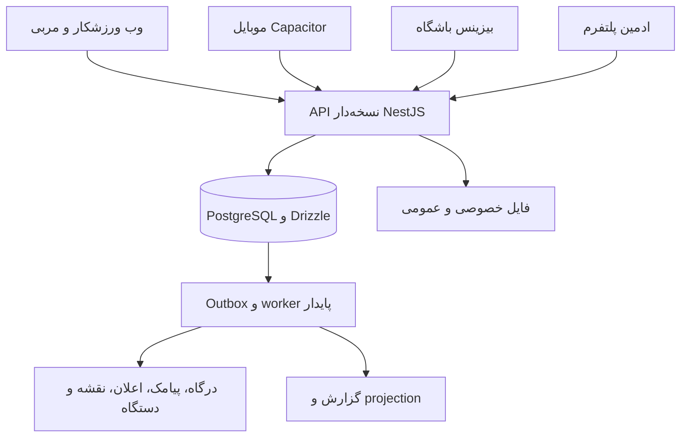

# طرح اجرایی کامل Gym4Me

تاریخ: ۲۰۲۶/۱۰/۱۲ · وضعیت: طراحی پیشنهادی برای اجرا، نه اعلام تحویل قابلیت‌ها.

درخواست تأییدشدهٔ کاربر: تمام M01 تا M16 و قابلیت‌های تکمیلی دعوت تیم/پرداخت سهمی، پیشنهاد سانس خلوت، پیشنهاد زمان مناسب و مسیر تازه‌کار در محصول نهایی باشند. فازبندی فقط ترتیب تحویل است. مرجع ظاهری صفحات، طراحی فعلی `/discovery`، `/discovery/clubs/:clubId` و `/discovery/clubs/:clubId/slots` است.

## بستهٔ طراحی

| سند                                       | خروجی                                                            |
| ----------------------------------------- | ---------------------------------------------------------------- |
| [معماری](architecture.md)                 | مرز ماژول‌ها، API، تراکنش، صف، وب/native، امنیت و انتشار         |
| [مدل داده](data-model.md)                 | موجودیت‌ها، فیلدها، رابطه‌ها، وضعیت‌ها و قیود                    |
| [فلو و صفحات](flow-screen-map.md)         | فهرست صفحات هر فضا و اتصال تمام فلوها به مدل و صفحه              |
| [مشخصات سه صفحهٔ مرجع](discovery-spec.md) | توسعه روی کامپوننت‌ها و طراحی فعلی، قرارداد داده و حالت‌های صفحه |
| [سنجش و SEO](measurement-seo.md)          | تعریف سنجه، رویداد، صفحات عمومی و قواعد ایندکس                   |
| [منابع طراحی](design-references.md)       | شواهد کد، Mobbin، Product Hunt و مستندات فنی                     |

## تصمیم معماری

سه رابط فعلی و API NestJS حفظ شوند. بک‌اند یک **modular monolith** با ماژول‌های مالک داده و موارد استفادهٔ مشخص باشد. API و worker از یک کد دامنه استفاده کنند و جدا اجرا شوند. PostgreSQL مرجع قطعی رزرو، حق استفاده و دفتر مالی باشد. پیامک، نقشه، درگاه، فایل و دستگاه از adapter عبور کنند.

## پوشش دامنه

شناسه‌های P، C، B و A در فهرست صفحات به‌ترتیب متعلق به ورزشکار/عمومی، مربی، بیزینس و ادمین‌اند. بخش‌های D در مدل داده مرز مالکیت‌اند؛ بعضی ماژول‌های محصول با چند بخش داده کار می‌کنند.

| قابلیت                 | مدل‌های اصلی                       | فلو              | صفحات شاخص                     | تحویل   |
| ---------------------- | ---------------------------------- | ---------------- | ------------------------------ | ------- |
| M01 حساب و دسترسی      | D01 هویت و سازمان                  | FL01–FL03        | P01–P05، P26، B01–B05، A01     | PH1     |
| M02 کشف و مقایسه       | D02 کاتالوگ، D12 نظرات/علاقه‌مندی  | FL04، FL19       | P06–P13                        | PH1–PH2 |
| M03 کشف مربی           | D07 مربی، D12 نظر مربی             | FL11             | P14–P15، C01–C03               | PH3     |
| M04 زمین و سالن        | D03 خدمت/تقویم، D04 رزرو           | FL07، FL09       | P10، P16–P18، B08–B11          | PH2     |
| M05 کلاس و دوره        | D04 جلسه، دوره، انتظار             | FL06، FL08       | P10، P16–P18، P23، B10–B11     | PH2     |
| M06 جلسهٔ خصوصی        | D03 زمان، D04 رزرو، D07 رابطه      | FL11             | P15–P18، C04–C05               | PH3     |
| M07 عضویت و بسته       | D05 حق استفاده                     | FL05، FL10       | P19–P22، B12–B14               | PH2     |
| M08 پرداخت/استرداد     | D06 تجارت و دفتر مالی              | FL05، FL09، FL20 | P16–P18، P24–P25، B15–B18، A09 | PH2     |
| M09 کارت و حضور        | D09 دسترسی و حضور                  | FL10             | P22، B13–B14                   | PH2     |
| M10 کمد و تجهیزات      | D10 سخت‌افزار                      | FL18             | P33، B23–B24، A14              | PH6     |
| M11 مدیریت شاگرد       | D07 رابطه و پرونده                 | FL12             | C06–C08                        | PH3     |
| M12 برنامه و اجرا      | D08 تمرین                          | FL13–FL14        | P27–P29، C09–C11               | PH4     |
| M13 پیام و پیشرفت      | D08 اندازه‌گیری، D11 ارتباط        | FL15             | P30–P32، C12–C13               | PH4     |
| M14 قرارداد و تسویه    | D13 قرارداد/درآمد                  | FL16             | C14–C16، B19–B21               | PH3–PH5 |
| M15 چندشعبه            | D01 محدوده، D05 بسته، D14 پلن      | FL17             | B03–B05، B22، B25              | PH5     |
| M16 عملیات/پشتیبانی    | D12 بررسی، D15 عملیات، D16 زیرساخت | FL03، FL20–FL22  | B13–B18، B26–B29، A02–A15      | PH1–PH5 |
| T170 تیم و پرداخت سهمی | D17 گروه و سهم                     | FL23             | P34–P35، B30                   | PH7     |
| T171 سانس خلوت         | D03 تعرفه، D18 پیشنهاد             | FL24             | P06، P10، B31                  | PH7     |
| T172 زمان مناسب        | D18 ترجیح/پیشنهاد                  | FL25             | P06، P36                       | PH7     |
| T173 مسیر تازه‌کار     | D18 مسیر شروع                      | FL26             | P02، P37                       | PH7     |

## ترتیب کار بدون حذف دامنه

۱. تکمیل هویت و محدودهٔ شعبه؛ فایل واقعی؛ اتصال کاتالوگ به سه صفحهٔ مرجع؛ حل مسیرهای native و نشست موبایل.

۲. خدمت، تعرفه/سیاست نسخه‌دار، منابع، جلسات و ظرفیت؛ سپس سفارش/پرداخت، بسته، رزرو، حضور و پذیرش. خرید آزمایشی باید تا حضور واقعی قابل ردیابی باشد.

۳. پروفایل و تقویم مربی، رابطهٔ شاگرد، قرارداد پایه و جلسات خصوصی.

۴. برنامهٔ نسخه‌دار، ثبت اجرای واقعی، همگام‌سازی، پیام و پیشرفت.

۵. تسویهٔ پیشرفته، پلن بیزینس و چندشعبه؛ سپس دستگاه منتخب در شعبهٔ واقعی.

۶. امکانات PH7 که اکنون در دامنهٔ تأییدشده‌اند؛ سنجش اثر پس از ایجاد خط مبنا.

مرجع وضعیت اجرا همچنان [backlog](backlog.md) است. تیک‌های فعلی تغییر وضعیت نمی‌کنند. این سند تعریف موردنیاز برای تسک‌ها را دقیق‌تر می‌کند؛ ساخت جداول و صفحات در این نوبت مستندسازی انجام نشده است.

## تصمیم‌هایی که پیش از بخش وابسته لازم‌اند

| تصمیم              | پیشنهاد طراحی                                | نیاز برای اجرا                               |
| ------------------ | -------------------------------------------- | -------------------------------------------- |
| شهر و همکار پایلوت | یک محدوده با چند مجموعهٔ مستقل               | انتخاب شریک و ظرفیت واقعی تیم                |
| مالک دریافت وجه    | هر سفارش یک فروشنده/دریافت‌کنندهٔ مشخص       | قرارداد درگاه، مسئول استرداد و مسیر تسویه    |
| لغو، غیبت و فریز   | نسخهٔ مستقل برای هر خدمت                     | تأیید عددها با مجموعه                        |
| نشست native        | اعتبار جدا از cookie وب، نگهداری امن         | انتخاب و آزمون secure storage و بازگشت درگاه |
| فایل و اعلان       | فایل خصوصی با URL کوتاه‌عمر؛ اعلان چندکاناله | انتخاب سرویس و سیاست نگهداری                 |
| SaaS و کارمزد      | پلن نسخه‌دار و سهم صریح در خرید              | تعیین قیمت و مسئول پرداخت                    |
| دستگاه             | adapter برای مدل آزمایش‌شده                  | دستگاه واقعی و مستندات سازنده                |
| کودک و مدارک       | قواعد خدمت و دسترسی محدود                    | تعیین گروه مخاطب و فرایند رضایت/مدرک         |

## معیار پذیرش طرح

- هر M01–M16 و T170–T173 در مدل، فلو، صفحه و فاز قابل ردیابی است.
- رزرو آخرین ظرفیت و مصرف آخرین جلسه در رقابت هم‌زمان فقط یک‌بار موفق می‌شوند.
- تکرار callback، اسکن و درخواست استرداد اثر مضاعف ایجاد نمی‌کند.
- کاربر مهمان پس از ورود، انتخاب زمان و خدمت را بازیابی می‌کند و قیمت را دوباره تأیید می‌کند.
- باشگاه جدید بدون نسخهٔ تازهٔ موبایل قابل نمایش است؛ وب صفحهٔ عمومی قابل خواندن برای crawler دارد.
- تأیید خرید، رزرو و فرمان دستگاه فقط پس از نتیجهٔ معتبر همان عملیات نمایش داده می‌شود.
- ظاهر سه صفحهٔ مرجع از theme و kit فعلی پیروی می‌کند؛ صفحهٔ جدید UI موازی نسازد.
