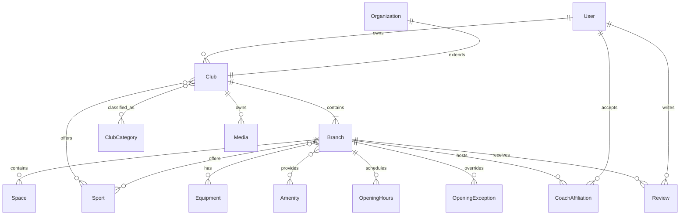

# مدل باشگاه و کاتالوگ

وضعیت: بک‌اند و migration پیاده‌سازی شده؛ ۲۰۲۶/۱۰/۱۱. این سند قرارداد فعلی است. اتصال صفحات کشف و ساخت فرم‌های کامل ویرایش کاتالوگ هنوز کار جداگانه‌ای است.

## مرز مدل‌ها



- **Club:** هویت عمومی برند باشگاه؛ نام، معرفی، تصاویر، دسته‌ها، رشته‌ها، برچسب‌ها و ارتباطات مشترک.
- **Organization:** مرز دسترسی کارکنان و بررسی ادمین. شناسهٔ Club همان شناسهٔ Organization است. نام و slug فقط در Organization ذخیره می‌شوند و در خروجی Club برگردانده می‌شوند.
- **Branch:** محل فیزیکی فعالیت؛ موقعیت، تجهیزات، امکانات، ساعات، مقررات و مربیان هر شعبه مستقل‌اند. هنگام ساخت باشگاه، شعبهٔ اصلی خودکار ایجاد می‌شود.
- **Space:** سالن، زمین، استودیو یا بخش داخلی شعبه؛ فعلاً نام، توضیح، ظرفیت اختیاری و وضعیت فعالیت دارد. ظرفیت آن به معنی ظرفیت قابل رزرو نیست.
- **Taxonomy:** جدول‌های مستقل و قابل مدیریت توسط ادمین؛ دستهٔ باشگاه، رشته، تجهیزات، امکانات، برچسب و ویژگی دسترس‌پذیری. ارتباط‌ها جدول واسط و کلید خارجی دارند.
- **Media:** متادیتای تصویر یا ویدیو متعلق به یک باشگاه. لوگو و کاور فقط تصویر هستند؛ گالری تصویر و ویدیو می‌پذیرد.
- **CoachAffiliation:** همکاری مربی و شعبه، مستقل از دسترسی کارکنان بیزینس. پذیرش همکاری مجوز مدیریت باشگاه ایجاد نمی‌کند.
- **Review:** نظر کاربر دربارهٔ یک شعبه؛ امتیاز باشگاه از نظرات منتشرشده محاسبه می‌شود و عدد قابل ویرایش توسط مالک نیست.

این تفکیک برای بدنسازی، استودیو، استخر، سالن چندمنظوره و مجموعهٔ زمین‌های ورزشی استفاده می‌شود؛ تجهیزات یا داشتن مربی برای همه اجباری نیست.

## اجباری و اختیاری

اجباری‌بودن زمان ذخیرهٔ پیش‌نویس با آمادگی انتشار متفاوت است. مقدارهای ناقص به‌صورت `null` یا لیست خالی ذخیره می‌شوند؛ از متن یا مختصات ساختگی استفاده نمی‌شود.

| فیلد | ساخت پیش‌نویس | انتشار | قاعده |
| --- | --- | --- | --- |
| `name` | اجباری | اجباری | ۲ تا ۱۲۰ کاراکتر |
| `id`, `ownerId`, `slug` | خودکار؛ slug قابل انتخاب | موجود | مالک از حساب واردشده تعیین می‌شود؛ body نمی‌تواند مالک را عوض کند |
| `description` | اختیاری | اجباری | حداکثر ۱۰٬۰۰۰ کاراکتر |
| `shortDescription` | اختیاری | اختیاری | حداکثر ۲۸۰ کاراکتر |
| `logoId` | اختیاری | اختیاری | تصویر متعلق به همین باشگاه |
| `coverId` | اختیاری | اجباری | تصویر متعلق به همین باشگاه |
| `categoryIds` | اختیاری | حداقل یک دستهٔ فعال | ساخته‌شده توسط ادمین |
| `sportIds` باشگاه | اختیاری | حداقل یک رشتهٔ فعال | رشته‌های کل مجموعه |
| `phones` | اختیاری | حداقل یکی در باشگاه یا شعبهٔ اصلی | شمارهٔ عمومی تماس؛ شمارهٔ خصوصی مالک نمایش داده نمی‌شود |
| `gallery`, `socials`, `tagIds` | اختیاری | اختیاری | آرایه‌های محدود، با ترتیب مشخص |
| شعبهٔ اصلی | خودکار | اجباری | نام اولیه از باشگاه گرفته می‌شود |
| `location.address` | اختیاری | اجباری در شعبهٔ اصلی | متن آدرس |
| `countryId`, `provinceId`, `cityId` | اختیاری | اجباری در شعبهٔ اصلی | سلسله‌مراتب واقعی با FK کنترل می‌شود |
| `location.coordinates` | اختیاری | اجباری در شعبهٔ اصلی | دقیقاً `[latitude, longitude]`؛ نه ترتیب GeoJSON |
| `districtId`, `neighborhood`, `cityZone` | اختیاری | اختیاری | منطقهٔ اداری، محله و جهت جغرافیایی جدا هستند |
| `sportIds` شعبه | اختیاری | حداقل یک رشتهٔ فعال در شعبهٔ اصلی | رشته‌های قابل ارائه در آن محل |
| `openingHours.weekly` | اختیاری | حداقل یک بازه در شعبهٔ اصلی | ساعات اطلاع‌رسانی، مستقل از رزرو |
| `openingHours.exceptions` | اختیاری | اختیاری | تعطیلی یا ساعات ویژهٔ یک تاریخ |
| `equipments`, `amenities`, `accessibilityFeatures` | اختیاری | اختیاری | نبود اطلاعات به معنی نبود امکان نیست |
| `rules`, `visitInstructions`, `audiencePolicies` | اختیاری | اختیاری | مقررات، آمادگی بازدید، گروه مخاطب و بازهٔ سنی |
| `spaces`, مربیان و نظرات | اختیاری | اختیاری | موجودیت مستقل؛ از PATCH باشگاه ثبت نمی‌شوند |
| وضعیت‌ها، تاریخ‌ها و امتیاز | خودکار | خودکار | وضعیت انتشار فقط با endpoint مربوط؛ امتیاز محاسبه می‌شود |

ساخت یک **شعبهٔ اضافه** فقط `name` می‌خواهد. برای نمایش عمومی شعبه باید نشانی، کشور، استان، شهر، مختصات، رشته، ساعت هفتگی و شمارهٔ تماس شعبه یا باشگاه موجود باشند؛ شعبهٔ ناقص خصوصی می‌ماند و جلوی انتشار شعبهٔ اصلی کامل را نمی‌گیرد.

`operatingStatus` باشگاه، شعبه و فضا با پیش‌فرض `active`، یکی از `active / temporarily_closed / permanently_closed` است. بسته‌شدن عملیاتی با مخفی‌کردن صفحه متفاوت است. منطقهٔ زمانی شعبه پیش‌فرض `Asia/Tehran` دارد.

طبق درخواست حذف شده‌اند: `addressDetails`، `postalCode`، `directions`، `serviceModes` و `spaceId` داخل ساعات فعالیت. ارسال این کلیدها خطای ۴۰۰ می‌دهد. `visitInstructions` صرفاً آمادگی مراجعه مثل همراه‌داشتن کفش یا مدرک است. `slots` طبق تصمیم قبلی برای طراحی جداگانه باقی مانده است.

## قرارداد داده‌ها

نمونهٔ ساخت پیش‌نویس:

```http
POST /api/v1/business/clubs
Content-Type: application/json
x-gym-client: business

{"name":"باشگاه نمونه"}
```

نمونهٔ تکمیل اطلاعات مشترک؛ UUIDها باید قبلاً در همان محیط ایجاد شده باشند:

```json
{
  "description": "معرفی مجموعه و فعالیت‌های ورزشی آن",
  "shortDescription": null,
  "coverId": "<media-uuid>",
  "categoryIds": ["<category-uuid>"],
  "sportIds": ["<sport-uuid>"],
  "phones": ["02112345678"],
  "socials": [{"platform": "instagram", "link": "https://www.instagram.com/example/"}],
  "gallery": [{"mediaId": "<media-uuid>", "caption": "سالن اصلی"}]
}
```

`phones` رشته یا شیء `{number, label?, extension?, isPrimary?}` می‌پذیرد؛ خروجی همیشه شیء نرمال‌شده است. حداکثر ۱۰ شماره و یک شمارهٔ اصلی در هر محدوده مجاز است. گالری حداکثر ۵۰ آیتم و شبکه‌های اجتماعی حداکثر ۲۰ آیتم دارند. شبکه‌های پشتیبانی‌شده: `instagram`, `website`, `telegram`, `whatsapp`, `youtube`, `aparat`, `x`, `linkedin`, `other`. لینک‌ها باید HTTPS باشند.

نمونهٔ PATCH شعبه:

```json
{
  "location": {
    "address": "تهران، نشانی مجموعه",
    "coordinates": [35.7, 51.4],
    "countryId": "<country-uuid>",
    "provinceId": "<province-uuid>",
    "cityId": "<city-uuid>",
    "cityZone": "north"
  },
  "sportIds": ["<sport-uuid>"],
  "equipments": [{"equipmentId": "<equipment-uuid>", "quantity": 4}],
  "amenities": [{"amenityId": "<amenity-uuid>", "availability": "included"}],
  "accessibilityFeatures": [{"featureId": "<feature-uuid>"}],
  "openingHours": {
    "weekly": [
      {"dayOfWeek": 0, "audience": "women", "startMinute": 480, "endMinute": 900},
      {"dayOfWeek": 0, "audience": "men", "startMinute": 960, "endMinute": 1380}
    ],
    "exceptions": [{"date": "2026-12-01", "audience": "all", "isClosed": true}]
  }
}
```

- در PATCH، کلید غایب یعنی حفظ مقدار قبلی؛ `null` برای فیلد nullable یعنی پاک‌کردن؛ `[]` یعنی پاک‌کردن آن رابطه یا لیست.
- `location` و `openingHours` در صورت ارسال، **کامل جایگزین** می‌شوند. برای تغییر یک زیر‌فیلد، مقادیر مورد نیاز دیگر را هم بفرستید. `location: null` تمام موقعیت را پاک می‌کند.
- `cityZone`: شمال، جنوب، شرق، غرب، مرکز و چهار جهت ترکیبی با مقدارهای `north / south / east / west / central / northeast / northwest / southeast / southwest`.
- `dayOfWeek`: شنبه ۰ تا جمعه ۶. دقیقه‌ها نسبت به نیمه‌شب محلی شعبه‌اند. ساعت ۲۲ تا ۲ بامداد برابر `1320..1560`؛ شبانه‌روزی `0..1440`. طول هر بازه حداکثر ۲۴ ساعت است.
- `audience`: `all / men / women / mixed / family / private`. هم‌پوشانی برای یک گروه یا بازهٔ عمومی رد می‌شود؛ گروه‌های متفاوت می‌توانند هم‌زمان فعال باشند.
- استثناها تاریخ میلادی `YYYY-MM-DD` محلی دارند؛ نمایش شمسی وظیفهٔ رابط کاربری است. تعطیل با `isClosed:true` بازه ندارد؛ روز ویژهٔ باز `intervals` لازم دارد. محاسبهٔ «اکنون باز است» یا تولید سانس از این ساعات هنوز اضافه نشده است.
- `quantity` تجهیزات اختیاری و در صورت وجود عدد صحیح مثبت است. `availability` امکانات یکی از `included / paid / unavailable` است؛ قیمت خدمت را نگهداری نمی‌کند.
- `owner` در پاسخ فقط `id` و `displayName` دارد. دسته‌ها، رشته‌ها و رسانه‌ها به شکل شیء برگردانده می‌شوند؛ مربیان در جزئیات شعبه و نظرات از endpoint صفحه‌بندی‌شده خوانده می‌شوند.

## دسترسی و انتشار

مالک و مدیر مجموعه کاتالوگ را ویرایش می‌کنند؛ اعضای پذیرش و مالی فقط اطلاعات خصوصی مجموعهٔ خود را می‌خوانند. نقش مدیر فعلی در محدودهٔ کل مجموعه است؛ محدودسازی مدیر به شعب مشخص هنوز پیاده نشده است. آرشیو فقط برای مالک است. ادمین داده‌های مرجع و نتیجهٔ بررسی را مدیریت می‌کند. جلسهٔ application مجوز عملیات business نمی‌دهد.

فلو انتشار:

1. ساخت `draft` و تکمیل شعبهٔ اصلی.
2. `GET readiness` فهرست دقیق کمبودها را می‌دهد.
3. `POST publication/submit` با بررسی کامل‌بودن، وضعیت را `pending_review` می‌کند.
4. ادمین `approved / rejected / suspended` را با دلیل ثبت می‌کند.
5. مالک/مدیر `POST publication/publish` می‌زند؛ فقط باشگاه کامل و تأییدشده عمومی می‌شود.
6. تغییر اطلاعات باشگاه، شعبه یا فضا، انتشار را به پیش‌نویس و بررسی را به pending بازمی‌گرداند. تعلیق با ویرایش رفع نمی‌شود. این نسخه از تغییر منتشرشده snapshot جدا نگه نمی‌دارد.

مالکیت در خود PostgreSQL نیز به عضویت owner وصل است؛ هر مجموعه یک مالک دارد. انتقال مالکیت endpoint ندارد. دادهٔ شعبه، لوگو و گالری نمی‌توانند به باشگاه دیگری وصل شوند. غیرفعال‌کردن یک اصطلاح مرجع ارتباط‌های قبلی را حذف نمی‌کند، ولی انتخاب جدید آن ممنوع می‌شود.

مربی در اپ پروفایل خود را ثبت می‌کند، بیزینس دعوت همکاری شعبه را ایجاد می‌کند و مربی آن را می‌پذیرد. نمایش عمومی فقط برای همکاری فعال در محدودهٔ تاریخ مجاز است. تأیید مدرک حرفه‌ای، برنامهٔ تمرینی و تسویه بخشی از این مدل پایه نیستند.

هر کاربر حداکثر یک نظر برای هر شعبه دارد؛ ثبت مجدد همان نظر را ویرایش و دوباره pending می‌کند. فقط نظر منتشرشده در فهرست و امتیاز می‌آید. اعضای تیم مجموعه و مربی فعال همان شعبه مجاز به امتیازدادن نیستند. بیزینس می‌تواند به نظر منتشرشده پاسخ دهد. تا اتصال به تردد/رزرو، برچسب «مراجعهٔ تأییدشده» وجود ندارد.

## مسیرهای API

همهٔ مسیرهای زیر پیشوند `/api/v1` دارند. بدنه‌ها و required/nullable در Swagger از همان schemaهای اعتبارسنجی تولید می‌شوند.

| روش | مسیر | کاربرد |
| --- | --- | --- |
| POST | `/business/clubs` | ساخت باشگاه و شعبهٔ اصلی |
| GET, PATCH | `/business/clubs/:id` | خواندن و ویرایش باشگاه |
| GET | `/business/clubs/:id/readiness` | کمبودهای انتشار |
| POST | `/business/clubs/:id/publication/:action` | submit، publish، hide، archive |
| POST | `/business/clubs/:id/media` | ثبت متادیتای رسانه |
| POST | `/business/clubs/:id/branches` | افزودن شعبه |
| GET, PATCH | `/business/clubs/:id/branches/:branchId` | جزئیات شعبه |
| POST | `/business/clubs/:id/branches/:branchId/spaces` | ساخت فضای داخلی |
| PATCH | `/business/clubs/:id/branches/:branchId/spaces/:spaceId` | ویرایش جزئی فضا |
| GET | `/catalog/clubs` | فهرست عمومی؛ page و search، صفحهٔ ۲۵تایی |
| GET | `/catalog/clubs/:id` | جزئیات و خلاصهٔ حداکثر ۱۰۰ شعبه |
| GET | `/catalog/clubs/:id/branches/:branchId` | اطلاعات کامل شعبهٔ عمومی |
| GET | `/catalog/taxonomies/:kind` | اصطلاح‌های فعال؛ صفحهٔ ۱۰۰تایی |
| GET, POST | `/admin/taxonomies/:kind` | فهرست شامل غیرفعال‌ها و ساخت اصطلاح |
| PATCH | `/admin/taxonomies/:kind/:id` | ویرایش یا غیرفعال‌کردن اصطلاح |
| GET | `/catalog/locations/:kind` | جغرافیا با parentId |
| POST | `/admin/locations` | ساخت مرجع جغرافیایی |
| GET | `/admin/clubs/:id` | بررسی اطلاعات باشگاه |
| GET | `/admin/clubs/:id/branches/:branchId` | بررسی جزئیات شعبه |
| POST | `/admin/clubs/:id/review` | ثبت نتیجه و دلیل بررسی |
| POST | `/profile/coach` | ایجاد/ویرایش معرفی مربی |
| GET | `/profile/coach/affiliations` | همکاری‌های مربی |
| POST | `/profile/coach/affiliations/:id/:action` | accept یا end |
| POST | `/business/clubs/:id/branches/:branchId/coaches` | دعوت مربی |
| POST | `/business/clubs/:id/branches/:branchId/coaches/:affiliationId/end` | پایان همکاری |
| GET, POST | `/catalog/clubs/:id/branches/:branchId/reviews` | نظرات عمومی و ثبت نظر با حساب اپ |
| GET | `/admin/reviews` | صف نظرات منتظر بررسی |
| POST | `/admin/reviews/:id/moderate` | انتشار یا رد با دلیل |
| POST | `/business/clubs/:id/branches/:branchId/reviews/:reviewId/reply` | پاسخ بیزینس |

`kind` اصطلاح‌ها: `club-categories`, `sports`, `equipments`, `amenities`, `tags`, `accessibility-features`. جغرافیا: `countries`, `provinces`, `cities`, `districts`. فهرست مجموعه‌های کاربر همچنان از `/business/organizations` خوانده می‌شود و شناسهٔ خروجی برای `/business/clubs/:id` معتبر است.

## ذخیره‌سازی، migration و بررسی

- schema هویت و کارکنان: `apps/api/src/database/schema/core.ts`.
- schema کاتالوگ و روابط: `apps/api/src/database/schema/catalog.ts`؛ `schema.ts` مسیر export پایدار است.
- migration: `0002_club-catalog.sql`. برای مجموعه‌های دارای مالک، Club ایجاد می‌کند؛ در نبود شعبه یک شعبهٔ اصلی می‌سازد و قدیمی‌ترین شعبهٔ موجود را اصلی می‌کند. مجموعهٔ بدون مالک به مالک ساختگی وصل نمی‌شود و نیاز به رسیدگی دارد.
- تغییرات چندجدولی در تراکنش‌اند؛ روابط، یکتایی، محدودهٔ مختصات، امتیاز و مالکیت با constraint کنترل می‌شوند. ساعات متداخل و آمادگی انتشار در سرویس اعتبارسنجی می‌شوند.
- این برش **متادیتا و لینک HTTPS رسانه** را ثبت می‌کند. آپلود فایل، object storage، اسکن/تبدیل تصویر، حذف فایل و URL امضاشده هنوز پیاده نشده‌اند. ثبت URL ادعای اثبات مالکیت فایل خارجی نیست.
- داده‌های مرجع واقعی کشور/استان/شهر و رشته‌ها seed نشده‌اند؛ ادمین باید آن‌ها را بسازد یا در مرحلهٔ بعد import شوند.
- تست‌ها: `pnpm --filter api test`، `test:clubs`، `test:auth`، `test:e2e` و `test:db`. تست‌های یکپارچه فقط DB با نام پایان‌یافته به `_test` را قبول می‌کنند.

## چک‌لیست این برش

- [x] تفکیک Club، Branch، Space و داده‌های مرجع.
- [x] قرارداد strict، فیلدهای اجباری/اختیاری و حذف کلیدهای درخواست‌شده.
- [x] migration و سازگاری مسیر ساخت مجموعه/شعبهٔ قبلی.
- [x] API مدیریت، مشاهدهٔ عمومی و بررسی ادمین.
- [x] ساعات هفتگی، عبور از نیمه‌شب و استثناها.
- [x] دعوت و پذیرش همکاری مربی، ثبت و بررسی نظر.
- [x] آزمون دسترسی بین مجموعه‌ها، constraintهای مالکیت، انتشار و حریم خصوصی.
- [ ] فرم‌های کامل مدیریت این فیلدها در بیزینس و ادمین.
- [ ] اتصال صفحات نمونهٔ کشف به API واقعی.
- [ ] آپلود واقعی رسانه و ورود داده‌های مرجع.
- [ ] طراحی دقیق slots، تعرفه، ظرفیت رزرو و قواعد خرید.
