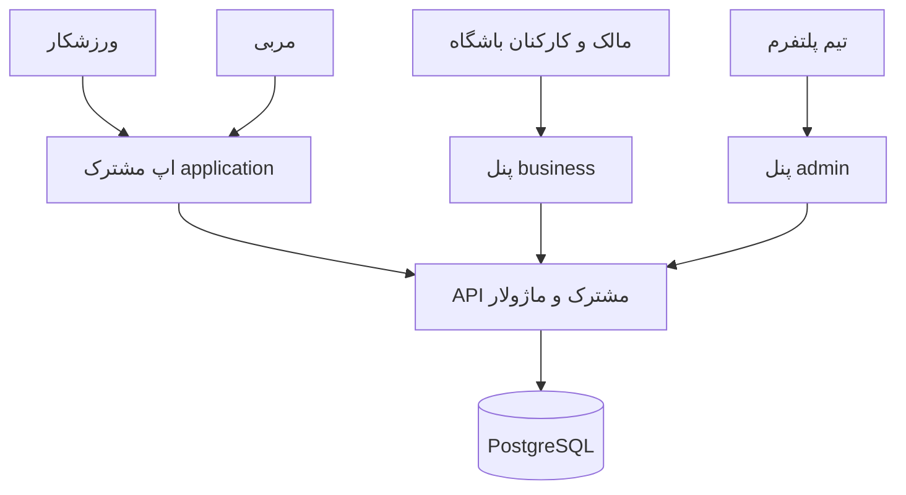

# کانسپت محصول Gym4Me

مرجع: [فهرست مستندات](README.md) · [فیچرها](features.md) · [فازها](roadmap.md)

## مسئله و وعدهٔ محصول

ورزشکار برای انتخاب باشگاه، اطلاع از تعرفه، هماهنگی جلسه، پرداخت و پیگیری تمرین به چند مسیر جدا نیاز پیدا می‌کند. مربی باید برنامه، شاگرد، تقویم و درآمد را هماهنگ نگه دارد. باشگاه نیز باید فروش آنلاین و حضوری، ظرفیت، عضویت و حضور را با هم تطبیق دهد. این‌ها فرض مسئلهٔ محصول بر پایهٔ گفت‌وگو هستند و در پایلوت باید با کاربران واقعی سنجیده شوند.

وعدهٔ Gym4Me این است: کاربر بتواند یک خدمت ورزشی مناسب را پیدا کند، با شرایط روشن بخرد، زمان معتبر رزرو کند و ادامهٔ تمرینش را با مربی پیگیری کند؛ همان خرید و حضور در ابزار روزانهٔ باشگاه و مربی هم قابل پیگیری باشد.

## سه فضای کاری، یک هویت

| فضا                       | مخاطب                            | کارهای اصلی                                                                                 |
| ------------------------- | -------------------------------- | ------------------------------------------------------------------------------------------- |
| application، حالت ورزشکار | فرد استفاده‌کننده از خدمت        | کشف و مقایسه، خرید و رزرو، عضویت و QR، برنامه و ثبت تمرین، ارتباط با مربی                   |
| application، حالت مربی    | مربی مستقل یا همکار باشگاه       | پروفایل حرفه‌ای، زمان آزاد، شاگردان، جلسات، برنامه‌نویسی تمرین، پیام و پیگیری درآمد         |
| business                  | مالک، مدیر شعبه، پذیرش و حسابدار | مجموعه و شعبه، تعرفه و ظرفیت، اعضا و کلاس‌ها، پرداخت و حضور، کمد و تجهیزات، قرارداد و تسویه |
| admin                     | عملیات و پشتیبانی Gym4Me         | بررسی مجموعه و مربی، رسیدگی به اختلاف، گزارش تخلف، پایش پرداخت و ثبت اقدامات مجاز           |

یک شخص می‌تواند هم ورزشکار، هم مربی و هم عضو تیم یک باشگاه باشد. فعال‌کردن حالت مربی حساب جدید ایجاد نمی‌کند. نقش و محدودهٔ دسترسی به رابطهٔ معتبر فرد با سازمان یا شاگرد وابسته است و در سرور بررسی می‌شود. مالک باشگاه هم برای وظایف باشگاه از بیزینس استفاده می‌کند.

## ارزش و داستان کاربر

| نقش               | خواسته                                                     | نتیجهٔ مورد انتظار                                               |
| ----------------- | ---------------------------------------------------------- | ---------------------------------------------------------------- |
| ورزشکار تازه‌وارد | «می‌خواهم چند باشگاه را با هزینه و شرایط یکسان مقایسه کنم» | انتخاب با آگاهی از قیمت نهایی، محدودیت بسته و ساعات قابل استفاده |
| ورزشکار عضو       | «می‌خواهم ماندهٔ جلسات و رزروهایم را بدانم»                | جلوگیری از ابهام دربارهٔ اعتبار، مصرف جلسه و لغو                 |
| مربی              | «می‌خواهم برنامه و اجرای واقعی هر شاگرد را کنار هم ببینم»  | بازخورد و تغییر برنامه بر پایهٔ سابقهٔ قابل پیگیری               |
| پذیرش             | «می‌خواهم رزرو تلفنی و آنلاین یک ظرفیت مشترک داشته باشند»  | پذیرش روزانه بدون فروش ظرفیت تکراری                              |
| مالک              | «می‌خواهم بدانم هر مبلغ و تسویه از چه خدمتی آمده است»      | امکان تطبیق فروش، دریافت وجه، خدمت انجام‌شده و سهم مربی          |

## چرخه‌های اصلی

۱. **کشف تا حضور:** جست‌وجو ← مقایسه ← انتخاب خدمت ← مشاهدهٔ شرایط و قیمت ← خرید یا مصرف بسته ← رزرو قطعی ← ورود ← ثبت حضور واقعی.

۲. **مربی تا ادامهٔ تمرین:** انتخاب مربی ← شروع همکاری ← ارزیابی اولیه ← برنامهٔ نسخه‌دار ← ثبت اجرای تمرین ← بازخورد ← اصلاح برنامه.

۳. **خدمت تا تسویه:** قرارداد معتبر ← خرید و رزرو ← نتیجهٔ جلسه ← محاسبهٔ سهم ← صورت‌حساب ← رسیدگی به اختلاف ← ثبت پرداخت و اصلاحات احتمالی.

در [فلوها](flows.md) پیش‌شرط، حالت خطا و معیار پذیرش این مسیرها آمده است.

## مفاهیم مشترک

| مفهوم                | تعریف محصول                                                                               |
| -------------------- | ----------------------------------------------------------------------------------------- |
| مجموعه و شعبه        | سازمان ارائه‌دهنده و محل ارائهٔ خدمات آن؛ حتی نسخهٔ تک‌شعبه به این تفکیک نیاز دارد        |
| منبع                 | ظرفیت محدود مانند زمین، اتاق، سالن، زمان مربی یا کمد                                      |
| خدمت و تعرفه         | چیزی که فروخته می‌شود و شرایط نسخه‌دار قیمت، مدت، ظرفیت، محدودیت و لغو آن                 |
| سفارش                | تصویر شرایط و مبلغ پذیرفته‌شده در خرید؛ با ویرایش تعرفهٔ آینده عوض نمی‌شود                |
| پرداخت               | تلاش و نتیجهٔ جابه‌جایی وجه؛ بازگشت مرورگر از درگاه به‌تنهایی تأیید پرداخت نیست           |
| عضویت یا بسته        | قرارداد خریداری‌شدهٔ حق استفاده از خدمات مشخص در زمان و شعب مجاز                          |
| حق استفاده           | ماندهٔ آزاد، نگه‌داشته‌شده، مصرف‌شده یا برگشتی؛ دفتر گردش جلسه از دفتر پول جداست          |
| رزرو                 | نگهداری موقت یا تعهد قطعی ظرفیت در زمان معلوم؛ خرید بسته به‌تنهایی رزرو همهٔ کلاس‌ها نیست |
| تردد و حضور          | ورود به ساختمان و شرکت در جلسه دو رویداد مستقل‌اند                                        |
| برنامه و اجرای تمرین | نسخهٔ تجویزشده توسط مربی و آنچه ورزشکار واقعاً ثبت کرده، دو سابقهٔ جدا هستند              |
| همکاری مربی          | رابطهٔ مربی با شاگرد یا باشگاه، با دامنهٔ دسترسی و زمان اثر مشخص                          |
| تسویه                | پرداخت مبلغ واجد شرایط به ذی‌نفع؛ فروش، دریافت وجه و مبلغ قابل تسویه یکی نیستند           |

## دامنهٔ محصول و مدل عرضه

هر ۱۶ ماژول M01 تا M16 در دامنهٔ اصلی حفظ شده است. پایلوت عملیاتی PH2 یک برش قابل استفاده از این دامنه است؛ پایان آن به معنی پایان محصول کامل نیست. برنامهٔ تمرین، مدیریت شاگرد، چندشعبه و تجهیزات در فازهای بعدی چک‌لیست دارند.

مدل درآمد پیشنهادی: اشتراک بیزینس برای ابزار مدیریت و در صورت تصمیم تجاری، کارمزد فروش خدمات یا ابزار مربیگری. مبلغ، درصد و مسئول پرداخت کارمزد هنوز تصمیم بازند و نباید پیش‌فرض مخفی خرید باشند.

مدیریت پیشرفتهٔ تسویهٔ مربی و چندشعبه در پلن بالاتر بیزینس قرار می‌گیرند؛ اسم و قیمت پلن باز است. مشاهدهٔ سوابق مالی خود مربی و دریافت تعهدات قبلی نباید با تنزل پلن از دسترس خارج شود. اتصال تجهیزات فقط برای مدل‌های آزمایش‌شده عرضه می‌شود؛ بسته‌بندی تجاری آن هنوز مشخص نیست.

پیشنهاد پایلوت، چند مجموعهٔ مستقل در یک محدودهٔ محدود شهری است تا عملیات حضوری و پشتیبانی قابل مشاهده باشد. تهران گزینهٔ پیشنهادی قبلی است؛ شهر یا محله هنوز انتخاب قطعی نشده است. ابتدا یک نوع ظرفیت باید از ابتدا تا انتها آزموده شود و سپس زمین و کلاس هر دو پیش از تکمیل PH2 پوشش داده شوند.

## قواعدی که در تمام فازها برقرارند

- قیمت، ظرفیت، اعتبار بسته و مجوز در سرور تعیین می‌شود. تغییر نقش در UI یا ارسال شناسهٔ شعبه مجوز ایجاد نمی‌کند.
- درخواست یا callback تکراری نباید رزرو، برداشت جلسه، بازپرداخت یا تسویهٔ اضافه ایجاد کند.
- ظرفیت زمین، صندلی کلاس، زمان مربی و حق استفادهٔ بسته در رقابت هم‌زمان هم معتبر می‌مانند.
- تغییر تعرفه، سیاست لغو یا قرارداد مربی از تاریخ اثر مشخص اعمال می‌شود و شرایط خرید قبلی محفوظ می‌ماند.
- رزرو بدون پرداخت و رزرو با بسته ممکن‌اند، اما دلیل و وضعیت آن‌ها باید معلوم باشد؛ وضعیت نامشخص درگاه مساوی شکست قطعی نیست.
- پیام، عکس پیشرفت و محدودیت‌های شخصی ورزشکار فقط با دسترسی مربوط دیده می‌شوند؛ پذیرش به همهٔ پروندهٔ مربیگری دسترسی ندارد.
- هر اصلاح دستی حساس، علت، عامل، زمان و سابقهٔ قابل بررسی دارد.
- فارسی و RTL، تاریخ شمسی در رابط، منطقهٔ زمانی شعبه، نرمال‌سازی حروف فارسی/عربی و واحد روشن تومان جزو طراحی اصلی‌اند. واحد ذخیره و تبدیل درگاه باید صریح و بدون اعداد اعشاری شناور برای پول باشد.
- اینترنت ضعیف، خالی بودن داده، خطای سرور و دستگاه آفلاین باید وضعیت قابل فهم و راه بازیابی داشته باشند. رزرو و پرداخت آفلاین قطعی اعلام نمی‌شوند.

## اهداف و سنجش موفقیت

دادهٔ واقعی پایلوت نداریم. آستانه‌های رفتاری زیر فرض پیشنهادی برای برنامه‌ریزی‌اند و در T104 بازبینی می‌شوند؛ ادعای نرخ فعلی یا معیار بازار نیستند.

| هدف                           | تعریف و بازهٔ اندازه‌گیری                                             | معیار اولیه                                                                  |
| ----------------------------- | --------------------------------------------------------------------- | ---------------------------------------------------------------------------- |
| اعتماد به ظرفیت و مانده       | سناریوهای رقابتی رزرو، آخرین جلسه، callback و اسکن تکراری             | صفر تخصیص اضافه در سناریوهای پذیرش و پایلوت؛ هر مورد مانع توسعهٔ عرضه است    |
| کاربر بتواند خرید را کامل کند | آزمون کاربردپذیری ۱۰ سناریوی هدایت‌نشدهٔ کشف تا تأیید، پیش از پایلوت  | دست‌کم ۸ تکمیل بدون کمک مجری؛ خطاهای درگاه جدا گزارش شوند                    |
| خودکفایی پذیرش                | آزمون ثبت عضو، رزرو حضوری، ورود و رسیدگی به لغو با کارکنان پایلوت     | دست‌کم ۸ مورد از ۱۰ سناریو بدون اصلاح مستقیم دیتابیس                         |
| خرید و خدمت قابل پیگیری باشند | سفارش‌های پرداخت‌شده و خدمات انجام‌شدهٔ هفتگی                         | هر مورد به خرید، وضعیت حضور و ثبت مالی مربوط وصل باشد؛ مغایرت بی‌وضعیت نماند |
| تداوم ورزش و استفاده          | بازگشت ۳۰روزه و تمدید در گروه‌های هم‌زمانِ واجد شرایط                 | ابتدا خط مبنا در چهار هفته؛ هدف بهبود پس از آن ثبت شود                       |
| همراهی مربی مؤثر باشد         | تمرین‌های ثبت‌شده / تمرین‌های سررسیدشده و زمان پاسخ پیام نیازمند پاسخ | خط مبنا در پایلوت مربیگری؛ غیبت داده صفر فرض نشود                            |

شاخص اصلی پیشنهادی «خدمات انجام‌شدهٔ معتبر در هفته» است: خدمت دارای سابقهٔ حضور یا انجام، وضعیت خرید روشن و بدون شمارش تکراری. ورود به باشگاه، رزرو لغوشده و صرفاً خرید بسته به این عدد اضافه نمی‌شوند.

## تصمیم‌های قطعی و تصمیم‌های باز

| شناسه | موضوع                                 | وضعیت یا فرض فعلی                                                           | مسئول پیشنهادی / موعد                           |
| ----- | ------------------------------------- | --------------------------------------------------------------------------- | ----------------------------------------------- |
| D01   | جداسازی اپ‌ها                         | قطعی: یک اپ مربی/ورزشکار، business باشگاه و admin پلتفرم                    | تصمیم کاربر                                     |
| D02   | بک‌اند و مسیر API                     | قطعی: NestJS موجود، PostgreSQL + Drizzle، الگوی /api/v1/{domain}/{features} | تصمیم کاربر و کد فعلی                           |
| D03   | انتشار موبایل                         | پوستهٔ Capacitor در مخزن موجود است؛ انتشار فروشگاهی هنوز تحویل نشده         | فنی / پیش از انتشار موبایل                      |
| Q01   | شهر، نوع مجموعه و همکاران پایلوت      | پیشنهاد محدودهٔ محدود و مجموعهٔ مستقل؛ انتخاب نشده                          | محصول و عملیات / پیش از جذب پایلوت PH2          |
| Q02   | پیامک، پرداخت، نقشه و ذخیره‌سازی فایل | پیامک: کاوه‌نگار، الگوی g4m-otp و کد ۵ رقمی؛ سایر ارائه‌دهندگان هنوز انتخاب نشده‌اند                           | فنی و عملیات / قبل از اتصال واقعی مربوط         |
| Q03   | لغو، غیبت، کسر جلسه، فریز و بازپرداخت | به تفکیک خدمت با نسخهٔ شرایط؛ اعداد و مهلت‌ها بازند                         | محصول و باشگاه / پیش از فروش PH2                |
| Q04   | مالک دریافت وجه، کارمزد و مسیر تسویه  | نیازمند تعیین برای هر نوع فروش و قرارداد                                    | محصول، مالی و مسئول قرارداد / پیش از فروش واقعی |
| Q05   | بررسی هویت و مدارک و کاربر کم‌سن      | داده و فرایند لازم برای هر خدمت تعریف شود                                   | محصول و مسئول قرارداد / پیش از پذیرش آن گروه    |
| Q06   | مدل دستگاه و سیاست قطعی               | فقط دستگاه منتخب با آزمون حضوری                                             | فنی و باشگاه / آغاز PH6                         |
| Q07   | تیم، ظرفیت و زمان‌بندی                | مشخص نشده؛ تاریخ تعهد در roadmap درج نشده                                   | مالک محصول / قبل از تعیین sprint                |
| Q08   | قیمت پلن بالاتر و محدودیت‌ها          | چندشعبه و تسویهٔ پیشرفته در پلن بالاتر؛ قیمت باز                            | محصول / پیش از عرضهٔ PH5                        |
| Q09   | نگهداری، حذف و اشتراک دادهٔ خصوصی     | نیازمند سیاست روشن و قابل اجرا؛ مدت‌ها بازند                                | محصول و مسئول داده / قبل از دادهٔ واقعی مربوط   |

این تصمیم‌های باز مانع تکمیل مستندات یا طراحی مستقل نیستند؛ پیش از اجرای بخش وابسته باید پاسخشان ثبت شود. PH7 شامل پیشنهادهای رشد است. تشخیص پزشکی خودکار، پشتیبانی از تمام برندهای تجهیزات و کیف پول قابل برداشت عمومی در این دامنه تعهد نشده‌اند.
