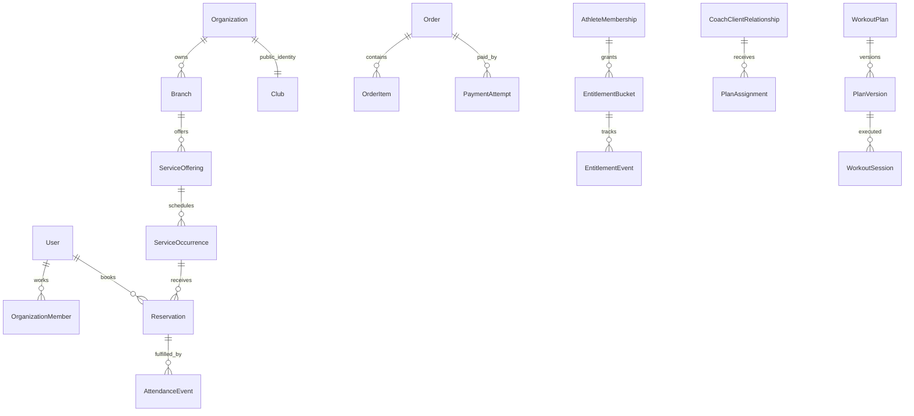

# مدل دادهٔ کامل Gym4Me

مرجع: [طرح](blueprint.md) · [معماری](architecture.md) · [صفحات و فلوها](flow-screen-map.md).

این سند مدل منطقی پیشنهادی است؛ migration ساخته یا اجرا نشده است. «موجود» یعنی جدول/ساختار در schema فعلی دیده شد، «توسعه» یعنی همان مدل با فیلد/قید جدید، «جدید» یعنی طراحی آینده. نام‌های PascalCase زبان محصول‌اند؛ نام‌های SQL موجود بدون migration سازگار تغییر نکنند. مدل‌های پایهٔ فعلی در `apps/api/src/database/schema/core.ts` و `catalog.ts` هستند.

## قرارداد مشترک

- aggregateهای مستقل: UUID، `createdAt/updatedAt` از سرور و `version` برای کنترل هم‌زمانی. join tableهای ساده می‌توانند PK ترکیبی داشته باشند.
- دادهٔ متعلق به باشگاه: `organizationId` و در صورت نیاز `branchId`؛ FK ترکیبی `(organizationId,branchId)` و FK ترکیبی برای فرزندان جلوی نسبت‌دادن رکورد به tenant دیگر را بگیرند. دادهٔ شخصی/سراسری مالک user دارد، نه organization ساختگی.
- پول: `amountMinor: bigint` با `currency=IRR`؛ در JSON مبلغ به رشته تبدیل شود. تومان فقط نمایش و تبدیل صریح ×۱۰/÷۱۰؛ تخفیف درصدی عدد صحیح basis points و rounding مشخص دارد. refund از مجموع مجاز بیشتر نشود.
- لحظه‌ها: `timestamptz`؛ recurrence: روز/دقیقهٔ محلی + timezone IANA؛ تاریخ بدون ساعت: `date`. شمسی فرمت نمایش است. rangeها نیم‌باز `[start,end)` و پایان بزرگ‌تر از شروع باشد.
- وضعیت‌های حساس enum/check صریح؛ policy/price/contract version پس از انتشار immutable. رکورد مالی، حضور و حق استفاده با رویداد اصلاحی تغییر کنند. آرشیو کاتالوگ نباید سابقهٔ خرید را حذف کند.
- JSONB برای snapshot شرایط خرید، metadata provider، پاسخ فرم نسخه‌دار و payload رویداد است؛ رابطه، پول، ظرفیت و ماندهٔ جلسه در JSON مبهم دفن نشوند.
- فیلدهایی که `?` دارند nullable/اختیاری‌اند؛ در هر migration طول، nullability، FK، delete policy و index تعیین شود. جدول‌های زیر حداقل فیلدهای دامنه را نشان می‌دهند؛ قرارداد مشترک بر همه موارد مربوط اعمال می‌شود.

## D01 — هویت، سازمان و رضایت

| مدل                    | فیلدها و رابطهٔ اصلی                                             | وضعیت/قید                                                        | وضعیت ساخت |
| ---------------------- | ---------------------------------------------------------------- | ---------------------------------------------------------------- | ---------- |
| User                   | phone، displayName، phoneVerifiedAt، status                      | شماره نرمال‌شده unique؛ هویت مربی و ورزشکار مشترک                | موجود      |
| AuthSession            | userId، client، tokenHash، device، expiresAt، revokedAt          | token hash unique؛ نشست هر surface مستقل                         | موجود      |
| NativeCredential       | sessionId، refreshHash، tokenFamilyId، rotatedAt، revokedAt      | rotation؛ reuse سبب ابطال خانواده؛ secret خام ذخیره نشود         | جدید       |
| OtpChallenge           | phone، client، codeHash، attempts، expiresAt، consumedAt         | مصرف یک‌بار و سقف تلاش                                           | موجود      |
| AuthRateLimit          | key، count، expiresAt                                            | ارسال/تلاش اتمیک                                                 | موجود      |
| Organization           | name، slug، reviewStatus، reviewReason                           | slug unique؛ status فعلی حفظ شود                                 | موجود      |
| OrganizationMember     | organizationId، userId، role                                     | یکتایی org/user؛ دقیقاً یک owner با فرایند انتقال معتبر          | توسعه      |
| MemberBranchAccess     | organizationMemberId، branchId، permissionSet                    | FK tenant؛ محدودسازی شعبه؛ نبود grant مجوز نمی‌دهد               | جدید       |
| OrganizationInvitation | organizationId، phone، role، invitedBy، expiresAt                | accepted/revoked/expired؛ scopeهای شعبه همراه دعوت               | توسعه      |
| InvitationBranchAccess | invitationId، branchId، permissionSet                            | scope دعوت به همان مجموعه                                        | جدید       |
| PlatformAdmin          | userId، permissionSet، status                                    | permission مالی/بررسی/پشتیبانی جدا؛ privilege حداقلی             | توسعه      |
| AthleteProfile         | userId، experienceLevel، goals، preferredDays                    | user unique؛ اطلاعات اختیاری                                     | جدید       |
| ConsentGrant           | userId، purpose، subjectId?، policyVersion، grantedAt، revokedAt | رضایت رسانه، تبلیغ و اشتراک داده مستقل و قابل لغو                | جدید       |
| DataRequest            | userId، type، scope، requestedAt، resultAssetId?                 | export/delete، processing/completed/rejected؛ نگهداری ضروری مشخص | جدید       |

`OrganizationMember` عضویت کاری است. خرید باشگاه مدل `AthleteMembership` دارد. role عمومی در User جای مجوز سازمان/رابطه را نگیرد. مالکیت دقیقاً یک owner با فرایند/constraint موجود و آزمون tenant حفظ شود؛ unique جزئی به‌تنهایی وجود حداقل یک owner را تضمین نمی‌کند.

## D02 — کاتالوگ، مکان و رسانه

| مدل                                                                         | فیلدها و رابطهٔ اصلی                                                                                                  | وضعیت/قید                                                          | وضعیت ساخت |
| --------------------------------------------------------------------------- | --------------------------------------------------------------------------------------------------------------------- | ------------------------------------------------------------------ | ---------- |
| Club                                                                        | id=Organization.id، description، logoId، coverId، publicationStatus، verifiedAt                                       | هویت عمومی؛ name/slug فقط Organization                             | موجود      |
| Branch                                                                      | organizationId، name، slug، timezone                                                                                  | org/slug unique                                                    | موجود      |
| BranchProfile                                                               | branchId، clubId، address، lat/lng، cityId، districtId?، rules، audiencePolicies                                      | مختصات و سلسله‌مراتب واقعی؛ انتشار ناقص ممنوع                      | موجود      |
| Space                                                                       | branchId، name، description، capacity?، operatingStatus                                                               | ظرفیت اطلاع‌رسانی به‌تنهایی رزرو نیست                              | موجود      |
| Country / Province / City / District                                        | name، code/slug، parentId                                                                                             | سلسله‌مراتب و FK واقعی؛ جدول مستقل هر سطح                          | موجود      |
| ClubCategory / Sport / Equipment / Amenity / ClubTag / AccessibilityFeature | name، slug، isActive                                                                                                  | جدول‌های مستقل فعلی؛ taxonomy عمومی مبهم جایگزین نشود              | موجود      |
| CatalogRelation                                                             | clubCategoryLinks، clubSportLinks، clubTagLinks، branchSports، branchEquipments، branchAmenities، branchAccessibility | همان joinهای فعلی با FK/PK؛ quantity و availability در رابطهٔ شعبه | موجود      |
| ClubPhone / ClubSocial                                                      | clubId، branchId?، number یا platform/url، sortOrder                                                                  | عمومی؛ شماره خصوصی مالک منتشر نشود                                 | موجود      |
| WeeklyHours / OpeningException / ExceptionInterval                          | branchId، audience، day/date، minuteRange                                                                             | بازهٔ محلی، عبور نیمه‌شب، استثنا؛ مستقل از ظرفیت                   | موجود      |
| FileAsset                                                                   | ownerUserId?، organizationId?، scope، storageKey، MIME، size، checksum، status                                        | uploading/scanning/ready/rejected/deleting؛ مالک معتبر             | جدید       |
| UploadSession                                                               | assetId، uploadTokenHash، expiresAt، byteLimit                                                                        | یک‌بارمصرف؛ تکمیل نیازمند بررسی فایل واقعی                         | جدید       |
| ClubMedia / ClubGallery                                                     | clubId، branchId?، fileAssetId?، type، caption، order                                                                 | metadata فعلی توسعه یابد؛ لوگو/کاور تصویر؛ مالکیت همسان            | توسعه      |
| CatalogPublicationVersion                                                   | clubId، version، publicSnapshot، approvedBy، effectiveAt                                                              | snapshot تأییدشده؛ ویرایش draft نسخهٔ زنده را ناخواسته حذف نکند    | جدید       |

CatalogRelation نام جمعی همین هفت join موجود است، نه یک جدول polymorphic تازه. FileAsset مالک/دامنهٔ مشخص دارد؛ URL عمومی فقط برای رسانهٔ عمومی ready صادر شود. برای مهاجرت URLهای فعلی به asset، مالکیت/دسترسی واقعاً بررسی شود.

## D03 — خدمات، قیمت و زمان‌بندی

| مدل                            | فیلدها و رابطهٔ اصلی                                                                                     | وضعیت/قید                                                         |
| ------------------------------ | -------------------------------------------------------------------------------------------------------- | ----------------------------------------------------------------- |
| ServiceOffering                | orgId، branchId، sportId، kind، title، status، sellerAccountId                                           | kind=space/class/private/access؛ draft/published/archived         |
| ServiceVersion                 | serviceId، version، duration، audience، age/level، requirements، includedItems                           | شرایط خدمت immutable پس از فروش                                   |
| ServicePriceVersion            | serviceVersionId، amountMinor، pricingUnit، validFrom/To، timeBand?                                      | قیمت هر سانس/جلسه/دوره/بسته هم‌تعریف؛ هم‌پوشانی قانون مبهم رد شود |
| CancellationPolicyVersion      | sellerId، cutoff، noShowRule، refundRule، clubCancelRule                                                 | متن و قاعدهٔ ماشین‌خوان هم‌نسخه                                   |
| ServiceDocumentRequirement     | serviceVersionId، documentType، validityRule، reviewRole                                                 | مدارک و اثر نقص قبل از خرید معلوم                                 |
| MemberDocument                 | userId، requirementId، assetId، expiresAt، reviewStatus، reviewedBy                                      | private؛ validated/rejected/expired؛ tenant مجاز                  |
| Resource                       | orgId، branchId، spaceId?، type، active                                                                  | زمین، اتاق یا تجهیز رزروپذیر؛ مستقل از taxonomy تجهیزات           |
| ConflictUnit                   | orgId، branchId، name                                                                                    | کوچک‌ترین بخش انحصاری فضا                                         |
| ResourceConflictUnit           | resourceId، conflictUnitId                                                                               | سالن کامل همه بخش‌ها، نیم‌سالن زیرمجموعه؛ tenant یکسان            |
| AvailabilityRule               | resourceId?، coachUserId?، weekday، startMinute، endMinute، timezone                                     | دقیقاً یک subject؛ مالک/مجوز تغییر صریح                           |
| ScheduleClosure                | subject، timeRange، reason، createdBy                                                                    | تعطیلی/تعمیرات نیز زیر همان کنترل تداخل                           |
| RecurrenceSeries               | serviceId، localRule، timezone، untilDate، generationVersion                                             | تولید occurrence یکتا؛ تغییر سری رزرو قدیمی را خراب نکند          |
| ServiceOccurrence              | serviceVersionId، priceVersionId، policyVersionId، branchId، start/end، status                           | scheduled/cancelled/completed؛ snapshot نتیجه خرید جدا            |
| ServiceAddOn / OccurrenceAddOn | serviceVersionId، resourceId?، title، priceVersionId، included؛ occurrenceId، addOnId، availableQuantity | خدمات همراه و رایگان/پولی؛ موجودی محدود زیر همان allocation و قفل |
| OccurrenceResource             | occurrenceId، resourceId                                                                                 | منابع لازم جلسه؛ claim کلاس یک‌بار برای occurrence                |
| FacilityOccupancy              | conflictUnitId، range، occurrenceId?، reservationId?، active                                             | دقیقاً یک owner؛ exclusion unit/range هنگام active                |
| CoachTimeClaim                 | coachUserId، range، occurrenceId?، reservationId?، active                                                | تقویم سراسری مربی؛ عدم تداخل بین تمام سازمان‌ها                   |
| TravelBufferRule               | coachUserId، fromBranchId، toBranchId، minutes، validFrom                                                | بررسی همسایه‌ها زیر قفل تقویم؛ جزئیات سایر tenantها پنهان         |

تمام D03 جدید است. reuse از Branch/Space/CoachProfile؛ Space جدول دیگری با نام GymSpace نسازد. ruleهای ساعات کاتالوگ برای اطلاع‌اند؛ خرید به AvailabilityRule و occurrence معتبر تکیه کند.

## D04 — رزرو، کلاس، دوره و انتظار

| مدل                   | فیلدها و رابطهٔ اصلی                                                                | وضعیت/قید                                                                                  |
| --------------------- | ----------------------------------------------------------------------------------- | ------------------------------------------------------------------------------------------ |
| Reservation           | userId، orgId، occurrenceId، orderItemId?، source، status، policySnapshot، revision | held/pending_approval/confirmed/cancelled/expired/completed/no_show؛ اثر سیاست جدا ثبت شود |
| BookingHold           | reservationId، expiresAt، status، idempotencyId                                     | active/converted/released/expired؛ حداکثر یک hold فعال برای رزرو                           |
| BookingAllocation     | reservationId، seatPoolId?، occupancyId?، quantity، state                           | held/confirmed/released؛ seat یا claim معتبر با FK، نه targetId بی‌قید                     |
| SeatPool              | occurrenceId، capacity، heldCount، confirmedCount                                   | occurrence unique؛ nonnegative؛ held+confirmed≤capacity زیر قفل                            |
| ClassDefinition       | serviceId، coachId، level، audience، capacityDefault                                | template؛ تغییر مقدار پایه جلسهٔ فروخته‌شده را عوض نکند                                    |
| ClassSession          | occurrenceId، classDefinitionId، coachId، seatPoolId                                | یک‌به‌یک با occurrence؛ مربی جایگزین سابقه دارد                                            |
| Course                | serviceId، title، start/end، seatGuaranteePolicy                                    | تضمین کل دوره یا هر جلسه صریح                                                              |
| CourseSession         | courseId، occurrenceId، sequence                                                    | course/sequence و course/occurrence unique                                                 |
| CourseEnrollment      | courseId، userId، orderItemId، status                                               | ثبت‌نام فعال یکتا؛ تضمین دوره با allocation تمام جلسات                                     |
| EnrollmentReservation | enrollmentId، reservationId                                                         | تمام جلسات خرید دوره قابل پیگیری                                                           |
| WaitlistEntry         | occurrenceId، userId، joinedAt، eligibility، status                                 | waiting/offered/accepted/withdrawn/expired؛ entry فعال یکتا                                |
| WaitlistOffer         | entryId، holdId، expiresAt، status                                                  | offered/accepted/expired/rejected؛ پیشنهاد ظرفیت واقعاً نگهداری کند                        |
| ReservationChange     | reservationId، revision، old/newOccurrenceId، reason، deltaOrderId?                 | تاریخچهٔ لغو/جابه‌جایی؛ اثر مالی ارجاع‌دار                                                 |
| PrivateSessionRequest | reservationId، coachId، responseDeadline، response                                  | accept/reject/expire؛ درخواست برابر تأیید نیست                                             |
| OnlineSessionAccess   | reservationId، provider، encryptedJoinLink، validRange، accessScope                 | لینک جلسه فقط طرف‌های مجاز؛ سرویس تماس یا لینک خارجی پس از انتخاب provider                 |

تمام D04 جدید است. پول برای رزرو با بسته می‌تواند صفر باشد؛ allocation حق استفاده لازم است. منبع لغو `athlete/club/coach/system` و زمان تصمیم برای اعمال نسخهٔ درست policy نگهداری شود.

## D05 — عضویت و دفتر حق استفاده

| مدل                   | فیلدها و رابطهٔ اصلی                                                   | وضعیت/قید                                                         |
| --------------------- | ---------------------------------------------------------------------- | ----------------------------------------------------------------- |
| MembershipPlan        | sellerId، name، status                                                 | تعریف قابل فروش                                                   |
| MembershipPlanVersion | planId، priceVersionId، duration، startRule، cancellation/freezeRule   | snapshot immutable                                                |
| PlanUsageRule         | planVersionId، serviceId/sportId، quotaUnit، quota، dailyLimit         | محدودهٔ حق استفاده و unlimited صریح؛ تعداد ساختگی برای نامحدود نه |
| PlanBranchAccess      | planVersionId، branchId                                                | شعب مجاز بسته؛ tenant مطابق فروشنده                               |
| AthleteMembership     | userId، sellerId، planVersionId، orderItemId، startsAt، endsAt، status | pending/active/frozen/expired/cancelled؛ کارکنان این جدول نیستند  |
| EntitlementBucket     | membershipId، usageRuleId، granted، held، consumed، expiresAt          | بازسازی از دفتر؛ nonnegative و held+consumed≤granted              |
| EntitlementHold       | bucketId، reservationId، quantity، expiresAt، state                    | held/consumed/released؛ مصرف آخرین حق یک‌بار                      |
| EntitlementEvent      | bucketId، type، quantity، sourceId، reversesEventId?                   | grant/hold/release/consume/restore/expire/adjust؛ مرجع اثر unique |
| MembershipFreeze      | membershipId، start/end، reason، approvedBy، extensionRule             | سیاست خرید تعیین کند چه رزروهایی متاثرند                          |
| MembershipChange      | membershipId، from/toVersion، effectiveAt، orderId?، reason            | تمدید/ارتقا/انتقال با سابقه و رضایت                               |
| GuestBenefit          | membershipId، guestUserId?، usageRuleId، consumedAt                    | سقف مهمان و یک‌بارمصرف                                            |

تمام D05 جدید است. adjustment مانده در import، grant افتتاحیه با مرجع ImportRow بسازد؛ مانده را مستقیم بدون دفتر تغییر ندهد.

## D06 — سفارش، پرداخت و دفتر مالی

| مدل                         | فیلدها و رابطهٔ اصلی                                                                              | وضعیت/قید                                                                                   |
| --------------------------- | ------------------------------------------------------------------------------------------------- | ------------------------------------------------------------------------------------------- |
| SellerAccount               | orgId?، coachUserId?، platformPartyId?، receivingAccountRef، status                               | دقیقاً یک party؛ اطلاعات حساب دریافت خصوصی                                                  |
| PriceQuote                  | actorId، sellerId، linesSnapshot، currency، total، expiresAt، version                             | قیمت سمت سرور؛ شخصی، no-store                                                               |
| Order                       | buyerId، sellerId، quoteId، status، totals، acceptedAt                                            | draft/awaiting_payment/paid/partially_refunded/refunded/cancelled؛ یک فروشنده برای هر سفارش |
| OrderItem                   | orderId، serviceVersionId?، planVersionId?، occurrenceId?، quantity، price/policySnapshot، amount | نوع کالای مشخص و FKهای معتبر؛ شرایط پذیرفته‌شده مستقل                                       |
| DiscountCode                | sellerId، code، rule، budgetOwner، dates، limits                                                  | دامنه و بودجه؛ محدودیت مصرف زیر قفل                                                         |
| DiscountRedemption          | codeId، orderId، userId، amount، status                                                           | reserve/apply/release و مرجع یکتا                                                           |
| PaymentAttempt              | orderId، provider، merchantRef، authority?، amount، state، verifiedAt                             | created/pending/unknown/verified/failed؛ provider/merchantRef unique                        |
| PaymentWebhook              | provider، providerEventId، attemptId?، payloadDigest، verificationState                           | dedupe؛ payload خام فقط با نگهداری محدود و redaction                                        |
| PaymentAllocation           | paymentId، orderItemId، amount                                                                    | مجموع از وجه verified تجاوز نکند                                                            |
| Refund                      | paymentId، orderItemId?، reason، amount، providerRef?، state                                      | requested/processing/unknown/succeeded/failed؛ مرجع اثر unique                              |
| Invoice / InvoiceLine       | sellerId، orderId، number، immutableLines، issuedAt                                               | شماره در محدودهٔ فروشنده unique؛ رسید و صورتحساب قابل ردیابی                                |
| CreditAccount / CreditEntry | ownerUserId، sellerId، currency؛ amount، source، journalId                                        | اعتبار مصرفی با دامنهٔ روشن؛ برداشت عمومی فرض نشده                                          |
| LedgerAccount               | partyRef، currency، accountType، purpose                                                          | نوع asset/liability/revenue/expense/equity؛ هدف مشخص                                        |
| JournalEntry                | sourceType، sourceId، postedAt، reversalOf?، status                                               | draft/posted/reversed؛ posted immutable؛ source effect unique                               |
| JournalLine                 | journalId، accountId، debitMinor، creditMinor                                                     | یک سمت مثبت؛ ارز همسان؛ مجموع debit=credit در commit                                        |

تمام D06 جدید است. `Order.status=paid` فقط وضعیت وصول است؛ نتیجهٔ خدمت و رزرو مستقل باقی می‌مانند. سفارش چند فروشنده به چند Order در یک checkout group شکسته شود، نه مخلوط‌کردن tenantها. ثبت cash توسط پذیرش یک PaymentAttempt از نوع cash/manual با actor و evidence باشد؛ عکس رسید کاربر خودکار verified نشود.

## D07 — مربی و رابطهٔ شاگرد

| مدل                     | فیلدها و رابطهٔ اصلی                                                                            | وضعیت/ساخت                                                      |
| ----------------------- | ----------------------------------------------------------------------------------------------- | --------------------------------------------------------------- |
| CoachProfile            | userId، bio، specialties، experience، serviceModes                                              | موجود؛ توسعهٔ پروفایل حرفه‌ای                                   |
| CoachCredential         | coachId، issuer، type، number?، assetId، expiresAt                                              | جدید؛ private و نیازمند بررسی                                   |
| CredentialVerification  | credentialId، reviewer، checkedAt، method، result، reason                                       | جدید؛ pending/verified/rejected/expired با دامنهٔ بررسی         |
| CoachAffiliation        | coachId، branchId، start/end، state، invitedBy                                                  | موجود به نام branchCoaches؛ همکاری به‌تنهایی مجوز کارکنان نیست  |
| CoachClientRelationship | coachId، athleteId، sellerId?، serviceAgreementId?، start/end، status، permissionScope          | جدید؛ requested/active/ended/suspended؛ علت دسترسی پرونده       |
| CoachingAgreement       | relationshipId، orderItemId?، serviceVersionId، acceptedTerms، responseWindow، effectiveFrom/To | جدید؛ شرایط خدمت مربی/شاگرد، مستقل از قرارداد درآمد مربی/باشگاه |
| CoachingInvitation      | coachId، phone/userId، relationshipId?، expiresAt، status                                       | جدید؛ پذیرش با هویت واقعی، دعوت بدون افشای پرونده               |
| CoachingAssessment      | relationshipId، formVersion، answers، assessedAt                                                | جدید؛ هدف/سطح/تجهیزات و محدودیت اختیاری، دسترسی خصوصی           |
| SessionNote             | relationshipId، reservationId، authorId، visibility، nextAction                                 | جدید؛ یادداشت خصوصی مربی از بازخورد قابل‌مشاهده جدا             |

## D08 — برنامه، اجرا و پیشرفت

| مدل                                       | فیلدها و رابطهٔ اصلی                                                                      | وضعیت/قید                                                 |
| ----------------------------------------- | ----------------------------------------------------------------------------------------- | --------------------------------------------------------- |
| Exercise                                  | owner/scope، name، muscleGroup، equipmentId?، movementType                                | library؛ archive سابقه را حذف نکند                        |
| ExerciseInstruction / ExerciseAlternative | exerciseId، locale، text، assetId?؛ source/alternativeId                                  | آموزش و جایگزین؛ لینک قابل اعتبارسنجی                     |
| WorkoutTemplate                           | coachId، title، templateVersion، structure                                                | قالب؛ assignment مستقیم به JSON mutable نه                |
| WorkoutPlan                               | relationshipId، title، createdBy، state                                                   | draft/active/archived                                     |
| PlanVersion                               | planId، version، effectiveFrom، publishedAt                                               | version منتشرشده immutable                                |
| PlanDay / PlanBlock                       | planVersionId، day/sequence؛ dayId، kind، sequence                                        | kind=single/superset/circuit؛ ترتیب پایدار                |
| ExercisePrescription                      | blockId، exerciseId، sets، reps/time، restSeconds، targetLoad?، notes                     | واحد و هدف روشن؛ تمرین واقعی جدا                          |
| PlanAssignment                            | relationshipId، planVersionId، startsAt/endsAt                                            | واگذاری با نسخه؛ تغییر آینده سابقه را دست‌نخورده نگه دارد |
| WorkoutSession                            | athleteId، assignmentId?، planVersionId?، planDayId?، start/end، state، clientOperationId | in_progress/completed/discarded؛ user/client ID unique    |
| WorkoutExerciseLog                        | workoutSessionId، prescriptionId?، exerciseId، sequence، note                             | حرکت جایگزین و اجرای آزاد ممکن                            |
| WorkoutSetLog                             | exerciseLogId، setNumber، actualLoad/reps/time، RPE?، completedAt، clientOperationId      | واحد مشخص؛ عملیات sync یکتا؛ version برای اصلاح           |
| WeeklyCheckIn                             | relationshipId، weekStart، formVersion، adherence، difficulty، answers                    | relationship/week unique؛ missing صفر نیست                |
| BodyMeasurement                           | athleteId، type، value، unit، measuredAt، source                                          | وزن/اندازه اختیاری؛ مقایسه هم‌تعریف                       |
| ProgressMedia                             | athleteId، relationshipId?، assetId، capturedAt، consentId?                               | private پیش‌فرض؛ انتشار نیازمند رضایت قابل لغو            |

تمام D08 جدید است. نمودار و رکورد projection/query از log هستند؛ عدد رکورد بدون مرجع تمرین ذخیره نشود. طرح از ادعای تشخیص پزشکی خودکار استفاده نمی‌کند.

## D09 — دسترسی و حضور

| مدل                        | فیلدها و رابطهٔ اصلی                                                                                            | وضعیت/قید                                                                  |
| -------------------------- | --------------------------------------------------------------------------------------------------------------- | -------------------------------------------------------------------------- |
| AccessPass                 | userId، membershipId?، reservationId?، branchId، validRange                                                     | مجوز ورود؛ QR فقط ارائهٔ مجوز است                                          |
| CheckInToken               | passId، nonceHash، expiresAt، consumedAt، action                                                                | کوتاه‌عمر؛ hash unique؛ مصرف اتمیک                                         |
| AccessDecision             | passId، branchId، actor/deviceId، decidedAt، allowed، reason                                                    | evidence پذیرش یا رد                                                       |
| Visit                      | userId، branchId، enteredAt، exitedAt?، source                                                                  | ورود ساختمان؛ مستقل از خدمت                                                |
| AttendanceRecord           | reservationId، athleteId، occurrenceId، currentStatus، version                                                  | present/absent/excused؛ فرد/جلسه unique                                    |
| AttendanceEvent            | recordId، actorId، eventType، occurredAt، reason، reversesId?                                                   | تاریخچه اصلاح و انجام خدمت؛ اثر consume یکتا                               |
| ServiceFulfilment          | orderItemId?، reservationId?، attendanceId?، planAssignmentId?، participantId?، fulfilledAt، state، reversesId? | evidence انجام معتبر؛ حداقل مرجع typed لازم؛ کلید business انجام خدمت یکتا |
| GuestPass / ManualOverride | sponsorMembershipId?، guestId، validRange؛ actorId، target، reason                                              | محدود و audit؛ override مجوز عمومی نشود                                    |

تمام D09 جدید است. ServiceFulfilment با مرجع typed به حضور، انجام رزرو زمین یا تحویل خدمت مربیگری وصل شود؛ هر نوع خدمت معیار انجام مصوب خودش را دارد. metric از fulfilment معتبر و عدم ابطال مشتق شود؛ Visit، صرف خرید بسته یا انتشار برنامه بدون تعهد قابل بررسی به‌تنهایی انجام خدمت نیست.

## D10 — کمد و دستگاه

| مدل               | فیلدها و رابطهٔ اصلی                                             | وضعیت/قید                                             |
| ----------------- | ---------------------------------------------------------------- | ----------------------------------------------------- |
| Locker            | branchId، code، size، type، deviceId?، status                    | branch/code unique؛ available/occupied/out_of_service |
| LockerAssignment  | lockerId، userId، visitId?، rentalId?، assignedAt، handedBackAt  | یک تخصیص فعال برای هر کمد؛ تحویل تأییدشده             |
| LockerRental      | lockerId، membershipId?، orderItemId، start/end                  | قرارداد کمد ثابت/اجاره‌ای با policy                   |
| HardwareDevice    | branchId، model، provider، connectionRef، capabilities، status   | credential رمزگذاری‌شده؛ مدل پشتیبانی‌شده             |
| DeviceCommand     | deviceId، operationId، action، expiresAt، state                  | queued/sent/acknowledged/unknown/failed/expired       |
| DeviceEvent       | deviceId، providerEventId، commandId?، observedAt، observedState | dedupe؛ واقعیت فیزیکی از فرمان جدا                    |
| EquipmentIncident | branchId، device/lockerId، reportedBy، status، resolution        | خرابی، وسایل باقی‌مانده و اقدام دستی قابل پیگیری      |

تمام D10 جدید است. retry unlock پس از timeout بدون policy دستگاه و تطبیق حالت مجاز نیست.

## D11 — پیام و اعلان

| مدل                                            | فیلدها و رابطهٔ اصلی                                                           | وضعیت/قید                                                          |
| ---------------------------------------------- | ------------------------------------------------------------------------------ | ------------------------------------------------------------------ |
| CoachingConversation / ConversationParticipant | relationshipId؛ conversationId، userId، joined/leftAt                          | اعضای مجاز رابطه؛ مجوز فایل نیز بررسی شود                          |
| Message                                        | conversationId، senderId، clientOperationId، body، workout/sessionRef?، sentAt | pending/sent/failed/deleted؛ sender/client ID unique               |
| MessageAttachment                              | messageId، assetId                                                             | دسترسی همان conversation و file                                    |
| NotificationPreference                         | userId، purpose، channel، enabled، quietHours                                  | اطلاع ضروری خرید از تبلیغ جدا                                      |
| Notification                                   | recipientId، eventId، templateVersion، reference، state                        | dedupe recipient/event/purpose؛ محتوای خصوصی حداقلی                |
| DeliveryAttempt                                | notificationId، channel، providerRef، state، attempts                          | queued/sent/delivered/unknown/failed؛ نبود receipt تحویل تلقی نشود |
| NotificationTemplate / PushRegistration        | purpose، locale، version؛ userId، deviceRef، encryptedToken                    | نسخه و ثبت/ابطال دستگاه؛ secret به analytics نرود                  |

تمام D11 جدید است. اعلان نمایشی فقط بعد از commit عملیات؛ اعتبار reservationVersion قبل از ارسال reminder کنترل شود.

## D12 — نظر، علاقه‌مندی و اعتماد

| مدل                            | فیلدها و رابطهٔ اصلی                                                      | وضعیت/ساخت                                              |
| ------------------------------ | ------------------------------------------------------------------------- | ------------------------------------------------------- |
| ClubReview                     | userId، branchId، rating، body، moderationState، businessReply            | موجود؛ unique user/branch؛ توسعهٔ evidence حضور         |
| CoachReview                    | athleteId، coachId، relationshipId، rating، body، moderationState         | جدید؛ واجدشرایط با جلسه واقعی؛ محدودیت تضاد منافع       |
| ReviewEvidence                 | reviewType، clubReviewId?، coachReviewId?، attendanceId                   | جدید؛ دقیقاً یک review FK؛ نشان تأیید با evidence معتبر |
| ContentReport / ModerationCase | reporterId، targetType، targetRef، reason؛ assignedTo، decision، timeline | جدید؛ target قابل کنترل، اقدام با audit                 |
| FavoriteClub / FavoriteCoach   | userId، clubId/coachId، createdAt                                         | جدید؛ join unique؛ داده مهمان ادغام شود                 |
| SavedSearch                    | userId، filters، locale، notificationConsentId?                           | جدید؛ query allowlist؛ خودکار تبلیغ ارسال نشود          |

## D13 — قرارداد و تسویهٔ مربی

| مدل                  | فیلدها و رابطهٔ اصلی                                                                              | وضعیت/قید                                                       |
| -------------------- | ------------------------------------------------------------------------------------------------- | --------------------------------------------------------------- |
| CoachContract        | sellerId، coachId، affiliationId?، status                                                         | draft/active/ended                                              |
| CoachContractVersion | contractId، effectiveFrom/To، calculationBase، fixed/perSession/bps، discount/space/platformRules | immutable و عدم هم‌پوشانی مبهم تاریخ اثر                        |
| CoachEarning         | contractVersionId، fulfilmentId?، orderItemId، gross، deductions، net، state                      | pending/eligible/disputed/settled؛ اثر خدمت/قرارداد unique      |
| EarningAdjustment    | earningId، sourceRefund/changeId، delta، journalId، reason                                        | اصلاح append-only حتی پس از تسویه                               |
| SettlementStatement  | sellerId، coachId، period، status، total                                                          | draft/review/approved/processing/paid/disputed                  |
| SettlementLine       | statementId، earningId/adjustmentId، amount                                                       | هر earning/adjustment فقط یک تخصیص نهایی                        |
| PayoutAttempt        | statementId، receivingAccountRef، amount، providerRef، state                                      | queued/processing/unknown/paid/failed؛ unique business transfer |
| SettlementDispute    | statement/lineId، raisedBy، reason، state، resolution                                             | رسیدگی مستند؛ سوابق با قطع همکاری حفظ شوند                      |

تمام D13 جدید است. eligibility دریافت وجه/انجام خدمت تابع قرارداد پذیرفته‌شده و تصمیم مالی است. نمودار درآمد وعدهٔ واریز بانکی نیست؛ integration payout جدا انتخاب و آزموده شود.

## D14 — اشتراک بیزینس و گزارش شعب

| مدل                                | فیلدها و رابطهٔ اصلی                                          | وضعیت/قید                               |
| ---------------------------------- | ------------------------------------------------------------- | --------------------------------------- |
| BusinessPlan / BusinessPlanVersion | name، status؛ features، limits، priceVersionId، downgradeRule | محصول SaaS، مستقل از بسته ورزشکار       |
| BusinessSubscription               | orgId، planVersionId، start/end، orderItemId، status          | trial/active/past_due/expired/cancelled |
| FeatureEntitlement / UsageMeter    | subscriptionId، feature، limit؛ orgId، period، metric، count  | enforcement سمت سرور؛ count قابل تطبیق  |
| BranchRevenueAllocation            | orderItemId/earningId، branchId، ruleVersion، amount          | تخصیص داخلی؛ فروش مشترک دوباره جمع نشود |

تمام D14 جدید است. تنزل پلن جلوی ساخت قابلیت جدید را طبق قرارداد می‌گیرد؛ دسترسی به سوابق خود و تعهدات قبلی حفظ شود.

## D15 — عملیات، پشتیبانی و ورود داده

| مدل                           | فیلدها و رابطهٔ اصلی                                                                  | وضعیت/ساخت                                                   |
| ----------------------------- | ------------------------------------------------------------------------------------- | ------------------------------------------------------------ |
| SupportTicket / TicketMessage | requesterId، orgId?، order/reservationId?، assignedTo، state؛ sender، body، assetId?  | جدید؛ open/in_progress/waiting/resolved؛ مجوز پرونده         |
| ReconciliationCase            | payment/refund/payoutId، reason، detectedAt، state، resolvedBy                        | جدید؛ ارجاع مشخص؛ timeout وضعیت معلوم نمی‌سازد               |
| ResolutionAction              | ticket/caseId، commandRef، actor، reason، result                                      | جدید؛ تغییر مالی از command دامنه، نه PATCH عمومی DB         |
| ImportJob / ImportRow         | orgId، assetId، mappingVersion، status؛ rowNumber، sourceKey، validation، createdRefs | جدید؛ dry run، خطای ردیف، مرجع idempotent، اصلاح قابل ردیابی |
| ExportJob                     | requestedBy، orgId/scope، filters، resultAssetId، expiresAt                           | جدید؛ مجوز و فایل خصوصی                                      |
| AuditEvent                    | actorId، orgId، action، targetId، details، createdAt                                  | موجود؛ توسعهٔ branch/trace/reason؛ بدون secret/متن پرونده    |

## D16 — زیرساخت پایدار و سنجش

| مدل               | فیلدها و رابطهٔ اصلی                                                                                   | وضعیت/قید                                                   |
| ----------------- | ------------------------------------------------------------------------------------------------------ | ----------------------------------------------------------- |
| IdempotencyRecord | actorScope، operation، keyHash، requestHash، status، responseRef، expiresAt                            | unique scope/operation/key؛ اختلاف بدنه رد شود              |
| OutboxEvent       | aggregateType/id/version، eventType، schemaVersion، payload، occurredAt، publishState                  | همان transaction عملیات؛ eventId unique                     |
| EventInbox        | consumer، eventId، processedAt                                                                         | consumer/event unique؛ dedupe durable                       |
| JobRecord         | type، sourceEventId، runAt، leaseUntil، attempt، state، lastErrorCode                                  | ready/running/done/failed/dead؛ claim اتمیک                 |
| ProductEvent      | eventId، schemaVersion، actorPseudonym، orgId?، entityRefs، occurredAt، receivedAt، source، properties | بدون PII/فایل/پیام؛ رویداد مالی و حضور server-authoritative |

تمام D16 جدید است. EventInbox فقط مصرف موفق را در transaction اثر نهایی ثبت کند؛ ثبت قبل از اثر و crash سبب گم‌شدن کار می‌شود.

## D17 — تیم و پرداخت سهمی پذیرفته‌شده

| مدل                                | فیلدها و رابطهٔ اصلی                                                               | وضعیت/قید                                            |
| ---------------------------------- | ---------------------------------------------------------------------------------- | ---------------------------------------------------- |
| BookingGroup                       | organizerId، reservationId، capacity، paymentPolicyVersion، deadline، state        | forming/awaiting_payment/confirmed/cancelled/expired |
| GroupInvitation / GroupParticipant | groupId، recipient/hash، expiresAt؛ groupId، userId، role، state                   | user/group unique؛ دعوت مجوز پرداخت ندارد            |
| SplitPaymentPolicyVersion          | sellerId، confirmationThreshold، shortfallOwner، overpayRule، refundAllocationRule | شرط قطعی‌شدن و مسئول کسری قبل از پرداخت معلوم        |
| SplitContribution                  | groupId، participantId، orderItemId، targetAmount، paidAllocation، state           | هر نفر پرداخت خودش؛ مرجع مالی و refund مستقل         |

همه جدید و در دامنهٔ نهایی‌اند. پول contributor تا شرط fulfilment به خرید موفق خدمت نسبت داده نشود؛ تأیید گروه دوباره از همان هسته ظرفیت استفاده کند. expiry و پرداخت دیررس refund/reconciliation هر نفر داشته باشند.

## D18 — زمان مناسب، سانس خلوت و مسیر تازه‌کار

| مدل                                        | فیلدها و رابطهٔ اصلی                                                                                     | وضعیت/قید                                             |
| ------------------------------------------ | -------------------------------------------------------------------------------------------------------- | ----------------------------------------------------- |
| DiscoveryPreference                        | userId، goal، level، audience، budget، availableWindows، areaPreference                                  | انتخاب اختیاری؛ مکان دقیق بی‌دلیل نگهداری نشود        |
| RecommendationRun / RecommendationFeedback | actorId، ruleVersion، availabilitySnapshotAt، candidateOccurrenceIds، reason؛ runId، candidateId، action | نتیجه توصیه تضمین رزرو نیست؛ انتخاب دوباره verify شود |
| OffPeakOffer                               | sellerId، serviceId، timeBand، priceVersionId/discountId، budget، validRange                             | budget/limit کنترل شود؛ تخفیف از policy فروشنده       |
| BeginnerPath / BeginnerPathStep            | pathVersion، goal، level؛ order، instruction، actionType، serviceCriteria                                | مسیر هدایت‌شده به خدمت واقعی؛ توصیهٔ پزشکی تولید نشود |
| BeginnerPathProgress                       | userId، pathVersion، stepId، state، completedAt                                                          | پیشرفت account-scoped و قابل ازسرگیری                 |

تمام D18 جدید و در دامنهٔ نهایی‌اند. ابتدا rule ساده و قابل توضیح براساس وقت/محل/ظرفیت؛ مدل ML برای شروع پیش‌فرض نیست.

## قیود و indexهای لازم برای طراحی migration

| موضوع           | قید و راه اجرای لازم                                                                                          |
| --------------- | ------------------------------------------------------------------------------------------------------------- |
| مالکیت          | FK ترکیبی tenant برای رابطهٔ branch/resource/service/order؛ حالت coach شخصی owner user جدا                    |
| تداخل           | exclusion برای FacilityOccupancy و CoachTimeClaim فعال با btree_gist؛ closureها نیز claim داشته باشند         |
| ظرفیت           | قفل SeatPool و bucket؛ CHECK شمارنده‌ها؛ unique مرجع allocation/اثر مصرف؛ reconciliation با دفتر              |
| نسخه            | unique aggregate/version؛ قفل انتشار؛ جلوگیری از update نسخهٔ منتشرشده                                        |
| پرداخت          | unique provider/merchantRef و اثر journal؛ limit تخصیص/refund زیر قفل پرداخت                                  |
| دوره            | unique enrollment/session؛ قفل همه جلسات به ترتیب ثابت؛ شکست یک جلسه کل تخصیص را rollback کند                 |
| کارهای پس‌زمینه | index state/runAt و leaseUntil؛ event/inbox/idempotency unique؛ job قبل از اثر done نشود                      |
| خواندن          | index tenant/branch/date/state؛ coach/date؛ athlete/date؛ ticket/state/assignee؛ cursor با id tie-breaker     |
| جست‌وجو         | متن نرمال فارسی/عربی و city/sport index؛ pg_trgm یا PostGIS پس از اثبات نیاز و تأیید extension میزبان         |
| حذف             | restrict سوابق خرید/مالی و روابط لازم؛ purge محتوای خصوصی با سیاست Q09 و audit بدون نگهداری دوباره همان محتوا |

پیش از ساخت هر دامنه، قرارداد دقیق SQL/Drizzle و سناریوهای هم‌زمانی همان دامنه نوشته شود. این فهرست مدل‌ها جای migration و آزمون constraint را نمی‌گیرد.
