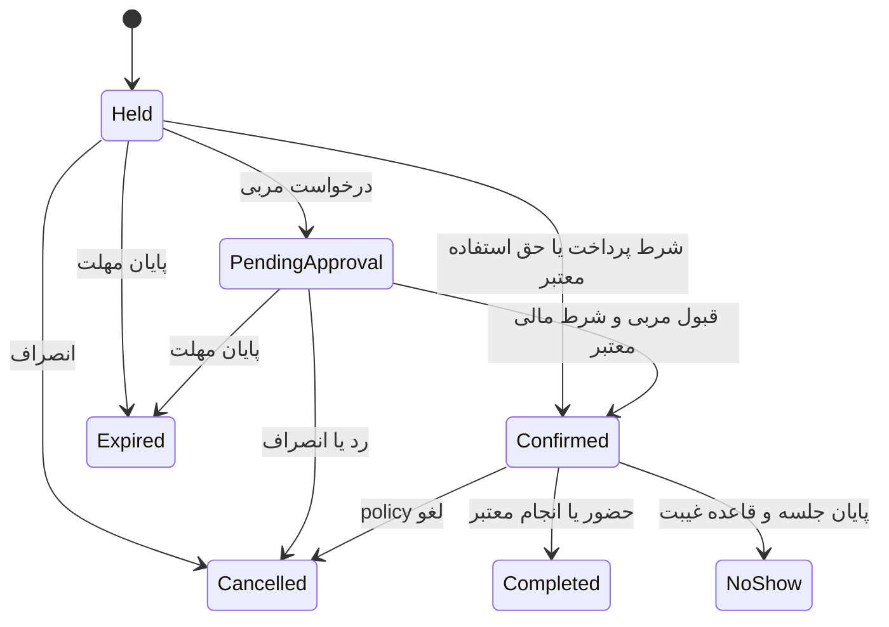
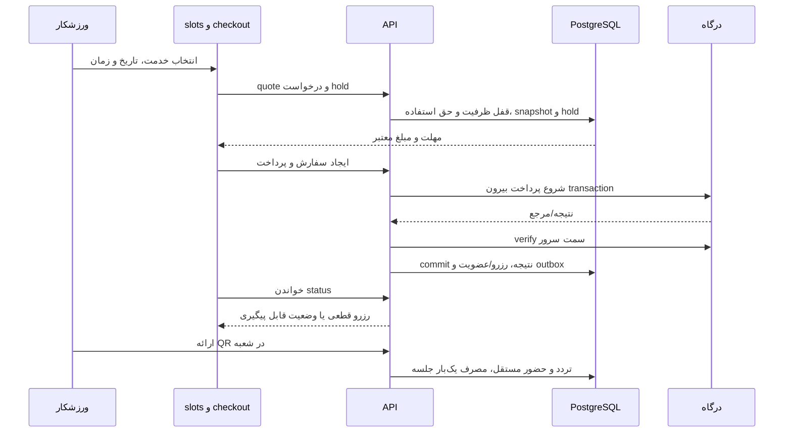

# فلوها و فهرست صفحات Gym4Me

مرجع: [طرح کامل](blueprint.md) · [فلوهای پذیرش موجود](flows.md) · [مدل‌ها](data-model.md) · [سه صفحهٔ مرجع](discovery-spec.md).

این فهرست قرارداد ساخت آینده است. «موجود» در جدول فقط وجود route/component را نشان می‌دهد؛ دادهٔ نمونه یا ذخیرهٔ محلی، تحویل فلو تجاری نیست. مسیرها روی host هر اپ تفسیر می‌شوند؛ اسامی پارامترها در Next به `[id]` تبدیل می‌شوند. ظاهر از kit/theme فعلی استفاده کند. فرم/Sheet و تب مرتبط الزاماً route جدا نیستند؛ پیوند مستقیم به state لازم از query قابل بازیابی باشد.

## ناوبری

ورزشکار: کشف، رزروهای من، تمرین، پیام‌ها، حساب. مربی در همان اپ با تغییر حالت مجاز: امروز، تقویم، شاگردها، برنامه‌ها، حساب/درآمد. ناوبری و دادهٔ انتخاب‌شده براساس mode باشند؛ تعویض mode مجوز سرور نمی‌سازد. بیزینس: پذیرش، تقویم، اعضا، خدمات، مالی، مربیان، گزارش، تنظیمات. ادمین: بررسی‌ها، کاربران، عملیات مالی، پشتیبانی، کاتالوگ و پایش.

ورود برای مرور عمومی لازم نیست. کاربر هنگام خرید/رزرو/پیام احراز هویت می‌شود و به انتخاب قبلی برمی‌گردد. ورود hostهای business/admin از فلو حساب مشترک استفاده می‌کند ولی نشست و محدودهٔ کاری مستقل است.

## ورزشکار و صفحات عمومی

| ID  | مسیر                                    | محتوای اصلی و اقدام                                   | مبنا/وضعیت                                     |
| --- | --------------------------------------- | ----------------------------------------------------- | ---------------------------------------------- |
| P01 | `/login`                                | شماره، OTP، زمان ارسال مجدد، خطا و returnTo مجاز      | موجود؛ تکمیل native لازم                       |
| P02 | `/onboarding`                           | هدف، سطح، روزهای آزاد و انتخاب اختیاری ترجیح          | جدید؛ اجباری‌کردن داده اضافی قبل از رزرو ممنوع |
| P03 | `/profile`                              | نام، اطلاعات اختیاری و تغییر حالت مربی                | موجود؛ توسعه                                   |
| P04 | `/sessions`                             | دستگاه‌های فعال و ابطال                               | موجود؛ توسعه native                            |
| P05 | `/invitations`                          | دعوت همکاری، شاگردی و عضویت تیم                       | موجود؛ توسعه انواع دعوت                        |
| P06 | `/discovery`                            | جست‌وجو، فیلتر، دسته، محله، کارت و ظرفیت مرتبط        | موجود با داده محلی؛ صفحه مرجع                  |
| P07 | `/discovery/map`                        | نتایج همان فیلتر روی نقشه و انتخاب دستی محل           | موجود؛ اتصال واقعی لازم                        |
| P08 | `/discovery/compare`                    | مقایسه خدمت، مبلغ نهایی، اعتبار و امکانات هم‌تعریف    | جدید                                           |
| P09 | `/saved`                                | باشگاه، مربی و جست‌وجوهای ذخیره‌شده                   | جدید؛ hook محلی فعلی ادغام شود                 |
| P10 | `/discovery/clubs/:clubId/slots`        | شعبه/خدمت، تاریخ، زمان، extras، quote و ادامه خرید    | موجود با ذخیره محلی؛ صفحه مرجع                 |
| P11 | `/discovery/clubs/:clubId`              | گالری، معرفی، شعب، امکانات، ساعات، مربی، نظر و CTA    | موجود با داده محلی؛ صفحه مرجع                  |
| P12 | `/discovery/clubs/:clubId/gallery`      | گالری عمومی و fullscreen viewer                       | موجود؛ اتصال رسانه واقعی                       |
| P13 | `/discovery/clubs/:clubId/reviews`      | نظر، evidence مراجعه، پاسخ و گزارش؛ فرم نظر           | موجود؛ evidence واقعی لازم                     |
| P14 | `/discovery/coaches`                    | فهرست/فیلتر تخصص، مکان، جنسیت، بودجه و زمان           | جدید                                           |
| P15 | `/discovery/coaches/:coachId`           | پروفایل، مدارک، همکاری‌ها، قیمت و جلسه آشنایی         | موجود با داده نمونه؛ توسعه                     |
| P16 | `/checkout`                             | ریز اقلام، شرایط، تخفیف، بسته یا پول، hold و مهلت     | جدید؛ شناسه quote/hold در state                |
| P17 | `/checkout/status`                      | نتیجه معتبر درگاه، پرداخت pending، retry امن و رسیدگی | جدید؛ nonce و orderRef، نه مبلغ از URL         |
| P18 | `/bookings/:reservationId`              | وضعیت، زمان، ورود، لغو/جابه‌جایی و پشتیبانی           | جدید؛ فهرست `/bookings` نمای همین بخش          |
| P19 | `/memberships`                          | بسته‌ها و مانده/اعتبار                                | جدید                                           |
| P20 | `/memberships/:membershipId`            | شرایط پذیرفته‌شده، گردش جلسه و شعب مجاز               | جدید                                           |
| P21 | `/memberships/:membershipId/manage`     | تمدید، ارتقا، فریز، مهمان و انتقال مجاز               | جدید                                           |
| P22 | `/membership-card`                      | QR کوتاه‌مدت، اعتبار و علت عدم مجوز                   | جدید                                           |
| P23 | `/waitlist`                             | صف‌ها، پیشنهاد ظرفیت، مهلت قبول و انصراف              | جدید                                           |
| P24 | `/orders`                               | خریدها و پرداخت/استرداد                               | جدید                                           |
| P25 | `/orders/:orderId`                      | ریز خرید، رسید، پرداخت مانده، refund و پیگیری         | جدید                                           |
| P26 | `/settings`                             | اعلان، حریم خصوصی، زبان/تم، رضایت و درخواست داده      | جدید؛ استفاده از کامپوننت حساب فعلی            |
| P27 | `/training`                             | برنامه فعال، روز تمرین، آموزش و شروع                  | route موجود؛ تمرین واقعی جدید                  |
| P28 | `/training/sessions/:sessionId`         | حرکت، ست، وزنه، تایمر، یادداشت و sync                 | جدید                                           |
| P29 | `/training/history`                     | تمرین‌های قبلی و نسخه برنامه همان زمان                | جدید                                           |
| P30 | `/progress`                             | نمودارها، اندازه‌گیری و عکس خصوصی                     | جدید                                           |
| P31 | `/messages`                             | گفتگوهای مجاز و پیام خوانده‌نشده                      | جدید                                           |
| P32 | `/messages/:conversationId`             | چت، ارسال فایل، بازخورد حرکت و وضعیت تحویل            | جدید                                           |
| P33 | `/locker`                               | کمد تخصیص‌یافته، اجاره و تحویل/خرابی                  | جدید                                           |
| P34 | `/groups/:groupId`                      | اعضا، دعوت، سهم‌ها، مهلت و شرط قطعی‌شدن               | جدید؛ PH7 تأییدشده                             |
| P35 | `/groups/:groupId/payments`             | سهم خود، رسید، کسری و refund خود                      | جدید؛ مبلغ دیگران فقط طبق مجوز                 |
| P36 | `/discovery/recommendations`            | وقت/محل/بودجه، دلیل پیشنهاد و ظرفیت تازه              | جدید؛ PH7 تأییدشده                             |
| P37 | `/getting-started`                      | مسیر تازه‌کار، هدف/سطح و اولین خدمت مناسب             | جدید؛ PH7 تأییدشده                             |
| P38 | `/support`                              | تیکت جدید با اتصال به خرید/رزرو                       | جدید                                           |
| P39 | `/support/:ticketId`                    | timeline، پیام، فایل، وضعیت و مسئول رسیدگی            | جدید                                           |
| P40 | `/documents`                            | مدارک لازم خدمت، بارگذاری و وضعیت بررسی               | جدید                                           |
| P41 | `/training/exercises/:exerciseId`       | آموزش حرکت، واحد و جایگزین                            | جدید                                           |
| P42 | `/training/sessions/:sessionId/summary` | نتیجه تمرین، ذخیره/اصلاح و بازخورد؛ private پیش‌فرض   | جدید                                           |

صفحه `/` فعلی landing است؛ نقش آن هدایت به P06 یا P27 و توضیح محصول است. `/bookings` فهرست مستقل لازم دارد و با P18 یک بخش ناوبری شمرده شده؛ detail و list در اجرا دو route‌اند. P01–P05 در هر سه host با shell مناسب قابل استفاده‌اند. `/native/*` shellهای داخلی متناظر همین صفحه‌ها هستند و در SEO عمومی وارد نشوند.

## حالت مربی در اپ مشترک

| ID  | مسیر                                    | محتوای اصلی و اقدام                                 |
| --- | --------------------------------------- | --------------------------------------------------- |
| C01 | `/coach`                                | امروز، جلسات، پیام‌ها، درخواست‌ها و پیگیری‌ها       |
| C02 | `/coach/profile`                        | معرفی عمومی، خدمات، قیمت و محل فعالیت               |
| C03 | `/coach/credentials`                    | مدارک، بارگذاری، بررسی و انقضا                      |
| C04 | `/coach/calendar`                       | زمان آزاد، جلسات چند شعبه، buffer و بستن زمان خارجی |
| C05 | `/coach/sessions/:reservationId`        | درخواست/جلسه، حضور، غیبت، جابه‌جایی و یادداشت       |
| C06 | `/coach/students`                       | فعال، کم‌فعال، بسته نزدیک انقضا و جست‌وجو           |
| C07 | `/coach/students/:relationshipId`       | پرونده، ارزیابی، قرارداد، تمرین و پیشرفت مجاز       |
| C08 | `/coach/invitations`                    | دعوت شاگرد، لینک اختصاصی و درخواست‌های جدید         |
| C09 | `/coach/library`                        | حرکات، جایگزین‌ها و قالب‌های برنامه                 |
| C10 | `/coach/plans/:planId/edit`             | برنامه‌ساز، روز/بلوک، ست و انتشار نسخه              |
| C11 | `/coach/students/:relationshipId/plans` | واگذاری برنامه، نسخه و تاریخ اثر                    |
| C12 | `/coach/messages`                       | component پیام مشترک؛ context مربی و فیلتر شاگرد    |
| C13 | `/coach/check-ins`                      | پیگیری هفتگی، اجراهای واقعی و بازخورد               |
| C14 | `/coach/contracts`                      | همکاری‌ها، نسخه قرارداد و شرایط سهم                 |
| C15 | `/coach/income`                         | جلسات، درآمد pending/eligible و اصلاحات             |
| C16 | `/coach/settlements`                    | صورت‌حساب، جزئیات ردیف، اعتراض و رسید پرداخت        |

تمام Cها پیشنهاد ساخت‌اند؛ وجود coach profile پایه در API یا صفحه عمومی مربی، اجرای این فضای کاری نیست. editor/assignment با یک component مشترک ساخته شوند؛ mode ورزشکار امکان ویرایش نسخهٔ مربی را ندارد.

## پنل بیزینس

| ID  | مسیر                  | محتوای اصلی و اقدام                                         |
| --- | --------------------- | ----------------------------------------------------------- |
| B01 | `/login`              | ورود و تشخیص مجموعه‌های مجاز؛ حساب/نشست مشترک نیز موجود است |
| B02 | `/`                   | داشبورد عملیاتی، ظرفیت امروز، بدهی و تمدید                  |
| B03 | `/organizations`      | انتخاب/ساخت مجموعه؛ موجود، توسعه                            |
| B04 | `/branches`           | فهرست و ساخت شعبه؛ موجود، توسعه                             |
| B05 | `/branches/:branchId` | نشانی، ساعات، امکانات، منابع و حدود نقش                     |
| B06 | `/catalog`            | معرفی باشگاه، رسانه، readiness و ارسال برای انتشار          |
| B07 | `/team`               | کارکنان، دعوت، نقش و محدوده شعبه؛ موجود، توسعه              |
| B08 | `/resources`          | زمین/سالن/قسمت‌ها، تجهیزات و تعارض فضا                      |
| B09 | `/services`           | خدمت، نسخه تعرفه، بسته، policy و مدارک موردنیاز             |
| B10 | `/classes`            | کلاس/دوره، مربی، سطح، جلسات، ظرفیت و جبرانی                 |
| B11 | `/calendar`           | تقویم همه منابع، رزرو تلفنی، تعطیلی و تکرار                 |
| B12 | `/members`            | فهرست اعضا، پرونده، بسته، مدارک و تمدید                     |
| B13 | `/reception`          | جست‌وجوی سریع، QR، ثبت‌نام، پرداخت و ورود                   |
| B14 | `/attendance`         | تردد، حضور جلسات، غیبت و اصلاح با دلیل                      |
| B15 | `/orders`             | فروش، خرید حضوری، ریز سفارش و مانده                         |
| B16 | `/payments`           | پرداخت، رسید، تطبیق، refund و موارد نامشخص                  |
| B17 | `/finance`            | دریافت/بدهی/اعتبار/دفتر، گزارش و خروجی                      |
| B18 | `/support`            | پرونده اختلاف رزرو و پرداخت، پیام و پیگیری                  |
| B19 | `/coach-contracts`    | دعوت همکاری، قرارداد و نسخه سهم                             |
| B20 | `/coach-earnings`     | انجام خدمت، سهم، کسورات و اختلاف                            |
| B21 | `/settlements`        | صورت‌حساب، تأیید، پرداخت و اصلاح                            |
| B22 | `/reports`            | حضور، ظرفیت، تمدید و مقایسه شعب                             |
| B23 | `/lockers`            | کمد روزانه/ثابت، اجاره، تحویل و خرابی                       |
| B24 | `/devices`            | مدل‌ها، اتصال، سلامت، فرمان و پاسخ                          |
| B25 | `/subscription`       | پلن بیزینس، محدودیت، ارتقا و تنزل                           |
| B26 | `/imports`            | فایل، mapping، پیش‌نمایش، خطای ردیف و اثر import            |
| B27 | `/exports`            | خروجی مجاز و فایل مهلت‌دار                                  |
| B28 | `/audit`              | تاریخچه قیمت، مجوز، رزرو، حضور و مالی                       |
| B29 | `/settings`           | اعلان، سیاست عملیاتی، مدارک و روش‌های دریافت                |
| B30 | `/booking-groups`     | گروه‌ها، کسری پرداخت، مهلت و رسیدگی                         |
| B31 | `/off-peak`           | بازه خلوت، تخفیف، بودجه و گزارش اثر                         |

هر بخش data table + detail/form یا drawer لازم دارد؛ route جزئیات برای لینک پرونده/اقدام حساس انتخاب شود. دسکتاپ می‌تواند تراکم مناسب داشته باشد ولی همان tokenها، typography، kit و RTL حفظ شوند. حسابدار مجوز ویرایش برنامه خصوصی یا پیام شاگرد ندارد.

## پنل ادمین

| ID  | مسیر                   | محتوای اصلی و اقدام                                |
| --- | ---------------------- | -------------------------------------------------- |
| A01 | `/login`               | ورود، کنترل privilege و نشست مستقل                 |
| A02 | `/`                    | صف بررسی، مغایرت‌های باز و سلامت عملیات            |
| A03 | `/users`               | وضعیت هویت، نشست و دسترسی مجاز؛ موجود، توسعه       |
| A04 | `/organizations`       | بررسی/تعلیق مراکز و timeline؛ موجود، توسعه         |
| A05 | `/catalog-reviews`     | نسخه عمومی، readiness، تأیید یا رد مستند           |
| A06 | `/coach-verifications` | مدارک و دامنه بررسی، نتیجه و انقضا                 |
| A07 | `/taxonomies`          | رشته، دسته، تجهیزات، امکانات و دسترس‌پذیری         |
| A08 | `/locations`           | کشور، استان، شهر و منطقه                           |
| A09 | `/reconciliation`      | پرداخت/refund/payout نامشخص و اجرای command اصلاحی |
| A10 | `/tickets`             | صف پشتیبانی، ارجاع، SLA پیشنهادی و timeline        |
| A11 | `/moderation`          | نظر، گزارش تخلف، تضاد منافع و تصمیم                |
| A12 | `/audit`               | سابقه اقدامات حساس و trace؛ موجود، توسعه           |
| A13 | `/operations/jobs`     | outbox، retry، dead job و تشخیص اثر قبلی           |
| A14 | `/operations/devices`  | سلامت و اختلاف حالت دستگاه، ارجاع عملیات           |
| A15 | `/analytics`           | قیف، خدمات انجام‌شده، تکرار خرید و guardrailها     |

## قرارداد هر صفحه

هر صفحه باید owner داده/role مجاز، query و command، حالت loading/empty/error، expired/suspended/forbidden و recovery معلوم داشته باشد. دادهٔ خصوصی cache مشترک نشود. فرم error inline و focus قابل بازیابی داشته باشد؛ toast تنها تأیید عمل مالی نباشد. وضعیت انتخاب، زمان و فیلتر پس از back/ورود حفظ شود؛ مبلغ و ظرفیت از سرور تازه خوانده شوند.

UI state اختیاری قابل ذخیره در URL، فرم در state محلی، دادهٔ server با query cache tenant/user-scoped و mutation invalidation نگهداری شود. تعریف store عمومی با تمام اطلاعات خصوصی کاربرهای مختلف مجاز نیست. realtime یا polling صرفاً تازه‌کردن مشاهده است؛ صحت رزرو در command سرور enforce می‌شود.

## اتصال فلوها به صفحه و مدل

جزئیات پذیرش FL01–FL22 در flows.md حفظ شده‌اند. جدول زیر قرارداد عملیاتی آن‌ها و فلوهای جدید را به صفحه/مدل وصل می‌کند. رویدادهای دارای نقطه نام مفهومی‌اند و پیش از instrumentation با schemaVersion ثبت شوند.

| فلو                    | مسیر کاربر و صفحات                            | مدل/اثر اصلی                                               | خطا و بازیابی ضروری                                                  |
| ---------------------- | --------------------------------------------- | ---------------------------------------------------------- | -------------------------------------------------------------------- |
| FL01 ورود              | P01 → P03/P04 → مقصد قبلی؛ B01/A01            | OtpChallenge، AuthSession، NativeCredential                | OTP منقضی/محدودیت؛ resend امن؛ returnTo allowlist                    |
| FL02 حالت مربی         | P03 → C02 → C03 → C01                         | CoachProfile، CredentialVerification                       | حساب ثابت؛ مدرک ناقص؛ دسترسی فقط رابطه معتبر                         |
| FL03 راه‌اندازی باشگاه | B03 → B04/B05 → B06/B09 → A04/A05 → انتشار    | Organization/Club/Branch، PublicationVersion               | readiness ناقص/رد؛ دلیل و draft قابل اصلاح؛ تعلیق با ویرایش رفع نشود |
| FL04 کشف               | P06/P07 → P08 → P11 → P10                     | catalog read، Favorite، ServiceOccurrence                  | رد مکان؛ انتخاب دستی؛ نتیجه خالی؛ حفظ query؛ ظرفیت منقضی             |
| FL05 خرید/تمدید        | P19/P20/P21 یا P11 → P16 → P17 → P20          | Quote/Order/Payment → AthleteMembership و EntitlementEvent | verify نامشخص؛ شرایط تغییرکرده؛ حفظ snapshot خرید                    |
| FL06 کلاس/دوره         | P10 → P16 → P17 → P18                         | SeatPool، Reservation، CourseEnrollment                    | پرشدن یک جلسه دوره rollback کل تضمین؛ پیشنهاد خدمت جایگزین           |
| FL07 زمین              | P10 → P16 → P17 → P18                         | ResourceConflictUnit، Occupancy، Hold و Order              | تداخل بخش/سالن یا سری؛ بدون تأیید کاذب                               |
| FL08 انتظار            | P10 → P23 → پیشنهاد → P16/P18                 | WaitlistEntry/Offer، hold واقعی                            | پایان مهلت، eligibility عوض‌شده؛ بازگشت به صف طبق policy             |
| FL09 لغو/جابجایی       | P18 → preview شرایط → تأیید → P18/P25         | ReservationChange، allocation release، Refund              | حفظ رزرو قدیم تا تعهد جدید؛ refund pending قابل پیگیری               |
| FL10 ورود/حضور         | P22 → B13 → B14/C05                           | AccessDecision، Visit، AttendanceEvent → consume           | QR تکراری/منقضی؛ ورود ساختمان حضور کلاس محسوب نشود                   |
| FL11 انتخاب مربی       | P14/P15 → زمان → P16/P17 → P18/C05            | CoachTimeClaim، PrivateSessionRequest، Relationship        | زمان رفت‌وآمد/تداخل؛ رد یا expiry درخواست؛ آزادسازی اثرها            |
| FL12 شاگرد             | C08/P05 → پذیرش → C06/C07 → ارزیابی           | CoachingInvitation/Relationship/Assessment                 | عدم رضایت یا رابطه پایان‌یافته؛ اطلاعات پیش از پذیرش مخفی            |
| FL13 برنامه            | C09 → C10 → C11 → P27                         | PlanVersion/Assignment                                     | نسخه جدید آینده؛ برنامه منتشرشده و اجرای قبلی بازنویسی نشوند         |
| FL14 اجرا              | P27 → P41/P28 → P42 → P29                     | WorkoutSession/SetLog، clientOperationId                   | شبکه قطع؛ draft، retry deduped، conflict اصلاح روشن                  |
| FL15 بازخورد           | P30/P31/P32 ↔ C12/C13                         | Message، Attachment، CheckIn، Measurement                  | فایل processing/failed؛ revoke رابطه/رضایت؛ private پیش‌فرض          |
| FL16 قرارداد/تسویه     | B19/C14 → خدمت → B20/C15 → B21/C16            | ContractVersion → Earning → Statement/Payout               | اختلاف ردیف؛ payout unknown؛ اصلاح پس از refund حتی بعد از تسویه     |
| FL17 چندشعبه           | B25 → B03/B05/B07 → P20/B22                   | Subscription، BranchAccess، PlanBranchAccess               | تنزل پلن؛ آخرین جلسه مشترک؛ جلوگیری از دوباره‌شماری                  |
| FL18 کمد/دستگاه        | B13 → B23/P33 → B24 → تحویل                   | Assignment، Command، DeviceEvent                           | timeout unlock؛ تطبیق حالت/اقدام مسئول؛ آزادسازی پس از تحویل         |
| FL19 نظر               | P18/P13 → فرم → A11 → انتشار/پاسخ             | Club/CoachReview، Evidence، ModerationCase                 | حضور لازم برای badge؛ تضاد منافع؛ رد با دلیل؛ رسانه خصوصی مخفی       |
| FL20 اختلاف            | P25/P38/P39 → B18/A09/A10 → اقدام مجاز        | Ticket، ReconciliationCase، domain command، Audit          | timeout درگاه؛ ارجاع؛ اصلاح یک‌بار با actor/reason                   |
| FL21 import            | B26 → mapping → dry run → commit → گزارش      | ImportJob/Row و grant افتتاحیه                             | ردیف ناسالم/تکراری؛ اجرای دوباره بدون دوباره‌سازی؛ اصلاح ارجاع‌دار   |
| FL22 اعلان             | mutation commit → worker → اعلان → مقصد مجاز  | Outbox/Notification/DeliveryAttempt                        | reminder منسوخ؛ permission revoke؛ retry؛ delivery نامشخص            |
| FL23 تیم و سهم         | P18/P34 → دعوت → P35 → شرط پرداخت → رزرو قطعی | Group/Contribution/Policy، هسته booking/commerce           | کسری، overpay، deadline و پرداخت دیررس؛ refund مستقل هر نفر          |
| FL24 سانس خلوت         | B31 → P06/P10 → خرید                          | OffPeakOffer، PriceVersion/Discount                        | بودجه تمام؛ نسخه تخفیف عوض؛ quote تازه با تأیید کاربر                |
| FL25 زمان مناسب        | P36 → P10 → خرید → بازخورد                    | Preference، RecommendationRun/Feedback                     | مکان داده نشده؛ rule قابل توضیح؛ پیشنهاد پرشده verify شود            |
| FL26 تازه‌کار          | P02/P37 → قدم‌ها → P11/P15/P10 → اولین خدمت   | BeginnerPath/Progress و Reservation                        | skip/resume؛ سطح نامعلوم؛ مسیر به خدمت معتبر ختم شود                 |

## state machineهای مشترک

PaymentAttempt مستقل: `created → pending → verified | failed | unknown` و `unknown → verified | failed` فقط با evidence معتبر. Refund مستقل: `requested → processing → succeeded | failed | unknown`؛ رسیدگی به unknown باید با همان reference انجام شود. دستگاه هم state مستقل از رزرو دارد. برگشت از درگاه بدون verification فقط P17 را به حالت پیگیری می‌برد.

## تراکنش خرید تا حضور

## دروازهٔ ساخت هر فلو

ساخت UI شامل happy path و حداقل یک بازیابی اصلی از جدول است. پذیرش نهایی نیازمند اثبات دسترسی، رقابت ظرفیت، تکرار عملیات، مهلت‌ها و خرابی provider در دامنه مربوط است. مسیرهای عمومی crawler-readable باشند؛ صفحات private noindex و نیازمند مجوز. طراحی سه صفحه مرجع قبل از گسترش به سایر صفحه‌ها معیار consistency است.
