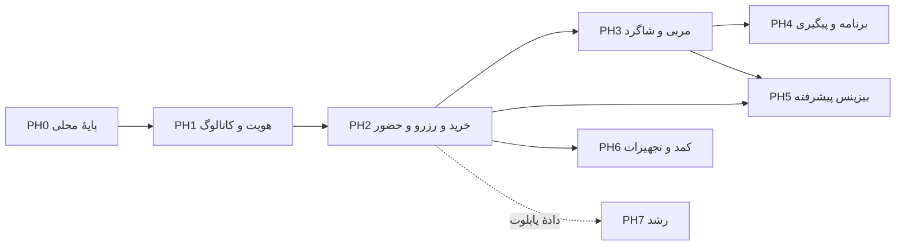

# فازها، وابستگی‌ها و چک‌لیست تحویل

مرجع: [کانسپت](concept.md) · [فیچرها](features.md) · [فلوها](flows.md) · [تسک‌ها](backlog.md)

فازبندی پیشنهاد اجرایی است. همهٔ M01 تا M16 در دامنهٔ اصلی حفظ شده‌اند. تاریخ و ظرفیت تیم مشخص نیست؛ این نقشه تعهد زمانی ایجاد نمی‌کند. مسئول‌ها نقش پیشنهادی هستند و هنگام برنامه‌ریزی باید به فرد مشخص تخصیص داده شوند.

وضعیت کد و شواهد جدید در [گزارش اجرایی فازها](phase-status.md) ثبت شده است؛ جدول و چک‌لیست زیر معیار خروج هر فاز را حفظ می‌کنند.

## تحویل دموی وب — ۲۰ اکتبر ۲۰۲۶

- [x] PH2 دمو: خرید/رزرو و عملیات نقش‌ها با پرداخت ساختگی، QR و استرداد.
- [x] PH3 دمو: مربی/شاگرد، جلسه و تقویم، پروندهٔ رضایت‌دار، قرارداد/مالی و نظر با رسیدگی.
- [x] ادغام در `main`، انتشار چهار سرویس رایگان و پذیرش آنلاین/مرورگر.

[شواهد و معیار دقیق تحویل](../qa/ph2-ph3-demo-2026-10-20.md). جدول و چک‌لیست‌های اصلی زیر همچنان معیار عرضهٔ واقعی، native و پایلوت‌اند.

## نمای کلی

| فاز | خروجی قابل استفاده                            | وضعیت امروز                           | وابستگی اصلی                            | مسئول پیشنهادی                   |
| --- | --------------------------------------------- | ------------------------------------- | --------------------------------------- | -------------------------------- |
| PH0 | پایهٔ محلی پروژه و نمونهٔ UI                  | پایهٔ تعریف‌شده موجود                 | —                                       | فنی                              |
| PH1 | حساب و دسترسی، بیزینس اولیه، کاتالوگ واقعی    | در حال اجرا؛ پذیرش نهایی باز          | PH0                                     | محصول، طراحی، بک‌اند و فرانت‌اند |
| PH2 | خرید، عضویت، رزرو زمین/کلاس و پذیرش؛ پایلوت   | برنامه‌ریزی‌شده                       | PH1 و تصمیم‌های پرداخت/قوانین           | محصول، عملیات، فنی و کیفیت       |
| PH3 | مربی در اپ مشترک، شاگرد و جلسهٔ خصوصی         | برنامه‌ریزی‌شده                       | PH1 و هستهٔ رزرو PH2                    | طراحی، بک‌اند و فرانت‌اند        |
| PH4 | برنامهٔ شخصی، اجرای تمرین، پیام و پیشرفت      | برنامه‌ریزی‌شده                       | رابطهٔ مربی/شاگرد PH3                   | محصول، طراحی و فنی               |
| PH5 | تسویهٔ پیشرفته و مدیریت چندشعبه در پلن بالاتر | برنامه‌ریزی‌شده                       | دفتر مالی PH2 و قرارداد PH3             | محصول، مالی و فنی                |
| PH6 | کمد و تجهیزات منتخب باشگاهی                   | برنامه‌ریزی‌شده                       | حضور و دسترسی PH2، دستگاه و شریک آزمایش | عملیات و فنی                     |
| PH7 | قابلیت‌های تکمیلی رشد                         | تأییدشده برای محصول نهایی؛ تحویل بعدی | دادهٔ واقعی و تصمیم قواعد خدمت          | محصول و داده                     |

PH6 به عرضهٔ چندشعبه وابسته نیست و پس از PH2 می‌تواند مسیر مستقلی داشته باشد. PH4 و PH5 نیز پس از آماده‌شدن پیش‌نیازهایشان قابلیت اجرای موازی دارند؛ این، تخصیص تیم یا دستور ایجاد کار موازی در این نوبت نیست.

## PH0 — پایهٔ موجود

**دامنه:** سه اپ و API، UI مشترک، پوستهٔ موبایل موجود، PostgreSQL و migration، health و قرارداد مسیر. **تسک‌ها:** T001 تا T008.

- [x] پایهٔ دیتابیس محلی، migration کاربران/مجموعه/شعبه و health آماده است.
- [x] نسخه‌بندی domain/feature و پروکسی سه اپ با مسیرهای زیرساخت هماهنگ است.
- [x] نمونهٔ کشف باشگاه با دادهٔ محلی مشخص و از رزرو واقعی متمایز است.

این دروازه فقط پایهٔ محلی را تأیید می‌کند. احراز هویت، ایزوله‌سازی دادهٔ مشتری، استقرار production و عملیات واقعی باشگاه جزو وضعیت تکمیل‌شدهٔ PH0 نیستند.

## PH1 — هویت، بیزینس پایه و کاتالوگ واقعی

**نتیجه:** کاربر وارد حساب می‌شود؛ باشگاه و شعبهٔ مجاز ساخته می‌شوند؛ اطلاعات و تعرفهٔ واقعی در اپ دیده می‌شود. **ماژول‌ها:** M01، بخش معرفی و مقایسهٔ M02، راه‌اندازی M16. **فلوها:** FL01، پایهٔ FL02، FL03 و معرفی/مقایسهٔ FL04. **تسک‌ها:** T010 تا T029.

در این فاز نمایش تعرفه مجاز است؛ فروش خدمت ظرفیت‌دار وقتی فعال می‌شود که PH2 برای همان نوع خدمت پذیرفته شده باشد. پوستهٔ native موجود باید به مسیر دادهٔ واقعی وصل شود؛ فهرست شناسه‌های نمونهٔ زمان build نباید مانع نمایش باشگاه‌های جدید در نسخهٔ موبایل شود.

- [ ] نشست وب و native، خروج از دستگاه و کنترل نقش/شعبه پذیرفته شده‌اند.
- [ ] دعوت کارکنان، بررسی مجموعه، ایجاد شعبه و انتشار کاتالوگ واقعی کار می‌کنند.
- [ ] جست‌وجو، مقایسه و صفحهٔ باشگاه از API می‌خوانند؛ دادهٔ نمونه در محیط عرضه جایگزین شده است.
- [ ] دسترسی بین دو مجموعه و دو شعبه با آزمون منفی بررسی شده است.
- [ ] محیط staging، migration و بازیابی پشتیبان آمادهٔ بررسی‌اند.

**پیش از خروج:** Q02 برای پیامک/فایل/نقشه، حداقل Q05 و Q09 برای داده‌های این فاز پاسخ داشته باشند. نمایندهٔ باشگاه بتواند اطلاعات مجموعهٔ خود را بدون ویرایش مستقیم دیتابیس منتشر کند.

## PH2 — خرید، عضویت، رزرو و عملیات روزانه

**نتیجه:** یک ورزشکار واقعی خدمت را می‌خرد یا از بسته مصرف می‌کند، زمین یا کلاس می‌گیرد و حضورش در بیزینس ثبت می‌شود. **ماژول‌ها:** M04، M05، M07، M08، M09 و تکمیل M02/M16. **فلوها:** FL05 تا FL10 و FL19 تا FL22. **تسک‌ها:** T040 تا T068 و T100 تا T108.

ترتیب داخلی ساخت: تعرفه و شرایط ← سفارش و دفتر ثبت ← منابع و ظرفیت ← خرید/مصرف بسته و تأیید پرداخت ← لغو/استرداد/تطبیق ← حضور و ابزار پذیرش. اعلان و ثبت رخداد پایدار همراه مسیرهای حساس ساخته شوند؛ ادمین و پشتیبانی قبل از فروش واقعی در دسترس باشند.

ثبت مربیِ یک کلاس و اطلاعات معرفی او در شعبه برای این فاز کافی است؛ کشف عمومی مربی، رزرو خصوصی و فضای کامل مربی در PH3 تکمیل می‌شود.

- [ ] خرید و تمدید بسته با مبلغ، تاریخ، شعب مجاز و شرایط نسخه‌دار کار می‌کند.
- [ ] زمین، کلاس و دوره، رزرو حضوری و آنلاین مشترک و سیاست نگهداری موقت دارند.
- [ ] آخرین صندلی، آخرین جلسه، بازهٔ مشترک و callback تکراری آزمون هم‌زمانی را گذرانده‌اند.
- [ ] پرداخت نامشخص و دیررس، لغو، جابه‌جایی، استرداد و لیست انتظار مسیر عملیاتی دارند.
- [ ] QR، ورود دستی مجاز، حضور واقعی و مصرف جلسه با هم تطبیق می‌شوند.
- [ ] پشتیبانی، گزارش روزانه، ورود دادهٔ قبلی و اعلان‌ها قابل استفاده‌اند.
- [ ] دروازهٔ پایلوت T100 تا T108 با شواهد واقعی پذیرفته شده است.

**پیش از فروش واقعی:** Q01، Q03، Q04 و سیاست داده‌های این فاز تعیین شده باشند. عرضهٔ آزمایشی از مجموعه و کاربران محدود آغاز شود؛ هدف پایلوت کشف اشکال عملیاتی و رفتار واقعی است.

## PH3 — مربی و شاگرد در یک اپ

**نتیجه:** مربی داخل همان application کار می‌کند، شاگرد مجاز دارد، زمان ارائه می‌کند و جلسه برگزار می‌شود. **ماژول‌ها:** M03، M06، M11 و پایهٔ M14. **فلوها:** تکمیل FL02، FL11، FL12 و پایهٔ FL16. **تسک‌ها:** T080 تا T094.

قرارداد و سابقهٔ مالی مربی از این فاز قابل ثبت و مشاهده‌اند. محاسبهٔ خودکار پیچیده، بستن دوره و قابلیت پلن بالاتر در PH5 تکمیل می‌شود؛ درآمد ثبت‌نشده نباید به‌عنوان مبلغ قطعی تسویه نمایش داده شود.

- [ ] تأیید و معرفی مربی، تغییر حالت، دعوت شاگرد و دسترسی پرونده پذیرفته شده‌اند.
- [ ] جلسات خصوصی/نیمه‌خصوصی تقویم مشترک مربی، مکان و زمان جابه‌جایی را رعایت می‌کنند.
- [ ] پذیرش، مربی و ورزشکار یک نتیجهٔ هماهنگ از جلسه می‌بینند.
- [ ] پایان همکاری دسترسی نامجاز را قطع می‌کند؛ سابقهٔ مربوط و پرداخت‌های مجاز قابل پیگیری‌اند.

## PH4 — برنامه، اجرای تمرین و پیگیری

**نتیجه:** مربی برنامه می‌سازد، ورزشکار اجرای واقعی را ثبت می‌کند و هر دو بازخورد و روند را می‌بینند. **ماژول‌ها:** M12 و M13. **فلوها:** FL13 تا FL15. **تسک‌ها:** T110 تا T121.

- [ ] برنامهٔ نسخه‌دار، تاریخ اثر، الگو، جایگزین حرکت و ثبت مقدار واقعی پذیرفته شده‌اند.
- [ ] پیش‌نویس تمرین در اینترنت ضعیف قابل بازیابی است؛ همگام‌سازی تکراری دادهٔ مضاعف نمی‌سازد.
- [ ] پیام و فایل خصوصی، پیگیری هفتگی و نمودار، فقط به مخاطب مجاز نمایش داده می‌شوند.
- [ ] تغییر برنامه و پایان همکاری سابقهٔ اجرای قبلی را خراب نمی‌کند.

## PH5 — بیزینس پیشرفته، تسویه و چندشعبه

**نتیجه:** مالک با پلن بالاتر قرارداد و تسویهٔ پیشرفته و عملیات چندشعبه را اداره می‌کند. **ماژول‌ها:** M14، M15 و گزارش‌های تکمیلی M16. **فلوها:** تکمیل FL16 و FL17. **تسک‌ها:** T130 تا T141.

- [ ] شرایط پلن، پرداخت، محدودیت و رفتار تنزل مشخص و در سرور اعمال شده‌اند.
- [ ] صورت‌حساب مربی تا خدمت و قرارداد ردیابی می‌شود؛ اعتراض و اصلاح پس از تسویه کار می‌کنند.
- [ ] عضویت مشترک شعب، محدودیت نقش و مصرف هم‌زمان آخرین جلسه درست‌اند.
- [ ] گزارش تجمیعی فروش، دریافت وجه، عضو و تخصیص درآمد دوباره‌شماری ندارد.

**تصمیم پیش‌نیاز:** Q08 و جزئیات Q04. دسترسی به سوابق و تعهدات قبلی با غیرفعال‌شدن قابلیت‌های پلن حذف نمی‌شود.

## PH6 — کمد و تجهیزات باشگاهی

**نتیجه:** کمد و تجهیزات منتخب در یک شعبهٔ واقعی با روش جایگزین مجاز کار می‌کنند. **ماژول:** M10. **فلو:** FL18. **تسک‌ها:** T150 تا T159.

- [ ] کمد روزانه، ثابت و اجاره‌ای، تخصیص یکتا و تحویل تأییدشده دارند.
- [ ] فرمان، پاسخ، خطا و وضعیت نامشخص دستگاه قابل پیگیری است.
- [ ] قطعی شبکه، قطعی برق، retry و اقدام اضطراری روی دستگاه منتخب آزمایش شده‌اند.
- [ ] پشتیبانی مدل دستگاه، نصب، آموزش پذیرش و مسئول رسیدگی مشخص‌اند.

**تصمیم پیش‌نیاز:** Q06. پشتیبانی هر مدل دستگاه پذیرش مستقل می‌خواهد؛ وجود یک adapter به معنی سازگاری با تمام تجهیزات نیست.

## PH7 — توسعهٔ تکمیلی تأییدشده

**نتیجه:** دعوت تیم/پرداخت سهمی، سانس خلوت، پیشنهاد زمان مناسب و مسیر تازه‌کار بر مبنای استفادهٔ واقعی. **تسک‌ها:** T170 تا T173. این فاز طبق درخواست کاربر جزو دامنهٔ محصول نهایی است؛ پذیرش ۱۶ ماژول پایه تا PH6 مستقل از آن قابل سنجش است. فلوهای FL23 تا FL26 و مدل/صفحه در [طرح کامل](blueprint.md) آمده‌اند.

- [ ] پرداخت سهمی و دعوت تیم پس از مشخص‌شدن مسئول پرداخت و شرایط انقضا طراحی شود.
- [ ] پیشنهاد زمان مناسب و سانس خلوت بر پایهٔ ظرفیت معتبر و معیار قابل سنجش آزمایش شود.
- [ ] مسیر تازه‌کار و آزمایش‌های جذب/بازگشت با دادهٔ واقعی ارزیابی شوند.

## وابستگی‌های بیرونی و ریسک برنامه

| وابستگی                    | لازم برای  | اثر حل‌نشدن                           | اقدام پیشنهادی                                           |
| -------------------------- | ---------- | ------------------------------------- | -------------------------------------------------------- |
| پیامک و روش احراز هویت     | PH1        | ورود واقعی آماده نمی‌شود              | اتصال آزمایشی با adapter؛ انتخاب ارائه‌دهنده پیش از عرضه |
| پرداخت و مالک دریافت وجه   | PH2        | فروش و تطبیق مالی واقعی آماده نمی‌شود | قرارداد و sandbox؛ ادمین رسیدگی قبل از فروش              |
| قوانین لغو و مصرف جلسه     | PH2        | رزرو/استرداد مبهم می‌شود              | نسخهٔ سیاست در سفارش، سناریوی پذیرش با باشگاه            |
| شریک پایلوت و دادهٔ معتبر  | PH2        | رفتار واقعی و عملیات سنجیده نمی‌شود   | انتخاب مجموعهٔ محدود، آموزش و ورود دادهٔ قابل برگشت      |
| قرارداد مربی و دادهٔ خصوصی | PH3 تا PH5 | دسترسی و سهم درآمد مبهم می‌ماند       | ثبت رابطه، تاریخ اثر و دامنهٔ مشاهده                     |
| ارائه‌دهندهٔ فایل و ارتباط | PH1 و PH4  | تصویر/ویدیو یا اعلان قابل اتکا نیست   | دسترسی محدود، retry و مسیر بازیابی                       |
| دستگاه و مستندات سازنده    | PH6        | آزمایش اتصال ممکن نیست                | انتخاب مدل و آزمایش روی سخت‌افزار واقعی                  |
| ظرفیت تیم و انتشار native  | تمام فازها | زمان تعهد قابل تعیین نیست             | خردکردن تسک منتخب، برآورد و صاحب مشخص قبل از sprint      |

## ردیابی پوشش ماژول‌ها

| ماژول                | فازها                    | فلوهای شاخص            |
| -------------------- | ------------------------ | ---------------------- |
| M01 حساب و دسترسی    | PH1؛ تکمیل نقش مربی PH3  | FL01، FL02، FL03       |
| M02 کشف و مقایسه     | PH1، PH2                 | FL04، FL19             |
| M03 کشف مربی         | PH3                      | FL02، FL11             |
| M04 زمین و فضا       | PH2                      | FL07، FL09             |
| M05 کلاس و انتظار    | PH2                      | FL06، FL08             |
| M06 جلسهٔ خصوصی      | PH3                      | FL11                   |
| M07 عضویت و بسته     | PH2، توسعهٔ مشترک PH5    | FL05، FL10، FL17       |
| M08 پرداخت و استرداد | PH2                      | FL05، FL09، FL20       |
| M09 ورود و حضور      | PH2                      | FL10                   |
| M10 کمد و تجهیزات    | PH6                      | FL18                   |
| M11 مدیریت شاگرد     | PH3؛ پیگیری تمرین در PH4 | FL12، FL13، FL15       |
| M12 برنامه و تمرین   | PH4                      | FL13، FL14             |
| M13 ارتباط و پیشرفت  | PH4                      | FL15                   |
| M14 قرارداد و تسویه  | PH3 پایه؛ PH5 پیشرفته    | FL16                   |
| M15 چندشعبه          | PH5                      | FL17                   |
| M16 عملیات و گزارش   | PH1، PH2، PH5            | FL03، FL20، FL21، FL22 |

برای پایان ۱۶ ماژول پایه، پذیرش PH1 تا PH6 لازم است؛ پایان تمام دامنهٔ تأییدشدهٔ کاربر پذیرش PH7 را هم می‌خواهد. یک فاز فقط به خاطر اتمام چند صفحه یا بسته‌شدن تسک‌های UI کامل اعلام نمی‌شود.
