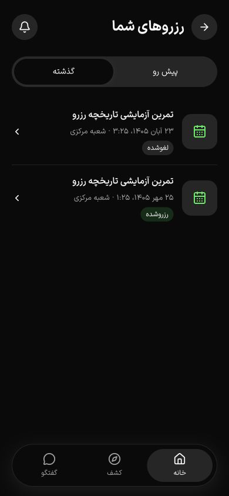
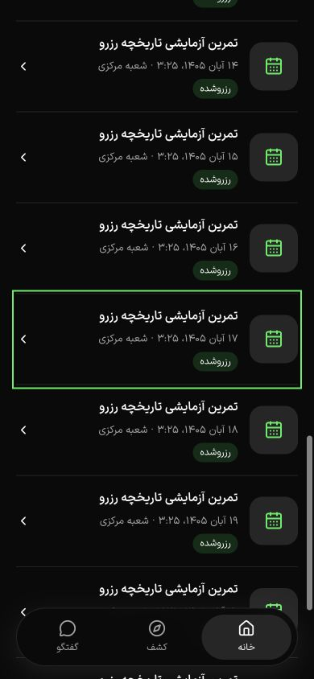

# تاریخچه و صفحه‌بندی رزرو — ۱۷ اکتبر ۲۰۲۶

جزئیات رزرو دیگر به ۱۰۰ ردیف فهرست اخیر وابسته نیست. خانه سه رزرو نزدیک را از سرور می‌گیرد و فهرست رزرو تب‌های پیش‌رو و گذشته را با cursor بارگذاری می‌کند. این شاهد بخشی از T020 و تجربهٔ رزرو PH2 است؛ پذیرش کامل PH0 تا PH2 همچنان باز است.

## نقص، اصلاح و قرارداد

- آزمون پیش از اصلاح با ۱۰۱ رزرو واقعی ساخته‌شده از مسیر checkout، برای جزئیات نخستین رزرو `undefined` گرفت. اکنون query مستقیم با شرط حساب و شناسه، همان snapshot و مبلغ خرید را برمی‌گرداند؛ حساب دیگر و شناسهٔ ناشناخته پاسخ یافت‌نشدن دارند.
- `GET /api/v1/sports/account/bookings/page` ورودی `tab=upcoming|past`، `limit=1..50` و `cursor` دارد و `{items,nextCursor}` برمی‌گرداند. پارامترها در Swagger و نوع پاسخ/هوک در `@repo/api/sports` اضافه شدند. مسیر قدیمی فهرست برای سازگاری باقی است؛ خانه و صفحهٔ رزرو از مسیر جدید استفاده می‌کنند.
- پیش‌رو شامل وضعیت‌های held/pending_approval/confirmed با پایان پس از زمان مبنای صفحه است و صعودی مرتب می‌شود. سایر رزروها، از جمله رزرو آیندهٔ لغوشده، در گذشته و به ترتیب نزولی‌اند. کلید `(start_at,id)` و نگهداری میکروثانیهٔ PostgreSQL در cursor، زمان‌های برابر را جدا می‌کنند. cursor به حساب و تب مقید است و زمان مبنا بین صفحات ثابت می‌ماند؛ تغییر هم‌زمان وضعیت رکوردها به معنی snapshot تراکنشیِ کل فهرست نیست.
- «نمایش رزروهای بیشتر» از ۲۰ ردیف شروع می‌کند. دادهٔ بارگذاری‌شده هنگام خطای صفحهٔ بعد حفظ می‌شود. پس از بارگذاری، فوکوس به نخستین لینک جدید می‌رود؛ پیمایش مستقیم آن را در مرکز دید و بالاتر از ناوبری شناور قرار می‌دهد. `aria-busy` و ناحیهٔ `status` شمار نتایج را اعلام می‌کنند.

## آزمون واقعی PostgreSQL و S3

دیتابیس موقت `gym4me_history_test` روی پورت 55433 و bucket تصادفی و خصوصی هر suite استفاده شدند؛ fixture و پیش‌نمایش کاربر تغییر نکردند.

| بررسی | نتیجه |
| --- | --- |
| تجارت، `NODE_OPTIONS=--throw-deprecation` و Jest ترتیبی | ۳۹ از ۳۹ پاس |
| کاتالوگ، همان تنظیم سخت‌گیرانه | ۳۶ از ۳۶ پاس |
| آزمون تاریخچه | ۱۰۲ رزرو، جزئیات خارج از سقف قدیمی، عبور کامل از صفحات، بدون تکرار یا حذف، زمان برابر/میکروثانیه، نزدیک‌ترین سه، پایان/لغو، cursor حساب/تب دیگر و ورودی نامعتبر |
| API، کلاینت مشترک و application | TypeScript و lint فایل‌های تغییرکرده پاس |
| API و application | build موفق؛ خروجی وب QA مستقل `.next-qa` با ۶۴ صفحه تولیدشده |
| زبان‌ها | ۲ آزمون i18n و کنترل متن پاس |
| حفاظت طراحی | هش ۵۹ فایل کارت/جزئیات/وابستگی محافظت‌شده بدون تغییر |

هشدار `pg` در اجرای اولیه با `--trace-deprecation` تا `readClub → publicationReadiness → transaction` ردیابی شد. خواندن موازی بخش‌ها روی یک اتصال تراکنش انجام می‌شد. اکنون فقط خواندن مبتنی بر pool موازی است؛ هر سه دستهٔ خواندن club/branch/media داخل تراکنش، با توابع lazy و به‌ترتیب اجرا می‌شوند. اجرای کاتالوگ با `--throw-deprecation` بدون هشدار پاس شد.

## شاهد مرورگر

روی API ایزولهٔ 7098 و build وب 7091، حساب ساختگی با ۲۸ رزرو ایجاد شد: ۲۶ پیش‌رو، یک جلسهٔ پایان‌یافته و یک رزرو آیندهٔ لغوشده. ورودی اختیاری `UI_FIXTURE_BOOKINGS=28` برای تکرار این بررسی به fixture اضافه شد؛ مقدار پیش‌فرض صفر و سقف ۱۲۰ است.

- ورود با OTP ساختگی، نمایش ۲۰ ردیف اول، افزودن شش ردیف، حذف دکمه در پایان و تب گذشته با دو ردیف تأیید شد.
- سه رزرو خانه پس از پایان جابه‌جایی با سه ردیف نخست فهرست برابر بودند. مشاهدهٔ فوری حین transition، صفحهٔ خروجی و ورودی را هم‌زمان می‌دید؛ آن مشاهده معیار مقایسه نشد.
- نقص اولیهٔ صفحه‌کلید بازتولید شد: پس از ناپدیدشدن دکمه، فوکوس روی `BODY` بود. پس از اصلاح، Enter در فارسی و انگلیسی فوکوس را به index=20 برد و متن «۲۶ رزرو نمایش داده شد.» / «26 bookings shown.» در status قرار گرفت. در بررسی نهایی ۳۹۰ پیکسل، محدودهٔ ردیف متمرکز y=365..479 و بالای ناوبری y=756 بود.
- ۱۲ ترکیب دو زبان/دو تم/عرض‌های ۳۶۰، ۳۹۰ و ۴۳۰ بدون سرریز افقی بودند؛ عرض واقعی، تم و تعداد ردیف در [خروجی اندازه‌گیری](booking-history-widths-2026-10-17.json) ثبت است. فارسی/تیره روی ۲۶ ردیف و سه ترکیب دیگر روی ۲۰ ردیف اندازه‌گیری شدند.
- زبان و تم اولیهٔ فارسی/تیره بازگردانده شدند؛ تغییرات تنظیمات فقط در حساب/مبدأ QA انجام شدند.
- پس از بررسی، دو سرویس QA متوقف شدند. شمار سفارش، خدمت، کاربر و سازمان fixture در دیتابیس هر چهار مورد صفر بود؛ دیتابیس موقت حذف شد. اندازهٔ viewport بازنشانی شد.

## حدود پذیرش

این برش آزمون دستگاه Android/iOS، صفحه‌خوان واقعی، اینترنت ضعیف/آفلاین و قطع درخواست صفحهٔ بعد، QA کامل حرکت یا staging را نمی‌بندد. بررسی سرریز جای پذیرش بصری پیکسلی نیست. ثبت‌شدن ناحیهٔ status شاهد خروجی گفتاری VoiceOver/TalkBack نیست. دروازه‌های مستقل زیرساخت و فروش واقعی نیز بازند.
