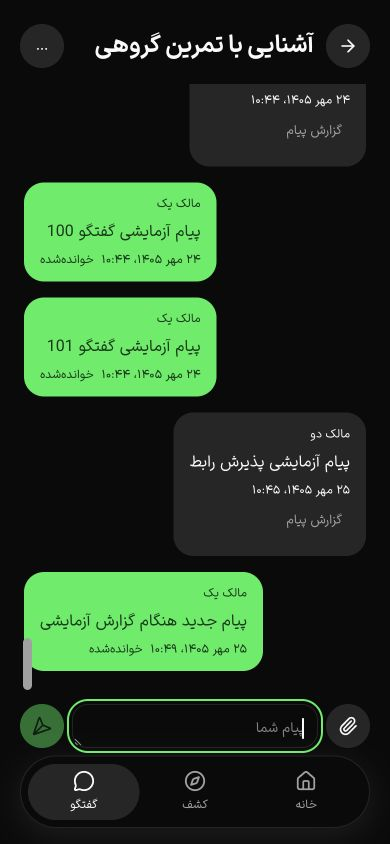
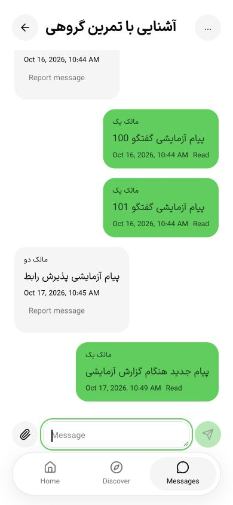
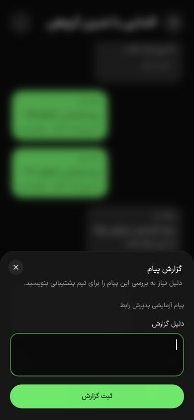

# گفتگوی کلاس، رسید خواندن و گزارش — ۱۷ اکتبر ۲۰۲۶

این برش بخشی از T069 و پذیرش تجربهٔ PH0/PH2 است. فازها، تقویم و پذیرش کامل گفتگو هنوز بسته نشده‌اند.

## قرارداد و پایداری

منطق گفتگو از CommunityService به `SportsConversationService` منتقل شد؛ controller و DI فقط یک پیاده‌سازی دارند. تقویم، اعلان و پشتیبانی در سرویس قبلی باقی‌اند. قرارداد preferences در parser/Swagger از یک schema و در `@repo/api/sports` با نوع مشخص استفاده می‌شود:

`POST /api/v1/sports/community/conversations/:id/preferences` ورودی `archived?` و `readMessageId?` می‌پذیرد؛ درخواست خالی نامعتبر است. آرشیو فقط ترجیح آرشیو را عوض می‌کند و پیام ندیده را نمی‌خواند. تأیید خواندن تنها به یک پیام همان گفتگو اشاره می‌کند. تراکنش، قفل حساب و بازبینی ثبت‌نام، دسترسی را هنگام نوشتن دوباره کنترل می‌کنند. cursor با tuple دقیق PostgreSQL از `created_at,id` ساخته می‌شود؛ رقابت و رسید کهنه آن را عقب نمی‌برند. ساعت مرورگر در تصمیم دخالت ندارد.

migration افزایشی `0027_sports_message_read_cursor` دو ستون cursor و قید جفت‌بودن آن‌ها را اضافه می‌کند. از `read_at` قدیمی رسید تازه استنباط نمی‌شود؛ دیدن/آرشیو قدیمی، شاهد پیام واقعاً دیده‌شده نبود. watermark تاریخی پس از moderation یا پاک‌شدن پیام می‌ماند. API برای پیام فرستنده فقط تعداد خوانندگان را برمی‌گرداند؛ هویت خوانندگان افشا نمی‌شود. لغو ثبت‌نام، دسترسی تازه را می‌بندد و واقعیت رسید قبلی را بازنویسی نمی‌کند؛ حذف دادهٔ حساب تابع چرخهٔ حریم خصوصی موجود است.

عضویت از رزرو confirmed/completed یا مجوز owner/manager همان شعبه مشتق می‌شود. فهرست عمومی اعضا از **نسخهٔ منتشرشده** و ترجیح public بودن حساب استفاده می‌کند؛ پیش‌نویس جدید نمی‌تواند roster را آشکار کند. حساب حذف‌شده، در انتظار حذف و تعلیق‌شده در roster عمومی نیست. میزبان مجاز همچنان اعضای معتبر را می‌بیند.

صفحهٔ پیام ۵۰ مورد است و یک رکورد اضافه، `hasMore` را تعیین می‌کند؛ انتهای دقیقِ ۵۰تایی صفحهٔ خالی اضافه ایجاد نمی‌کند. cursor متعلق به گفتگوی دیگر رد می‌شود و مقایسه داخل PostgreSQL دقت میکروثانیه را نگه می‌دارد. پیام تصویری در S3 خصوصی، پس از decode، تبدیل به WebP و حذف EXIF ذخیره می‌شود. درخواست تکراری همان پیام را برمی‌گرداند؛ تغییر محتوا با همان کلید رد می‌شود. گزارش پیام نیز قفل حساب/ثبت‌نام، کنترل پیام همان گفتگو و ثبت یکتای کاربر/پیام دارد.

## رابط و دسترس‌پذیری

اجزای موجود Luma، Field و Sheet حفظ شدند؛ سبک یا preset عمومی shadcn بازنویسی نشده است. تولید تازهٔ 12ui همچنان به‌دلیل محدودیت منطقه‌ای قبلاً ثبت‌شده در دسترس نیست و تلاشی برای دورزدن آن انجام نشد. [محدودیت ابزار](resource-availability-2026-10-17.md#محدودیت-ابزار-طراحی).

گفتگو به `chat.tsx` منتقل شد. فهرست مستقل و قابل اسکرول با صفحه‌کلید و فرم فشردهٔ ۵۶ پیکسلی جای فرم sticky قبلی را گرفت؛ فرم قبلی پیام آخر و دکمهٔ گزارش را می‌پوشاند. هدر و ناوبری بیرون فهرست می‌مانند. اندازهٔ تاریخ از ۱۰ به ۱۲ پیکسل افزایش یافت، متن فرستنده/تاریخ opacity کاهنده ندارد و نوار اسکرول باریک است. قواعد جدید فقط در کلاس‌های صفحهٔ گفتگو اعمال می‌شوند.

- ارسال متن، خطای تصویر نامعتبر، حذف پیوست، حفظ کلید تکرار برای retry و وضعیت در حال ارسال وجود دارند. حین ارسال، ویرایش payload غیرفعال است تا پاسخ دیررس پیش‌نویس جدید را پاک نکند؛ ورودی فایل نیز پس از موفقیت پاک می‌شود.
- رسید فقط در foreground، بدون Sheet گزارش، و هنگام ورود انتهای پیام‌ها به viewport **همان فهرست** فرستاده می‌شود. retry به پیامِ درخواست ناموفق اشاره می‌کند، نه آخرین پیام تازه و احتمالاً ندیده. پس از بازگشت از خطای query، observer دوباره متصل می‌شود.
- بارگذاری تاریخچه anchor قبلی را نگه می‌دارد. رسیدن پیام تازه در زمان خواندن تاریخچه کاربر را به پایین نمی‌پراند. End در ناحیهٔ focus‌پذیر، به پایان فهرست می‌رود.
- وضعیت ارسال/خواندن برای پیام خودی نمایش داده می‌شود. فرم گزارش برای پیام دیگر، دلیل، خطای API، وضعیت موفقیت، Escape و بازگشت focus دارد. آرشیو به صفحهٔ اطلاعات گفتگو منتقل شده و مجوز بستن گفتگو فقط برای میزبان نمایش داده می‌شود.
- polling موجود پنج‌ثانیه‌ای و `refetchIntervalInBackground=false` حفظ شد. رویداد `appStateChange` و وضعیت آغازین Capacitor به focus manager متصل شدند؛ resume بررسی visibility مرورگر را بازمی‌گرداند. این اتصال کد/نوع بررسی شده و پذیرش دستگاه نیست.

## شواهد اجراشده

**۵۶ از ۵۶ آزمون تجارت** روی PostgreSQL و S3 ایزوله با `--throw-deprecation` پاس شدند؛ اجرای نهایی ۶٫۵۲۳ ثانیه. پنج آزمون تازه شامل جدابودن آرشیو/خواندن، رقابت cursor، حفظ رسید تاریخی پس از لغو همراه با منع دسترسی، حریم خصوصی پیش‌نویس/انتشار، ۱۰۰ پیام با زمان مساوی/میکروثانیه و round-trip واقعی تصویر خصوصی هستند. دو اجرای میانی خطای fixture فیلد description و سپس تعریف نوع read count داشتند؛ fixture با مسیر واقعی ویرایش/انتشار ساخته و نوع صریح اصلاح شد. اجرای نهایی و build API موفق‌اند.

مرورگر با دیتابیس مستقل `gym4me_chat_ui_test`، دادهٔ مصنوعی و SMS ماک بررسی شد:

| فلو | نتیجهٔ مشاهده‌شده |
| --- | --- |
| ورود سرد و ورود دو حساب | فرم/OTP و مقصد گفتگو، با حساب ورزشکار و سپس میزبان موفق |
| ارسال متن | متن تازه در فهرست و دیتابیس ماند؛ ورودی پاک شد |
| گزارش | Sheet باز شد، دلیل ثبت شد، دقیقاً یک گزارش در DB بود، پیام موفقیت و focus مبدأ برگشتند |
| پیام هنگام گزارش | پیام جدید با polling به DOM رسید ولی cursor خواندن تغییر نکرد؛ پس از End و ورود پیام به viewport، cursor به همان پیام رسید |
| تاریخچه | ۱۰۳ پیام، سه صفحه، ۱۰۳ شناسهٔ یکتا و حذف دکمهٔ صفحهٔ بعد در پایان |
| آرشیو | از All حذف و در Archived ظاهر شد؛ عنوان کنترل اطلاعات تغییر کرد |
| رسید فرستنده | پس از تعویض حساب از UI، میزبان روی پیام واقعاً دیده‌شده «خوانده‌شده» دید |
| زبان/تم/عرض | ۱۲ حالت نهایی، فارسی/انگلیسی، روشن/تیره، ۳۶۰/۳۹۰/۴۳۰؛ فرم ۵۶ پیکسل، تاریخ ۱۲ پیکسل، پیام آخر در viewport، بدون سرریز یا کنترل بررسی‌شدهٔ کوچک‌تر از ۴۴×۴۴ |

[ماتریس نهایی](chat-widths-2026-10-17.json) مربوط به حساب میزبان است؛ فلوهای پاسخ/گزارش و تاریخچه با حساب ورزشکار نیز جدا بررسی شدند. شمار کنترل‌ها ۹ یا ۱۰ است و فقط کنترل‌های واقعاً داخل viewport و clip فهرست سنجیده شدند. این شاهد، همهٔ حالات، صفحه‌خوان، بزرگ‌نمایی یا انطباق کامل WCAG نیست.

TypeScript هر سه اپ کاربر/بیزینس/ادمین، API، UI و shared API، ESLint فایل‌های مربوط، دو آزمون و کنترل متن i18n، ۳۰ آزمون application، build وب QA با ۶۴ مسیر و build API موفق‌اند. کنترل ۵۹ فایل محافظت‌شده و diff check سالم است. دو worker و نبود cache اضافی فقط در build ایزولهٔ QA تنظیم شدند؛ تنظیم build تولیدی و guard پنج GiB native حفظ شدند. build بیزینس/ادمین در این برش تکرار نشد.

## رگرسیون hydration و اصلاح

بررسی ورود سرد نقص برش قبلی حرکت را آشکار کرد: گرهٔ route زیر Suspense ممکن است پس از layout effect والد hydrate شود. منطق isolation پیش از آماده‌شدن ref، فرم ورود را inert می‌کرد. اکنون تا ref معتبر صبر می‌کند و اتصال ref نیز sync را فراخوانی می‌کند. ورود سرد، ارسال OTP، ورود هر دو حساب، بارگذاری مستقیم گفتگو و حرکت‌های صفحات واقعاً دوباره موفق بودند. این اصلاح ادامهٔ [برش Back](navigation-back-2026-10-17.md) است؛ دستگاه/صفحه‌خوان همچنان بازند.

## staging و محدودیت‌ها

بازبینی خودکار ابتدا snapshot را به‌دلیل مقصد نامعلومِ private config رد کرد. بررسی فقط‌خواندنی ثابت کرد دو repository مستقل داخل `.artifacts` همین workspace و PostgreSQL/S3 روی پورت‌های loopback ۵۵۴۳۴/۸۳۳۴ هستند؛ داده یا رمز چاپ نشد. پس از ارائهٔ این شاهد، همان فرمان بکاپ تأیید و موفق شد. migration 0027 اعمال شد؛ نقش runtime دو ستون را خواند و verifier مجوز DML روی ۸۷ جدول و منع DDL/تاریخچه/نقش elevated را تأیید کرد. snapshot پس از migration و recovery verify در `2026-10-17T07:26:55.961Z` موفق بودند: یک dump و صفر حذف. این شاهد فلو UI staging یا مقصد خارج از میزبان نیست.

ابزار مرورگر پس از بازشدن تب دیگر نیز `document.visibilityState=visible` برگرداند؛ بنابراین توقف واقعی polling پس‌زمینه با آن قابل تأیید نبود. آزمون Android/iOS، صفحه‌کلید و safe area واقعی، read retry در قطع شبکه، رفتار با صفحه‌خوان و همهٔ حالات خطا بازند. فهرست گفتگو هنوز سقف ۱۰۰ دارد؛ تقویم‌ها و صفحه‌بندی فهرست/اعلان، پذیرش میزبانی گفتگو و revision/audit تغییر وضعیت بستن باید در ادامهٔ T069 تکمیل شوند. native جدید به‌دلیل فضای دیسک کمتر از guard ساخته نشد؛ هیچ پذیرش فروش یا پایلوت صادر نشده است.

پاک‌سازی نهایی: API و وب اختصاصی QA متوقف شدند؛ شمار کاربران، سازمان‌ها، خدمات، پیام‌ها و گزارش‌ها در هر دو دیتابیس این برش هر پنج صفر بود. فقط `gym4me_chat_ui_test` و `gym4me_chat_test` حذف شدند؛ دیتابیس مشترک و staging حفظ شدند. تب‌های ۲۴ و ۲۵ بسته، viewport بازنشانی و فارسی/تم تیره در origin QA بازگردانده شدند. فضای آزاد نهایی حدود ۱٫۵ GiB بود؛ export native تازه اجرا نشد.
