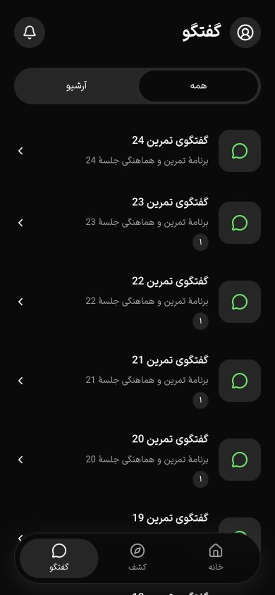
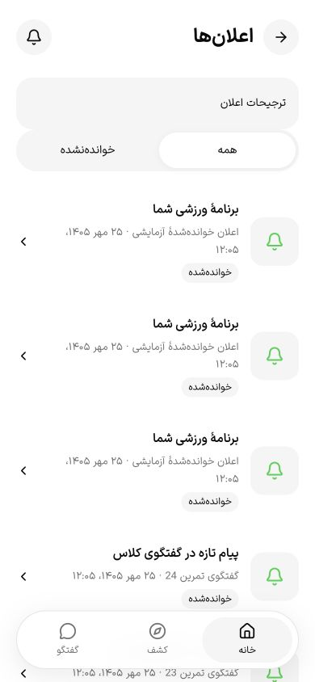
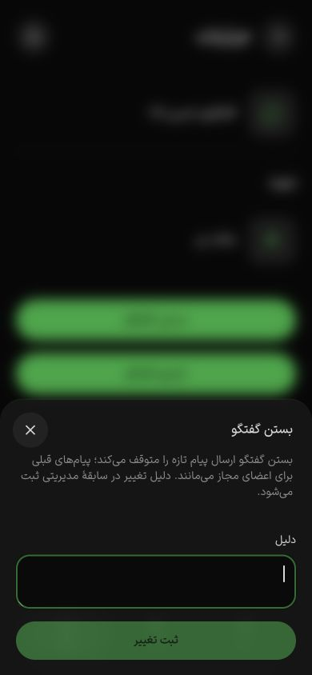

# فهرست ارتباطات و وضعیت گفتگوی میزبان — ۱۷ اکتبر ۲۰۲۶

این برش ادامهٔ T069 است. ۶۶ آزمون تجارت و ۳۶ حالت نهایی رابط موفق‌اند؛ migration 0029 **هنوز روی staging اعمال نشده** و تسک یا فازها بسته نشده‌اند.

## قرارداد و کنترل دسترسی

- `GET /api/v1/sports/community/conversations/page`، با cursor و `archived=true|false`، فهرست ۲۰تایی را برمی‌گرداند. عضویت معتبر رزرو یا نقش مالک/مدیر همان شعبه شرط مشاهده است. تب آرشیو scope مستقل دارد. ترتیب ایجاد گفتگو و شناسه ثابت است؛ آخرین پیام با زمان/شناسهٔ دقیق انتخاب می‌شود و پیام حذف‌شده در preview نیست. پیش‌نمایش تصویر بدون افشای کلید S3 معرفی می‌شود.
- `GET /api/v1/sports/community/notifications/page`، با cursor و `view=all|unread`، فقط اعلان‌های حساب فعلی را برمی‌گرداند. read تکراری، زمان نخستین خواندن را نگه می‌دارد؛ شناسهٔ حساب دیگر یا اعلان ناموجود رد می‌شود. نوشتن read/preferences حساب غیرقابل‌نوشتن را دوباره کنترل می‌کند. metadata خصوصیِ source/user در projection جدید نیست.
- cursor هر دو فهرست در همان scope اعتبارسنجی و tuple زمان/شناسه داخل PostgreSQL مقایسه می‌شود؛ دقت میکروثانیه با Date از بین نمی‌رود. یک رکورد اضافه پایان صفحه را مشخص می‌کند. مسیرهای آرایه‌ای قدیمی برای سازگاری باقی‌اند؛ صفحات جدید سقف ۱۰۰ آن‌ها را استفاده نمی‌کنند.
- `POST sports/community/conversations/:id/close` اکنون `closed`, `revision`, `reason`, `idempotencyKey` می‌گیرد. schema و Swagger منبع مشترک دارند؛ قراردادهای `@repo/api/sports` مشخص‌اند. تغییر اتمیک، receipt دارای hash و audit دلیل‌دار است؛ نسخهٔ کهنه و استفادهٔ دوبارهٔ کلید با بدنهٔ متفاوت رد می‌شوند. مجوز جاری سازمان/شعبه پیش از replay بررسی می‌شود. قفل عضویت و grant هنگام نوشتن، سلب هم‌زمان مجوز را هماهنگ می‌کند.
- شروع گفتگو در تراکنش، با قفل حساب، مجوز شعبه و یکتایی طبیعی occurrence انجام می‌شود؛ تکرار، همان گفتگو و فقط یک audit ایجاد می‌کند. ارسال‌های هم‌زمان یک فرستنده سری می‌شوند، payload تکراری فقط یک پیام می‌سازد و نرخ ارسال در تراکنش دوباره بررسی می‌شود. ارسال، قفل share گفتگو و تغییر وضعیت قفل update دارد؛ پیام منتظرِ قفل، وضعیت تازهٔ بسته را پیش از insert دوباره می‌خواند.

migration افزایشی `0029_sports_communication_pages` ستون revision مثبت و indexهای فهرست/اعلان خوانده‌نشده را اضافه می‌کند. API به نسخهٔ تازه نیاز دارد؛ پیش از راه‌اندازی build جدید در staging باید بکاپ، migration و بررسی runtime انجام شوند. این مرحله در این برش انجام نشده است.

## رابط، حرکت و دسترس‌پذیری

فهرست گفتگو و اعلان، infinite query تایپ‌دار، polling پنج‌ثانیه‌ای در پیش‌زمینه و توقف تنظیم‌شدهٔ polling پس‌زمینه دارند. تب در query حفظ می‌شود؛ filter، صفحهٔ جدید یا شناسهٔ تازه نمی‌سازد. بارگذاری بیشتر با Enter و guard لمس سریع، شمار قابل‌اعلان و focus اولین رکورد تازه انجام می‌شود. preview و شمار خوانده‌نشده محلی‌سازی شده‌اند؛ آیکن گفتگو و زنگ از اجزای موجود استفاده می‌کنند.

اعلان به‌طور صریح اقدام «خواندم» دارد؛ اقدام داخل link تو‌در‌تو نیست، خطا/درحال‌ارسال مشخص است و پس از حذف ردیف از فیلتر unread، focus به region فهرست می‌رود. عنوان گفتگوی مربوط در اعلان پیام هست؛ متن خود پیام در اعلان ذخیره نمی‌شود. وضعیت خوانده/تازه در خود ردیف دیده می‌شود و خط/متن تکراریِ footer حذف شد. نام دسترس‌پذیر اقدام، زمینهٔ عنوان/توضیح همان اعلان را دارد.

مدیر مجاز در جزئیات گفتگو Sheet تغییر وضعیت، توضیح اثر، دلیل اجباری و نتیجهٔ قابل‌اعلان می‌بیند. ورزشکار فقط آرشیو دارد. intent و revision هنگام بازکردن Sheet snapshot می‌شوند؛ refetch هم‌زمان، «بستن» را به «بازکردن» تبدیل نمی‌کند. تعارض، دلیل و intent را حفظ می‌کند؛ focus به پیام دقیق خطا می‌رود و بررسی صریح وضعیت تازه focus را به دلیل برمی‌گرداند. موفقیت، Sheet را می‌بندد و focus به trigger برمی‌گردد. حالت بسته، پیام‌های مجاز قبلی را نگه می‌دارد و composer را حذف می‌کند.

در ماتریس اولیه، دکمهٔ بستن Sheet برابر ۳۲×۳۲ بود. فقط wrapper جدید `LumaSheet` از close سفارشی ۴۴×۴۴ و فضای رزروشدهٔ عنوان استفاده می‌کند؛ Kit عمومی یا جزئیات محافظت‌شده تغییر نکرد. ماتریس نهایی دوباره از صفر اجرا شد: **۱۲ حالت Sheet و ۲۴ حالت دو فهرست** در فارسی/انگلیسی، روشن/تیره، عرض‌های ۳۶۰/۳۹۰/۴۳۰ و ارتفاع ۸۴۴. همهٔ هدف‌های مشاهده‌شده حداقل ۴۴ در هر دو بُعد و بدون سرریز افقی بودند. focus کیبورد close، outline قابل‌مشاهده داشت. [ماتریس، focus و شواهد](communication-widths-2026-10-17.json).

## سناریوهای واقعی مرورگر

fixture مستقل شامل دو سازمان، ۲۵ گفتگو و ۲۷ اعلان بود؛ SMS ماک و PostgreSQL/S3 محلی واقعی استفاده شدند. هیچ پیامک زنده، اطلاعات کارت یا جابه‌جایی پول وجود نداشت.

- ورزشکار با OTP محلی وارد شد؛ فهرست فعال ۲۲ مورد یکتا و آرشیو ۳ مورد داشت. صفحهٔ ۲۰تایی با Enter تکمیل و focus روی ردیف ۲۱ قرار گرفت. reload آرشیو query و aria-pressed را نگه داشت.
- ۲۷ اعلان یکتا با Enter کامل شد. unread از ۲۴ به ۲۳ رسید؛ ردیف حذف شد، region focus گرفت و status شمار تازه را اعلام کرد. یک نتیجهٔ read پس از reload در فهرست همه باقی ماند.
- ورزشکار ثبت‌نام‌شده در جزئیات همان گفتگو فقط «آرشیو گفتگو» داشت. مالک، اعضای مجاز، بستن و بازکردن را دید. ذخیره، ماندگاری، حذف composer و باقی‌ماندن پیام قبلی بررسی شدند.
- تعارض هر دو intent با تغییر کنترل‌شدهٔ SQL در دیتابیس **ساختگی** تزریق شد. دلیل، عنوان اقدام و intent حفظ شدند؛ بررسی وضعیت تازه و ثبت مجدد موفق بود. این تزریق audit API یا اقدام کاربر واقعی نیست. وضعیت نهایی گفتگو `closed=false`, revision 7 و چهار audit API بود؛ فاصلهٔ نسخه‌های ۴/۶ مربوط به تزریق آزمایش است.
- بدون API نیز خطای قابل‌بازیابی، Enter روی retry، تغییر تب، ناوبری و حفظ فیلتر unread بعد از reload بررسی شدند؛ صفحه سفید نبود. این سناریو قطع واقعی شبکهٔ دستگاه یا اینترنت کند نیست. [شاهد حالت نبود API](communication-unavailable-2026-10-17.json).
- تصاویر نهایی از ابتدای صفحه با `scrollY=0` و عرض واقعی ۳۹۰ ثبت شدند؛ نمایش وسط فهرست به‌جای ابتدای صفحه به‌عنوان شاهد نهایی استفاده نشده است.

## آزمون، منابع و محدودیت‌ها

مجموع نهایی **۶۶/۶۶** تجارت در اجرای واحد روی `gym4me_communication_verified_test` موفق بود. پنج آزمون تازه شامل بیش از ۱۰۰ گفتگو/اعلان، زمان میکروثانیه، آرشیو و حساب دیگر، read تکراری، حساب غیرقابل‌نوشتن، revision/receipt/audit، سلب grant و صف واقعی قفل close/send است. مشاهدهٔ صف قفل از اتصال مستقل انجام می‌شود تا snapshot آماری همان تراکنش تست را منحرف نکند. آزمون قدیمی بیعانه به یک batch worker متکی بود؛ اکنون backlog صریح و چند tick محدود را طی می‌کند و مبلغ نهایی استرداد را همچنان بررسی می‌کند. منطق مالی production برای پاس‌کردن آزمون تغییر نکرد.

build API و application QA با ۶۴ مسیر، typecheck/lint فایل‌ها و بسته‌های مرتبط، دو آزمون i18n و کنترل متن موفق‌اند. build تازهٔ business/admin یا native ادعا نمی‌شود. کنترل SHA روی **۵۹ فایل محافظت‌شده** و `git diff --check` موفق‌اند. این شاهد، baseline پیکسلی همهٔ کارت‌ها یا انطباق کامل WCAG نیست.

یک اجرای میانی با shutdown PostgreSQL/S3 قطع شد و موفق ثبت نشد. restart رسمی Docker ابتدا در shutdown UI گیر کرد؛ پس از احراز نبود worker VM، فقط UI/supervisor معطل بسته و start رسمی موفق شد. volume یا image حذف نشد. دیتابیس قبلی روی tmpfs پس از restart وجود نداشت؛ اجرای نهایی از دیتابیس تازه استفاده کرد. bucket اختصاصی اجرای قطع‌شده با پیشوند suite، زمان دقیق ایجاد و پنج شیء ساختگی به مجموع ۳۲۴ بایت شناسایی و با guard همان metadata پاک شد. cleanup suite نیز طوری اصلاح شد که شکست S3 مانع تلاش برای پاک‌سازی DB و بستن module نشود.

پس از QA، API و وب اختصاصی با shutdown عادی خارج شدند. شمار کاربران، سازمان‌ها، خدمات، گفتگوها، پیام‌ها، اعلان‌ها و سفارش‌ها در هر دو دیتابیس اختصاصی هر هفت صفر تأیید شد؛ فقط همان دو DB بدون FORCE و بعد از کنترل نبود اتصال حذف شدند. تب‌های موقت ۲۹/۳۰ بسته، viewport reset و زبان/تم origin QA به فارسی/تیره برگردانده شدند.

پیش از مرحلهٔ staging، میزبان خطای واقعی ENOSPC داد. فرمان Compose stop بدون دریافت تأیید توقف از daemon با خروج ۱۳۰ بسته شد و stop رسمی Desktop نیز با timeout برگشته است؛ ping پنج‌ثانیه‌ای control API timeout شد، درحالی‌که PostgreSQL مستقیم همچنان برای بررسی/حذف DBهای خالی پاسخ داد. worker VM موجود بود و **force-kill نشد**. فضای آزاد پس از بستن پردازش‌های QA دوباره بالا رفت، اما سلامت control plane تأیید نشده است. هیچ تنظیم حافظه/امنیتی Docker تغییر نکرد؛ [راهنمای رسمی منابع و تنظیمات](https://docs.docker.com/desktop/settings-and-maintenance/settings/) فقط برای تشخیص خوانده شد. staging 0029، بکاپ پیش از آن و recovery این نسخه هنوز بازند؛ snapshot تأییدشدهٔ قبلی مربوط به 0028 است. حداقل ۵ GiB runner native حفظ شد.

T069 باز می‌ماند. یافتهٔ guard گیرندهٔ حذف‌شده/تعلیق‌شده در برش بعدی همین روز اصلاح و با ۸ آزمون اختصاصی و ۶۶ رگرسیون تجارت تأیید شد؛ [شاهد چرخهٔ اعلان](notification-lifecycle-2026-10-17.md) وضعیت تازهٔ این مورد را ثبت می‌کند. مدیریت گفتگوی بیزینس، توقف polling در پس‌زمینهٔ واقعی، صفحه‌خوان، قطع شبکه/کیبورد/safe area روی Android/iOS و staging این نسخه نیز پذیرش نشده‌اند. سایر دروازه‌های PH0/PH1/PH2، CI مستقل و پایلوت همچنان بازند.

