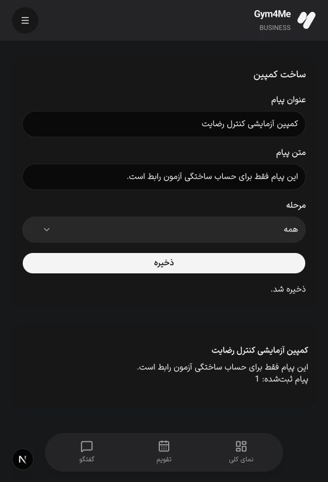
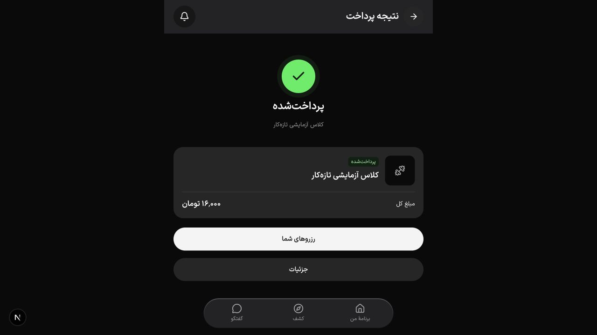
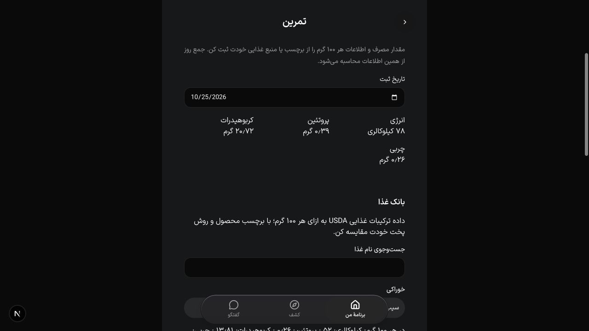

# شواهد تکمیل قابلیت‌های بدون تجهیزات

این گزارش وضعیت کد و آزمون است؛ همهٔ قابلیت‌ها هنوز روی نسخهٔ عمومی مستقر نشده‌اند. تغییرات از workspace دارای کارهای قبلی شروع شدند. قابلیت‌های قبلی مکان، تقویم، پیشنهاد تمرین، تغذیه و سایت حفظ شدند؛ پروژهٔ نامرتبط portfolio وارد این برش نمی‌شود.

## آزمون‌های اجراشده

| بررسی | نتیجه و مرز |
| --- | --- |
| API واحد | ۱۱۲ آزمون در ۲۰ مجموعه موفق |
| PostgreSQL قابلیت‌های جدید | ۱۲ سناریو موفق: دامنهٔ شعبه و مجوز پس از replay، نسخهٔ سرنخ، رضایت تازه و ارسال هم‌زمان، حساب در حال حذف، آخرین ظرفیت تخفیف، اعتبار و برگشت، سهم و ظرفیت زمین، انقضا و استرداد، منبع غذا، نشست و صف اعلان، منع شمارش دوگانه در گزارش پیشرفته، یک‌بار مصرف تخفیف برای گروه و مدارک معتبر هر بازیکن |
| کلاینت و قراردادها | ۲۶۵ آزمون موفق |
| رگرسیون مالی پیشرفته | ۱۷ سناریوی PH5 پس از اصلاح گزارش گروه موفق |
| i18n | هم‌ترازی پیام‌ها و check-copy موفق |
| TypeScript و lint | API، کلاینت API، UI، application و website موفق؛ فایل‌های جدید/درگیر lint شدند |
| ساخت API | `nest build` موفق |
| PDF | فایل فارسی و انگلیسی سه‌صفحه‌ای ساخته و render شد؛ فایل یک‌صفحه‌ای برنامهٔ واقعی fixture نیز از مرورگر دانلود و باز شد؛ [نمونه PDF](completion-2026-10-25/browser-plan.pdf) |
| بکاپ رمزگذاری‌شده | آزمون round-trip و رد دست‌کاری موفق؛ فایل ناتمام به‌عنوان plaintext نهایی منتشر نمی‌شود |
| بازیابی ابری | snapshot واقعی، ۱۳۷ جدول public و ۲۴ رسانه با ۴٬۰۲۰٬۵۷۰ بایت در PostgreSQL جداگانه بازیابی شدند؛ schema دفتر حذف معتبر بود |
| کپی مستقل بکاپ | آرشیو ۴٬۷۳۳٬۶۷۰ بایتی در GitHub draft release خصوصی برای همکاران ذخیره و دوباره دانلود شد؛ SHA256: `4a7b691c4d269f97a41421d91a86979bc8c9ecd7d9ac25e3fdac388ea7396f28` |
| پیکربندی native | `cap update android` و `cap update ios` موفق؛ افزونهٔ push به هر دو پروژه اضافه شد |

کلید بازیابی بکاپ و کلید ارسال FCM در مسیر خصوصی این مک و تنظیم محرمانهٔ سرویس مقصد نگهداری شده‌اند؛ هیچ کلید خصوصی در کد/گزارش قرار ندارد. فایل تنظیم Firebase Android شناسه‌های عمومی کلاینت است. نسخهٔ مستقل بکاپ draft است و release برنامه محسوب نمی‌شود. workflow زمان‌بندی‌شده تا ورود به شاخهٔ پیش‌فرض فعال نیست؛ اجرای منظم و دریافت هشدار هنوز شاهد ندارد. بازیابی همواره باید آفلاین بماند تا دفتر حذفِ به‌روز replay و بررسی شود.

## ساخت و اجرای ابری

[CI کامل b559bf4](https://github.com/hamidYeganeh/Gym4Me2/actions/runs/40145331354) شامل آزمون‌های قبلی، ساخت API و چهار وب، بستهٔ native، Android و iOS simulator موفق شد. [APK مستقل](https://github.com/hamidYeganeh/Gym4Me2/actions/runs/40145160605) نیز ساخته شد. ساخت نهایی پس از اصلاحات گزارش/مدارک باید با head جدید بررسی شود.

[اجرای مستقل بکاپ در GitHub](https://github.com/hamidYeganeh/Gym4Me2/actions/runs/40145359000) موفق شد و artifact رمزگذاری‌شده ساخت. سپس حساب خواندنی جداگانه با SELECT در public و drizzle و بدون مجوز DML/CREATE جای حساب اصلی را در secret بکاپ گرفت. یک اجرای اولیه با این حساب به دلیل CA و مجوز schema مهاجرت شکست خورد؛ هر دو اصلاح شدند و snapshot کامل محلی با همین نقش موفق شد. اجرای دوبارهٔ ابری با نقش محدود باید ثبت شود. TLS ابزار pg_dump گواهی سرور را با verify-full و ریشه‌های معتبر سیستم بررسی می‌کند. [مستندات PostgreSQL](https://www.postgresql.org/docs/18/libpq-ssl.html)

## مرورگر با دادهٔ ساختگی

- ورود شعبه با OTP ساختگی و API جداگانه انجام شد؛ هیچ پیامک یا کمپینی برای شمارهٔ واقعی ارسال نشد.
- ویرایش پیگیری، انتخاب مرحله، ساخت کمپین، پیش‌نمایش یک مخاطب دارای رضایت و ثبت یک پیام داخل اپ تأیید شد.
- سایت عمومی با API جداگانه، جلسه‌های موجود و مبلغ واقعی را نشان داد و برای باشگاه فاقد اطلاعات عمومی کامل، حالت خالی نگه داشت.
- پرداخت همان سفارش با اعتبار ساختگی، رسید پرداخت‌شده ساخت؛ ماندهٔ ۱۰۰٬۰۰۰ تومان به ۸۴٬۰۰۰ تومان رسید و مصرف ۱۶٬۰۰۰ تومان در دفتر دیده شد.
- ثبت ۱۵۰ گرم سیب از USDA، بدون refresh دستی جمع روز را به ۷۸ کیلوکالری، ۰٫۳۹ گرم پروتئین، ۲۰٫۷۲ کربوهیدرات و ۰٫۲۶ چربی رساند.
- فیلتر «فقط سانس تخفیف‌دار» مبلغ ۲۰٬۰۰۰ به ۱۶٬۰۰۰ تومان را از قیمت سرور نشان داد.
- بررسی مرورگر دو ایراد اجرایی را پیدا کرد: runtime اعلان خارج از ApiProvider و گزینه‌های مرحله داخل component غیرقابل استخراج برای picker. هر دو اصلاح شدند. فضای پایین صفحه‌های جدید برای نوار ناوبری نیز اضافه شد.

## منبع و محتوای اصلی

USDA SR Legacy 2018-04، بستهٔ ۶٬۰۷۴٬۵۹۲ بایتی با SHA256 `b80817294b8850530aaedf2e515c02593b1824f763a0ff356e5c2081643e6fd0`. خوراک فاقد یکی از چهار مقدار لازم حذف شد؛ مقدار غایب صفر فرض نشد. مقدار هر ورودی بر پایهٔ ۱۰۰ گرم در سرور محاسبه می‌شود. جست‌وجوی عمدهٔ بانک انگلیسی است و هفت نام فارسی رایج هم ثبت شده‌اند.

چهار حلقهٔ شماتیک squat، march، wall-push-up و glute-bridge و زیرنویس‌های fa/en با اسکریپت خود پروژه ساخته شدند؛ ادعای فیلم مربی یا محتوای بالینی ندارند. PDF متن را با شکل‌دهی مرورگر به تصویر صفحه تبدیل می‌کند؛ قابل جست‌وجو یا انتخاب نیست.

## تغییر baseline طراحی

دو فایل ClubCard از پیش در workspace با نسخهٔ portrait تغییر کرده بودند. تصویر موجود آن و مسیر landscape بررسی شد و فقط هش همان دو فایل به‌روز شد؛ ۵۷ فایل دیگر ثابت ماندند. سپس یک guard داده اضافه شد تا امکانات خالی، آیکن امکانات تأییدنشده نشان ندهد؛ هش ClubCard.tsx برای همین تغییر محدود دوباره ثبت شد. این یک پیشروی baseline مستند است، نه ادعای نبود هرگونه تغییر.

## مواردی که آزمون حاضر تأیید نمی‌کند

- ارسال/نمایش اعلان روی گوشی، APNs عملیاتی، امضای فروشگاه و رفتار لینک OS.
- پذیرندهٔ بانکی production، انتقال بین حساب‌ها یا تسویهٔ حقیقی شبکه.
- پایلوت، رضایت کاربران واقعی، آموزش کارکنان و KPI مبتنی بر استفادهٔ واقعی.
- تضمین مستقل و هم‌زمان ثبت حذف حساب؛ schedule بکاپ چنین تضمینی نیست.
- T116 ویدیوی خصوصی و پردازش فایل که قبلاً موکول شده بود.

کمد، گیت و تجهیزات مطابق درخواست در دامنه نیستند. build کامل و CI نسخهٔ نهایی باید جداگانه با شناسهٔ run ثبت شوند.
