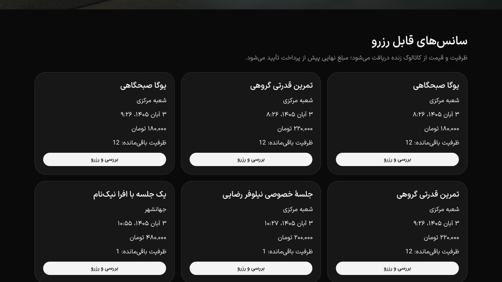
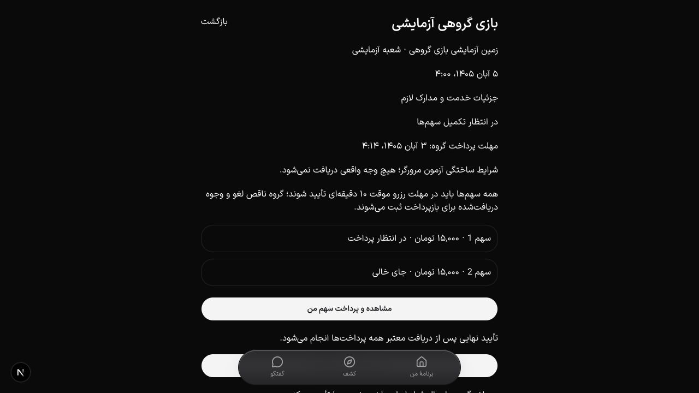

# شواهد تکمیل قابلیت‌های بدون تجهیزات

قابلیت‌ها در نسخهٔ دمو مستقر شدند. این گزارش شواهد کد، آزمون و استقرار دمو را ثبت می‌کند؛ پذیرش عرضهٔ عملیاتی در انتهای گزارش جدا آمده است. تغییرات از workspace دارای کارهای قبلی شروع شدند. قابلیت‌های قبلی مکان، تقویم، پیشنهاد تمرین، تغذیه و سایت حفظ شدند؛ پروژهٔ نامرتبط portfolio وارد این برش نمی‌شود.

## آزمون‌های اجراشده

| بررسی | نتیجه و مرز |
| --- | --- |
| API واحد | ۱۱۲ آزمون در ۲۰ مجموعه موفق |
| PostgreSQL قابلیت‌های جدید | ۱۳ سناریو موفق: دامنهٔ شعبه و مجوز پس از replay، نسخهٔ سرنخ، رضایت تازه و ارسال هم‌زمان، حساب در حال حذف، آخرین ظرفیت تخفیف، اعتبار و برگشت، سهم و ظرفیت زمین، انقضا و استرداد، منبع غذا، نشست و صف اعلان، منع شمارش دوگانه در گزارش پیشرفته، یک‌بار مصرف تخفیف برای گروه و مدارک معتبر هر بازیکن و عدم گرسنه‌ماندن گروه پرداخت‌شده پشت ۲۵ رزرو پرداخت‌نشده |
| کلاینت و قراردادها | ۲۶۵ آزمون موفق |
| رگرسیون مالی پیشرفته | ۱۷ سناریوی PH5 پس از اصلاح گزارش گروه موفق |
| i18n | هم‌ترازی پیام‌ها و check-copy موفق |
| TypeScript و lint | API، کلاینت API، UI، application و website موفق؛ فایل‌های جدید/درگیر lint شدند |
| ساخت API | `nest build` موفق |
| PDF | فایل فارسی و انگلیسی سه‌صفحه‌ای ساخته و render شد؛ فایل یک‌صفحه‌ای برنامهٔ واقعی fixture نیز از مرورگر دانلود و باز شد؛ [نمونه PDF](completion-2026-10-25/browser-plan.pdf) |
| بکاپ رمزگذاری‌شده | آزمون round-trip و رد دست‌کاری موفق؛ فایل ناتمام به‌عنوان plaintext نهایی منتشر نمی‌شود |
| بازیابی ابری | snapshot واقعی، ۱۳۷ جدول public و ۲۴ رسانه با ۴٬۰۲۰٬۵۷۰ بایت در PostgreSQL جداگانه بازیابی شدند؛ schema دفتر حذف معتبر بود |
| تمرین مهاجرت روی بازیابی | ۵۱ مهاجرت اعمال شد؛ ۱۴ کاربر، ۷ سفارش، ۲۴ رسانه و ۴٬۰۲۰٬۵۷۰ بایت رسانه بدون تغییر حفظ شدند؛ دیتابیس بازیابی به هیچ سرویس عمومی وصل نشد |
| کپی مستقل بکاپ | آرشیو ۴٬۷۳۳٬۶۷۰ بایتی در GitHub draft release خصوصی برای همکاران ذخیره و دوباره دانلود شد؛ SHA256: `4a7b691c4d269f97a41421d91a86979bc8c9ecd7d9ac25e3fdac388ea7396f28` |
| پیکربندی native | `cap update android` و `cap update ios` موفق؛ افزونهٔ push به هر دو پروژه اضافه شد |

کلید بازیابی بکاپ و کلید ارسال FCM در مسیر خصوصی این مک و تنظیم محرمانهٔ سرویس مقصد نگهداری شده‌اند؛ هیچ کلید خصوصی در کد/گزارش قرار ندارد. فایل تنظیم Firebase Android شناسه‌های عمومی کلاینت است. نسخهٔ مستقل اولیهٔ بکاپ draft است و release برنامه محسوب نمی‌شود. workflow پس از merge در شاخهٔ اصلی قرار گرفت و اجرای دستی آن از main موفق شد؛ دریافت هشدار توسط مسئول واقعی هنوز شاهد ندارد. بازیابی همواره باید آفلاین بماند تا دفتر حذفِ به‌روز replay و بررسی شود. [راهنمای عملیات و بازیابی](../operations/cloud-backup-demo.fa.md)

## ساخت و اجرای ابری

[CI نهایی 28f4b69](https://github.com/hamidYeganeh/Gym4Me2/actions/runs/40148111958) شامل آزمون‌های قبلی و جدید، ساخت API و چهار وب، بستهٔ native، Android و iOS simulator موفق شد. یک assertion اضافی در تست جدید توسط lint پیدا و حذف شد؛ سپس کل pipeline دوباره موفق اجرا شد. APK نهایی ۲۷٬۰۴۳٬۶۱۱ بایت است؛ SHA256 آن `90d61551831c533878862d72d022de2525d2e8f6720895dee91a4984b4b60db0` و artifact آن `12582485553` است. نسخهٔ محلی در `.artifacts/completion/native/gym4me-debug.apk` نگهداری می‌شود؛ خروجی Debug جای امضای فروشگاه نیست. ۲۱۹ فایل JS/JSON/HTML داخل assets نیز بررسی شدند: مقصد API و سایت صحیح بود و نشانگر کلیدهای خصوصی سرور یا دو متغیر محرمانهٔ FCM/بازیابی در آن‌ها یافت نشد؛ این بررسی جای ممیزی امنیتی کامل نیست.

[PR شمارهٔ ۲](https://github.com/hamidYeganeh/Gym4Me2/pull/2) با commit `fc3e06a2829efa8d1f96eb9f2902f4088fd18b89` وارد main شد. [CI پس از merge](https://github.com/hamidYeganeh/Gym4Me2/actions/runs/40148749136) نیز با هر دو job موفق شد؛ درخت کد merge با commit آزموده‌شده برابر است.

[اجرای مستقل بکاپ در GitHub](https://github.com/hamidYeganeh/Gym4Me2/actions/runs/40145359000) موفق شد و artifact رمزگذاری‌شده ساخت. سپس حساب خواندنی جداگانه با SELECT در public و drizzle و بدون مجوز DML/CREATE جای حساب اصلی را در secret بکاپ گرفت. یک اجرای اولیه با این حساب به دلیل CA و مجوز schema مهاجرت شکست خورد؛ هر دو اصلاح شدند و snapshot کامل محلی با همین نقش موفق شد. [اجرای دوبارهٔ ابری با نقش محدود](https://github.com/hamidYeganeh/Gym4Me2/actions/runs/40147090005) موفق شد؛ CA سیستم میزبان به container خواندنی mount می‌شود. TLS ابزار pg_dump گواهی سرور را با verify-full و ریشه‌های معتبر سیستم بررسی می‌کند. [مستندات PostgreSQL](https://www.postgresql.org/docs/18/libpq-ssl.html)

پس از تمرین روی بازیابی، ۵۱ مهاجرت روی نصب ابری موجود اجرا شد؛ شمار ۱۴ کاربر، ۸ سازمان، ۴۹ خدمت، ۷ سفارش و ۲۴ رسانه با ۴٬۰۲۰٬۵۷۰ بایت حفظ شد. reset یا seed اجرا نشد. [بکاپ جدید از main](https://github.com/hamidYeganeh/Gym4Me2/actions/runs/40148754241) موفق شد؛ artifact `12581965750` با digest آرشیو `5902f17218cf24de717ddf65eea91de5dc226e3ead991ecc3c988de97eb936e3` دریافت شد. رمزگشایی احرازشده، ۵۱ رکورد migration و همان ۲۴ رسانه را در snapshot زمان `2026-10-25T00:58:55.424Z` تأیید کرد. فایل‌های خامِ بازیابی و cluster موقت پس از تمرین پاک شدند.

## نسخه‌های منتشرشدهٔ دمو

[شناسهٔ نسخه‌ها، مسیر بازگشت و بررسی انتشار](../operations/demo-release-2026-10-25.fa.md)

| مقصد | deployment |
| --- | --- |
| [API](https://gym4me-demo-api.vercel.app/api/v1/system/health/ready) | `dpl_CRLVj9kuE7PmHyHBR43DUz5SrgE9` |
| [اپ](https://gym4me-demo-application.vercel.app/explore) | `dpl_BAciB6tgx5JfL7p6teXYbeVU4GbH` |
| [پنل مجموعه](https://gym4me-demo-business.vercel.app/crm) | `dpl_Bc7oRYerG4EmrRPbPWMBQeNjew7b` |
| [پنل مدیریت](https://gym4me-demo-admin.vercel.app/) | `dpl_BLAiKjgfbUQ6mhvtrUz48jiy1nJc` |
| [سایت عمومی](https://gym4me-demo-website.vercel.app/) | `dpl_Bcc69J1xqu3sWFsU4yd62z2VhJPL` |

API و سه پنل از commit merge ساخته شدند؛ سایت از 28f4b69 با همان درخت کد ساخته شد. مقصد جدید سایت به مخزن همین پروژه وصل است؛ مخزن قدیمیِ پروژهٔ `gym4me.website` جایگزین نشد. دو تنظیم آزمایشی در پروژهٔ قدیمی به نام‌های `GYM4ME_UNUSED_COMPLETION_API_URL` و `GYM4ME_UNUSED_COMPLETION_APP_ORIGIN` با مقدار خالی خنثی شدند؛ connector امکان حذف env ندارد.

بررسی HTTP پس از انتشار برای ۱۳ مسیر موفق شد: سلامت دیتابیس/رسانه، پیشنهادها، بازی‌های عمومی، رد اعتبار بدون نشست با origin صحیح، اپ و proxy آن، CRM و شبکه، مدیریت و سایت و کاتالوگ آن. هر ۱۲ فایل MP4/VTT نیز پاسخ ۲۰۰ دادند. جست‌وجوی «یوگا» در اپ و کاتالوگ سانس‌های سایت در مرورگر نسخهٔ منتشرشده بررسی شد. تغییر سایت به انگلیسی و تم روشن و بازگشت به فارسی/تیره نیز انجام شد؛ نام‌ها و توضیح‌های واردشده توسط باشگاه به‌صورت خودکار ترجمه نمی‌شوند. CRM ناشناس، ورود با `returnTo=/crm` را نشان داد؛ هیچ پیامک یا خرید واقعی برای این smoke اجرا نشد. پایش API و کاتالوگ از 2026-10-25T01:01:47.048Z تا 2026-10-25T01:17:00.746Z به مدت 15.23 دقیقه، همراه نمونهٔ نهایی همهٔ مقصدها، 21 نمونه و 173 درخواست مطابق انتظار داشت. این پایش، SLO بلندمدت یا تحویل اعلان روی دستگاه را اثبات نمی‌کند. [رسید قابل بررسی](completion-2026-10-25/release-checks.json)

## مرورگر با دادهٔ ساختگی

- ورود شعبه با OTP ساختگی و API جداگانه انجام شد؛ هیچ پیامک یا کمپینی برای شمارهٔ واقعی ارسال نشد.
- ویرایش پیگیری، انتخاب مرحله، ساخت کمپین، پیش‌نمایش یک مخاطب دارای رضایت و ثبت یک پیام داخل اپ تأیید شد.
- سایت عمومی با API جداگانه، جلسه‌های موجود و مبلغ واقعی را نشان داد و برای باشگاه فاقد اطلاعات عمومی کامل، حالت خالی نگه داشت.
- ساخت بازی دو نفره، محل و زمان زمین، دو سهم ۱۵ هزار تومانی و مسیر رسید سهم همان کاربر در مرورگر تأیید شد.
- پرداخت همان سفارش با اعتبار ساختگی، رسید پرداخت‌شده ساخت؛ ماندهٔ ۱۰۰٬۰۰۰ تومان به ۸۴٬۰۰۰ تومان رسید و مصرف ۱۶٬۰۰۰ تومان در دفتر دیده شد.
- ثبت ۱۵۰ گرم سیب از USDA، بدون refresh دستی جمع روز را به ۷۸ کیلوکالری، ۰٫۳۹ گرم پروتئین، ۲۰٫۷۲ کربوهیدرات و ۰٫۲۶ چربی رساند.
- فیلتر «فقط سانس تخفیف‌دار» مبلغ ۲۰٬۰۰۰ به ۱۶٬۰۰۰ تومان را از قیمت سرور نشان داد.
- بررسی مرورگر دو ایراد اجرایی را پیدا کرد: runtime اعلان خارج از ApiProvider و گزینه‌های مرحله داخل component غیرقابل استخراج برای picker. هر دو اصلاح شدند. فضای پایین صفحه‌های جدید برای نوار ناوبری نیز اضافه شد.

## منبع و محتوای اصلی

USDA SR Legacy 2018-04، بستهٔ ۶٬۰۷۴٬۵۹۲ بایتی با SHA256 `b80817294b8850530aaedf2e515c02593b1824f763a0ff356e5c2081643e6fd0`. خوراک فاقد یکی از چهار مقدار لازم حذف شد؛ مقدار غایب صفر فرض نشد. مقدار هر ورودی بر پایهٔ ۱۰۰ گرم در سرور محاسبه می‌شود. جست‌وجوی عمدهٔ بانک انگلیسی است و هفت نام فارسی رایج هم ثبت شده‌اند.

چهار حلقهٔ شماتیک squat، march، wall-push-up و glute-bridge و زیرنویس‌های fa/en با اسکریپت خود پروژه ساخته شدند؛ ادعای فیلم مربی یا محتوای بالینی ندارند. PDF متن را با شکل‌دهی مرورگر به تصویر صفحه تبدیل می‌کند؛ قابل جست‌وجو یا انتخاب نیست.

## تغییر baseline طراحی

دو فایل ClubCard از پیش در workspace با نسخهٔ portrait تغییر کرده بودند. تصویر موجود آن و مسیر landscape بررسی شد و فقط هش همان دو فایل به‌روز شد؛ ۵۷ فایل دیگر ثابت ماندند. سپس یک guard داده اضافه شد تا امکانات خالی، آیکن امکانات تأییدنشده نشان ندهد؛ هش ClubCard.tsx برای همین تغییر محدود دوباره ثبت شد. این یک پیشروی baseline مستند است، نه ادعای نبود هرگونه تغییر.

## مواردی که آزمون حاضر تأیید نمی‌کند

- ارسال/نمایش اعلان روی گوشی، APNs عملیاتی، امضای فروشگاه و رفتار لینک OS.
- پذیرندهٔ بانکی production، انتقال بین حساب‌ها یا تسویهٔ حقیقی شبکه.
- پایلوت، رضایت کاربران واقعی، آموزش کارکنان و KPI مبتنی بر استفادهٔ واقعی.
- تضمین مستقل و هم‌زمان ثبت حذف حساب؛ schedule بکاپ چنین تضمینی نیست.
- T116 ویدیوی خصوصی و پردازش فایل که قبلاً موکول شده بود.

کمد، گیت و تجهیزات مطابق درخواست در دامنه نیستند. استقرار حاضر دمو است؛ موارد پذیرش عملیاتی بالا با موفقیت build یا smoke تأیید نمی‌شوند.
