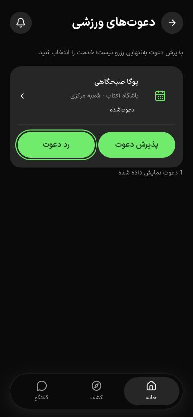

# بازگشت مشترک وب و native — ۱۷ اکتبر ۲۰۲۶

نقص مشاهده‌شدهٔ «دعوت ← خدمت ← Back به فهرست خدمات» در وب رفع و دوباره در مرورگر بررسی شد. این شاهد پذیرش کامل حرکت، native یا PH0 تا PH2 نیست.

تکمیل برش تقویم: پس از ورود OTP و بازگشت به جزئیات، fallback به parent predecessor کهنه را نگه می‌داشت و Back دوم به جزئیات برمی‌گشت. اکنون فقط fallback adapter، metadata والد را تازه می‌کند؛ replace معمولِ فیلتر والد معتبر را حفظ می‌کند. رگرسیون تازه و مجموع **۳۱ آزمون application** پاس‌اند. در build تازهٔ QA، فلو ورود از تقویم و دو Back با فاصلهٔ عادی به `/calendars` و سپس `/` رسیدند. [شاهد تقویم و محدودهٔ پذیرش](sports-calendars-2026-10-17.md).

بازآزمایی ورود سرد در برش بعدی همان روز یک رگرسیون hydration در isolation آشکار کرد: ref فرزند Suspense ممکن است دیرتر آماده شود. انتظار برای ref معتبر و refresh هنگام اتصال آن اضافه شد و ورود سرد/OTP، ورود دو حساب و بارگذاری مستقیم گفتگو دوباره موفق بودند. [شاهد تکمیلی و محدودیت‌ها](class-chat-2026-10-17.md#رگرسیون-hydration-و-اصلاح).

## تغییر

`apps/application/lib/app-navigation.ts` یک adapter مستقل با پورت‌های History، ساعت، رویداد و Sheet دارد. فقط metadata نام‌گذاری‌شدهٔ خود را کنار state مبهم Next.js می‌افزاید؛ ساختار داخلی Next خوانده یا بازسازی نمی‌شود. شناسهٔ session همان تب و predecessor ثبت‌شده لازم‌اند؛ طول history به‌تنهایی اعتبار بازگشت نیست. replace، فیلتر و reload مبدأ معتبر را حفظ می‌کنند. ورود مستقیم یا مبدأ ناشناخته به parent همان بخش می‌رود. مسیر ورود و واسطهٔ پرداخت مقصد Back داخل اپ نمی‌شوند. parent خارجی یا protocol-relative پذیرفته نیست.

هدر `LumaPage` و listener واحد Back در Capacitor از همین adapter استفاده می‌کنند. href اصلی لینک، کلیک با modifier و ظاهر هدر حفظ شده‌اند. Sheet پیش از صفحه بسته می‌شود؛ قفل مشترک از دو پرش با لمس سریع جلوگیری می‌کند و تا commit مقصد یا بازیابی تلاش بی‌اثر نگه داشته می‌شود. مسیر منطقی SSGOI، رنگ، CSS و اجزای محافظت‌شده تغییر نکرده‌اند.

صفحهٔ خروجی در SSGOI موقتاً دوباره به DOM اضافه می‌شود. `route-accessibility.ts` در محدودهٔ routeId اپ ورزشکار، فقط گرهٔ فعالِ متصل به React را تعاملی نگه می‌دارد و نسخه‌های خروجی را `inert` و `aria-hidden` می‌کند. رنگ، زمان و جابه‌جایی انیمیشن تغییر نکرده‌اند. حالت اولیهٔ attributes در فعال‌شدن دوباره/خروج از محدوده/cleanup بازگردانده می‌شود؛ provider و boundary تو‌در‌تو به مالک خود واگذار می‌شوند. تشخیص صرفاً با id مسیر کافی نبود: در بازگشت سریع، دو نسخه از همان دعوت هم‌زمان وجود داشتند؛ نسخهٔ نهایی این حالت را با هویت گره پوشش می‌دهد.

## بررسی‌های اجراشده

| سناریو | شاهد و نتیجه |
| --- | --- |
| دعوت به خدمت و Back هدر | URL و عنوان نهایی دوباره `/invitations/sports`؛ موفق |
| reload روی خدمت و سپس Back | مبدأ دعوت حفظ شد؛ موفق |
| Back و Forward مرورگر | دعوت و همان خدمت با id صحیح؛ موفق |
| ورود مستقیم خدمت در تب تازه | parent `/services` و عنوان «کلاس‌ها و سانس‌ها»؛ موفق |
| خانه به رزرو و Sheet لغو | Back مرورگر فقط Sheet را بست؛ URL رزرو ثابت و focus روی «لغو رزرو»؛ موفق |
| Escape و سپس دوبار کلیک Back هدر رزرو | Escape فقط Sheet را بست و focus برگشت؛ Back به خانهٔ مبدأ رفت و از آن عبور نکرد؛ موفق |
| قاب ۳۹۰×۸۴۴ فارسی/تیره | بازگشت از خدمت به دعوت، عنوان/URL، نبود سرریز و تصویر نهایی ثبت شدند |
| خروج هم‌زمان و برگشت سریع به همان مسیر | DOM سه boundary داشت؛ دو نسخهٔ خروجی inert/hidden و فقط یک نسخهٔ دعوت فعال بود؛ Tab به «رد دعوت» رفت و پس از پایان حرکت فقط همان boundary باقی ماند |

API ساختگیِ ارسال SMS و PostgreSQL/S3 واقعی در دیتابیس جداگانهٔ `gym4me_navigation_ui_test` استفاده شدند؛ حساب‌ها و رزرو مصنوعی‌اند. تأیید لغو انجام نشد و پیامک زنده یا پرداختی ارسال نشد.

۳۰ آزمون application پاس شدند: هفت آزمون تازهٔ adapter و آزمون‌های مسیر، deep link، Secure Storage، fetch و خروجی حساب. موارد تازه شامل cold history نامرتبط، reload/replace، query و trailing slash با `capacitor://localhost`، Sheet-first، تأخیر commit، لمس سریع، parent ناامن، state غیر object و cleanup بدون بازنویسی wrapper جدید چارچوب هستند. این آزمون‌ها جای دستگاه نیستند.

TypeScript و ESLint فایل‌های مرتبط، build وب QA با Next.js 16.4.0 و ۶۴ مسیر، کنترل ۵۹ فایل محافظت‌شده و `git diff --check` موفق بودند. سازگاری ترکیب wrapperها با Next علاوه بر آزمون پورت، در فلوهای واقعی مرورگر بالا مشاهده شد. suite تجارت دوباره اجرا نشد؛ بک‌اند این برش تغییر ندارد.

بررسی محدود براساس مهارت `design:accessibility-review` روی WCAG 2.1، ترتیب focus و semantics متمرکز بود. یافتهٔ هم‌پوشانی (ارتباط با ۲.۴.۳ و ۱.۳.۱) در وب اصلاح و با DOM، درخت دسترس‌پذیری و Tab بازآزمایی شد. [ثبت DOM رفت، برگشت و حالت نهایی](navigation-transition-dom-2026-10-17.json) شامل حالت واقعی دو نسخهٔ هم‌نام است. Back و Sheet پس از آخرین build دوباره اجرا شدند. VoiceOver/NVDA، کنتراست همهٔ صفحات و بزرگ‌نمایی اجرا نشدند؛ این بررسی، گواهی انطباق کامل نیست.

## محدودیت‌ها و ادامه

- صفحهٔ خروجی در مسیرهای آزموده‌شدهٔ ورزشکار اصلاح شد؛ پذیرش همهٔ transitionها و صفحه‌خوان واقعی باز است. `routeId` صریحِ ورزشکار دامنهٔ این اصلاح است؛ رفتار بیزینس/ادمین بدون routeId به‌عنوان پذیرش حرکت آن اپ‌ها ادعا نمی‌شود.
- پذیرش Android/iOS، دکمهٔ سخت‌افزاری، صفحه‌کلید native، reduced-motion واقعی، اینترنت ضعیف و همهٔ مسیرهای پرداخت هنوز اجرا نشده‌اند. شبیه‌سازی protocol/query و تأخیر در unit test، شاهد دستگاه نیست.
- تغییر raw hash بدون History API، بازگشت از صفحات بیرونی و همهٔ ترکیب‌های فیلتر در مرورگر این برش پوشش ندارند. عمداً مسیر مخصوص دعوت یا پارامتر returnTo جدیدی اضافه نشده است.
- هشت پوشهٔ تولیدی و غیرفعال همین مخزن (شش cache اپ‌ها و دو staging قدیمی native) پس از بررسی process/open-file حذف شدند. فضای آزاد پس از آن ۴٫۷ GiB بود؛ پس از build QA حدود ۳٫۷ GiB است. حداقل ۵ GiB runner رسمی native حفظ شد و export تازه اجرا نشد. هیچ source، خروجی فعلی native، dependency، volume یا مخزن بکاپ حذف نشد.

پاک‌سازی: وب و API اختصاصی این برش با shutdown عادی متوقف شدند. شمار کاربران، سازمان‌ها، خدمات، دعوت‌ها و سفارش‌های fixture هر پنج صفر بود و فقط دیتابیس موقت `gym4me_navigation_ui_test` حذف شد. تب‌های ۲۲ و ۲۳ بسته و viewport بازنشانی شدند؛ تب کاربر، دیتابیس‌های مشترک و volumeهای staging حفظ شدند.
