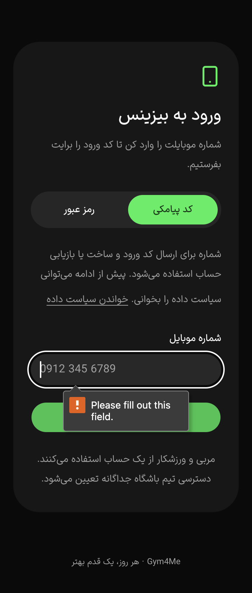

# PH0 — هدف لمس و عنوان ورود در سه اپ

این برش وب، بخشی از P0-03/P0-10 است؛ پذیرش کامل ورود، دسترس‌پذیری یا PH0 نیست. دادهٔ واقعی، شماره، رمز یا کد وارد نشد؛ متن شماره در تصاویر placeholder است. fixture محلی فقط‌خواندنی بود و نوشتن را رد می‌کرد.

## اصلاح

در [رسید قبلی فوکوس](ph0-focus-observations-2026-10-18.json)، ورودی تلفن و CTA ورود بیزینس/ادمین در عرض۳۶۰ ارتفاع۳۶px داشتند. `auth-controls.css` کف۴۴px را فقط در `main[data-gym-auth]` اعمال می‌کند. این کف در layer پایه است؛ اندازهٔ صریح بزرگ‌تر می‌تواند بر آن مقدم شود. فونت input حداقل۱۶px است، از جمله breakpoint دسکتاپ که قبلاً utility۱۴px داشت. گروه روش ورود قابلیت چندخطی‌شدن دارد. Button/Input محافظت‌شده و مصرف‌کنندگان کارت تغییر نکردند.

عنوان فرم دو پنل اکنون `h1` است؛ عنوان بخش معرفی دسکتاپ `h2` شد. در نمایش موبایل که معرفی پنهان است، عنوان اصلی همچنان در درخت heading وجود دارد. لینک برند حداقل۴۴px ارتفاع دارد و هدر می‌تواند چندخطی شود. application از همان AuthScreen مشترک و محدودهٔ کنترل‌ها استفاده می‌کند.

اصلاح یک فرض در QA: کلاس‌های `min-h-14` و `.mobile-auth` به‌تنهایی ثابت نمی‌کنند ارتفاع واقعی۵۶px است. [انتساب قوانین در مرورگر](ph0-auth-cascade-2026-10-18.json) نشان داد قانون **قدیمی و بدون تغییر** `.application-frame [data-slot=…]` حداقل را۴۴px می‌کند. در application، اندازهٔ واقعی ورودی و CTA۴۴px و Back۴۸px بود؛ حفظ۵۶px ادعا نمی‌شود. هدف۴۴px، معیار پروژه است و این گزارش آن را معادل پذیرش جامع AA نمی‌نامد.

## ماتریس مشاهده‌شده

[۹۶ رسید](ph0-auth-observations-2026-10-18.json): سه اپ × فارسی/انگلیسی × روشن/تیره × عرض‌های۳۶۰/۳۹۰/۴۳۰/۱۰۲۴ × روش SMS/password، در ارتفاع۸۴۴CSSpx و DPR۲. [کنترل ماشینی این مجموعه](ph0-auth-checks-2026-10-18.json) فقدان/تکرار حالت و این معیارها را بررسی کرد:

- تمام کنترل‌های ثبت‌شده حداقل۴۴×۴۴CSSpx؛ تمام ورودی‌ها حداقل۴۴px ارتفاع و فونت۱۶px.
- label متصل به input، وجود یک h1 رندرشده، جهت متن مطابق زبان، نبود سرریز افقی document.
- وجود/نبود فیلد password مطابق روش انتخاب‌شده و فوکوس روی تلفن.
- در۳۲ حالت application، دکمه برای فیلد خالی غیرفعال بود و کلیک نشد؛ فوکوس با کیبورد گرفته شد. در۶۴ حالت دو پنل، کلیک submit خالی توسط required مرورگر متوقف شد و تلفن فوکوس گرفت. این‌ها ورود موفق نیستند.

برای تنظیم آزمایش، cookie غیرامنیتی زبان و media رنگ سیستم در origin محلی۷۳۹۲ تغییر داده شدند. cookie اولیه وجود نداشت و در پایان حذف/نبودش تأیید شد؛ media پاک شد. این تنظیمات fixture آزمون‌اند و پذیرش فلو انتخاب زبان/تم از UI نیستند. DPR۲ نیز browser zoom۲۰۰٪ نیست.

شش PNG viewport با تطبیق backing/visual viewport و دو frame پایانی دقیقاً یکسان ثبت و بازبینی شدند. هدف تلفن با حاشیه داخل viewport بود؛ محتوای بالای صفحه ممکن است پس از focus/scroll خارج viewport باشد. این‌ها عکس تمام صفحه نیستند. ماتریس DOM مستقل از تصاویر، وجود h1 را ثبت می‌کند.

محدودیت آشکار: tooltip بومی required حتی روی رابط فارسی، در این مرورگر **انگلیسی** بود. کنترل اندازه/heading/فوکوس پاس شد؛ محلی‌سازی کامل خطای فرم هنوز پذیرفته نیست. پیام‌های inline محلی و اتصال دسترس‌پذیر آن‌ها باید در ادامه بررسی/تکمیل شوند. وضعیت OTP صادرشده، ارسال مجدد، رمز/نشست واقعی، خطای API، حفظ قصد کاربر، صفحه‌خوان واقعی، zoom و صفحه‌کلید دستگاه نیز در این مجموعه آزموده نشدند.

## checks و هزینه

هر سه build نهایی ترتیبی با heap۶۴۰MiB و یک worker، compile/TypeScript/render را گذراندند: application=`WXAhT6UF51Z_mgBQbcKHB`، business=`_KGLcIXwCOfouS1zgRwC_`، admin=`4eQuFupP0R6mUwRJHtmJ3`. لاگ و source hash در `.artifacts/ph0-auth-2026-10-18/` ثبت شده‌اند. lint دو فایل React، syntax ابزارهای QA، `git diff --check` و محافظ۵۹ فایل پاس‌اند. `node scripts/ph0-check-auth.mjs`،۹۶/۹۶ حالت را با صفر شکست در محدودهٔ بالا گزارش کرد.۱۰۳ آزمون منطقی قبلی برای این تغییر markup/CSS تکرار نشدند؛ تست سرویس و پذیرش دستگاه محسوب نمی‌شوند.

تمام کد محصول پیش از preview نوشته شد. هنگام build هیچ preview/fixture فعال نبود؛ هنگام QA فقط یک preview با heap۱۹۲ و یک fixture با heap۹۶ فعال بود. در پایان هر دو متوقف، تب‌های خودمان بسته و metrics/viewport/media پاک شدند. DB، Docker، native و سرویس خارجی اجرا نشدند. [ماتریس کامل PH0](ph0-acceptance.md) همچنان باز است.

پیگیری همان روز: [خطای inline محلی و فوکوس API](ph0-auth-errors-2026-10-18.md) محدودیت tooltip انگلیسی دو پنل را رفع و۲۴۰ حالت نامعتبر/guard و۱۲ probe۴۰۵ را ثبت کرد. پذیرش واقعی ورود و کامل PH0 همچنان باز است.
