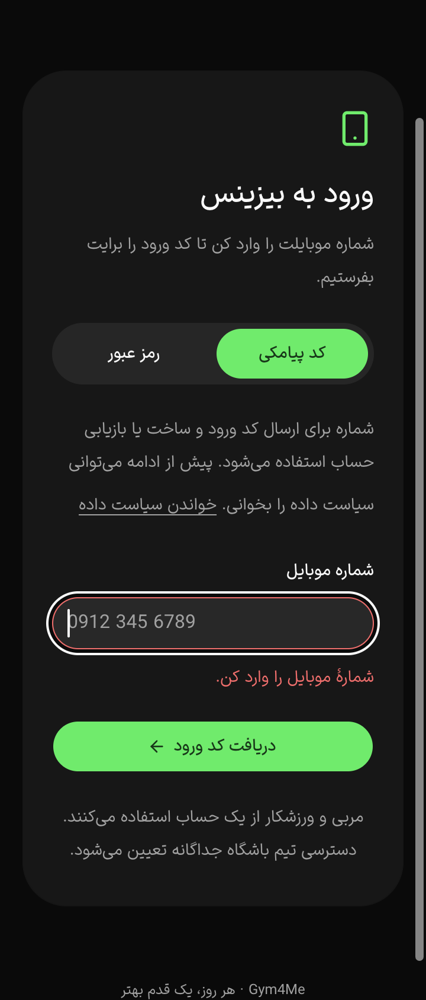
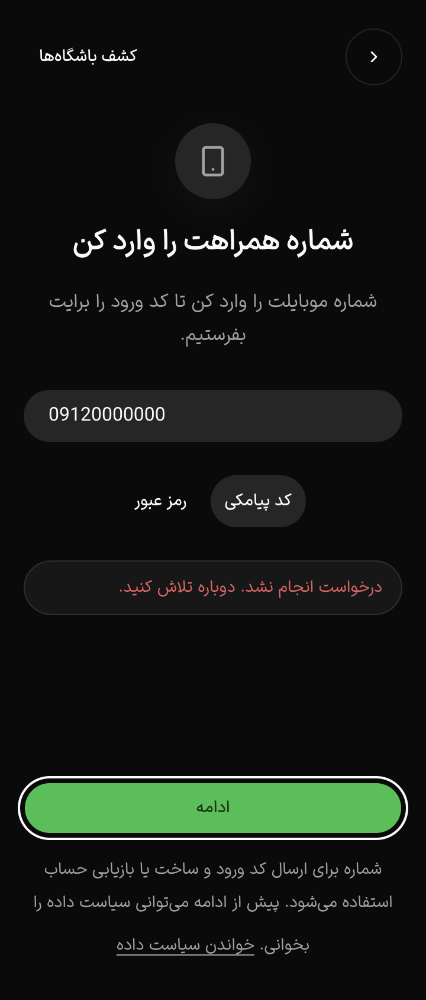

# PH0 — خطای محلی ورود و فوکوس پس از شکست درخواست

این برش فقط وب است؛ پذیرش کامل PH0 یا احراز هویت نیست. پیامک، حساب یا نشست واقعی ساخته نشد. همهٔ فرمان‌های آزمایشی فقط به fixture روی loopback رفتند و۴۰۵ گرفتند؛ شماره/رمز نمونه بودند. دادهٔ JSON شامل مقدار/طول ورودی یا بدنهٔ درخواست نیست؛ تصویر می‌تواند شمارهٔ مصنوعی را نشان دهد. پذیرش حفظ محتوای دقیق پیش‌نویس از این گزارش نتیجه نمی‌شود.

## اصلاح

پیام required انگلیسی مرورگر در [برش قبلی](ph0-auth-2026-10-18.md) با `noValidate` و اعتبارسنجی محلی جایگزین شد؛ required برای semantics باقی ماند. `LoginField` مشترک در دو layout ورود، label، input و خطای فارسی/انگلیسی را با ID یکتای هر mount به هم متصل می‌کند. `aria-invalid`، `aria-describedby` و alert محلی فقط هنگام خطا اضافه می‌شوند. اصلاح شماره، خطای همان فیلد را پاک می‌کند و خطای رمز خالی باقی می‌ماند. تغییر روش ورود، خطاهای مرحلهٔ قبلی را پاک می‌کند.

قالب شماره، ارقام فارسی/عربی، مرز۱۲۸ نویسهٔ رمز و کد۵رقمی با قرارداد فعلی سرور هماهنگ شدند. فاصله در رمز موجود حذف نمی‌شود. یک ref ارسال هم‌زمان را تا settle قفل می‌کند و فیلدهای در حال ارسال غیرفعال‌اند. این کنترل کلاینت جای اعتبارسنجی یا محدودیت درخواست سرور نیست؛ سرور تغییر نکرد.

دو نقص فوکوس در پاسخ۴۰۵ محلی پیدا و رفع شدند:

- [قبل از اصلاح](ph0-auth-denied-before-focus-2026-10-18.json)، پس از غیرفعال‌شدن موقت submit، فوکوس روی BODY می‌ماند. اکنون اگر کاربر کنترل دیگری انتخاب نکرده و مبدا هنوز در صفحهٔ فعال است، فوکوس برمی‌گردد.
- [حالت میانی](ph0-auth-selected-focus-before-2026-10-18.json)، لینک انتخابی کاربر حفظ می‌شد ولی نمایش خطا آن را زیر viewport می‌برد. اکنون همان کنترلِ دارای فوکوس کیبورد، فقط در محدودهٔ همان main، با scroll فوری nearest و حاشیه۸px دیده می‌ماند؛ فوکوس به مبدا دزدیده نمی‌شود. خروج از صفحه/پس‌زمینهٔ inert اجازهٔ این بازگردانی را نمی‌دهد؛ فلو خروج واقعی در این ماتریس اجرا نشده است.

## نگاشت صفحه، API و شاهد

| صفحه/حالت                                      | API                        | شاهد و حد                                                                                                                                                                                                       |
| ---------------------------------------------- | -------------------------- | --------------------------------------------------------------------------------------------------------------------------------------------------------------------------------------------------------------- |
| `/login` در سه اپ؛ خالی/شماره نامعتبر/رمز خالی | هیچ فرمانی نباید ارسال شود | [۲۴۰ حالت](ph0-auth-errors-observations-2026-10-18.json)، [چک‌ها](ph0-auth-errors-checks-2026-10-18.json):صفر POST در۶ رسید کامل شبکه، متن محلی و اتصال label/error، فوکوس، هدف۴۴px، فونت۱۶px و بدون سرریز افقی |
| رمز با دادهٔ مصنوعی، پاسخ۴۰۵                   | `auth/password/login`      | [رسید نهایی](ph0-auth-denied-2026-10-18.json):دوبارکلیک، Enter و تغییر فوکوس حین درخواست؛ نتیجهٔ واقعی ورود آزموده نشد                                                                                          |
| درخواست SMS با شمارهٔ مصنوعی، پاسخ۴۰۵          | `auth/otp/request`         | دوبارکلیک در هر سه اپ یک POST ساخت؛ fixture هر فرمان را رد کرد، هیچ SMS صادر نشد                                                                                                                                |
| کد، مرحلهٔ challenge و verify                  | `auth/otp/verify`          | قرارداد کد فقط آزمون خالص دارد؛ challenge واقعی، autofill و verify در مرورگر/دستگاه پذیرفته نشده‌اند                                                                                                            |

ماتریس۲۴۰ شامل سه اپ × دو زبان × دو تم × چهار عرض۳۶۰/۳۹۰/۴۳۰/۱۰۲۴ و مراحل دو روش است. در۱۶۰ حالت دو پنل، خطای inline و اولین فیلد خطادار بررسی شد. در۸۰ حالت application، guard دکمهٔ غیرفعال برای ورودی نامعتبر بررسی شد؛ این‌ها شاهد نمایش خطای inline در اپ نیستند. کنتراست محاسبه‌شدهٔ **متن خطای مشاهده‌شده روی سطح خودش** حداقل۴٫۷۶۴۷ و در تیره۶٫۱۹۳۷ بود؛ ممیزی تمام متن‌ها/تصاویر یا AA کامل نیست.

شش PNG viewport از این ماتریس با ابعاد backing درست و frame پایدار ثبت شدند. چهار تصویر خطای دو پنل بازبینی شدند؛ پیام native انگلیسی در آن‌ها نیست. این‌ها screenshot تمام صفحه نیستند.

## بازآزمایی فوکوس در بیلد نهایی

[۱۲ چک نهایی](ph0-auth-denied-checks-2026-10-18.json) در فارسی و عرض۳۶۰، با ظاهر سیستم، پاس‌اند: چهار تعامل در هر اپ، یک POST/۴۰۵ در هر مورد، بازگشت به button یا input برای submit/Enter و حفظ لینک انتخابی کاربر. جعبهٔ کنترل و، در حالات کیبورد، گسترهٔ outline داخل viewport بود. media latency۵۰۰ms برای probe درخواست و در finally پاک شد؛ این تنظیم، پذیرش جامع زمان‌بندی/کندی شبکه نیست. هر دو تم برای این۱۲ probe ادعا نمی‌شود.

چک اولیه به‌اشتباه `focus-visible` را بعد دوبارکلیک ماوس هم اجباری می‌کرد؛ [نتیجهٔ اولیه](ph0-auth-denied-checks-first-2026-10-18.json) حفظ شد. چک اصلاح‌شده برای۶ حالت کیبورد، نشانگر و محدودهٔ کامل آن را الزام می‌کند؛ برای ماوس، focus فعال و کنترل قابل‌دیدن را می‌خواهد و اگر UA نشانگر را نمایش دهد، محدودهٔ آن را نیز می‌سنجد. این تمایز با [راهنمای focus-visible در پیش‌نویس Selectors۴](https://www.w3.org/TR/selectors-4/#the-focus-visible-pseudo) سازگار است؛ نبود نشانگر پس از ماوس، به‌تنهایی شکست فوکوس کیبورد نیست. دادهٔ UI عوض نشد و tolerance پیکسلی اضافه نشد.

## checks، تازگی و باقی‌مانده

۶ آزمون جدید قرارداد، lint فایل‌های تغییرکرده، syntax ابزارها، diff check و محافظ۵۹ فایل پاس‌اند.۱۰۳ آزمون قبلی دوباره اجرا نشدند. ماتریس۲۴۰ روی buildهای ثبت‌شده در manifest خودش اجرا شد. پس از آن فقط catch/focus و scroll-margin تغییر کرد؛ منطق اعتبارسنجی ثابت ماند، ماتریس تکرار نشد و۱۲ probe مسیر تغییرکرده روی buildهای نهایی اجرا شدند.

سه build نهایی با compile/TypeScript/render پاس‌اند: application=`IJN-zDWQ0RoE3kssUZifg`، business=`Wscwl8OBMy-r6xITe_sdB`، admin=`WStoYtxAMZz58T7ZutzIT`. لاگ‌های مرحلهٔ اعتبارسنجی، اصلاح BODY و build نهایی در `.artifacts/ph0-auth-errors-2026-10-18/` جدا حفظ شدند. buildها ترتیبی، با یک worker و heap۶۴۰MiB هر V8 بودند؛ این عدد سقف کل RAM نیست. در QA فقط یک preview با heap۱۹۲ و یک fixture با heap۹۶ اجرا شد. فرایندها متوقف، تب‌های خودمان بسته و cookie موقت زبان، media/network/metrics/viewport پاک شدند. DB، Docker و native اجرا نشدند.

ورود/کد/نشست واقعی، error stateهای دیگر، reset/set-password، صفحه‌خوان و zoom واقعی، دستگاه، پوشش جامع حرکت/مسیر و مقایسهٔ حفظ ظاهر باقی‌اند. [تمام دروازه‌های PH0](ph0-acceptance.md) همچنان بازند؛ اصلاح این فرم‌ها پایان فاز محسوب نمی‌شود.
