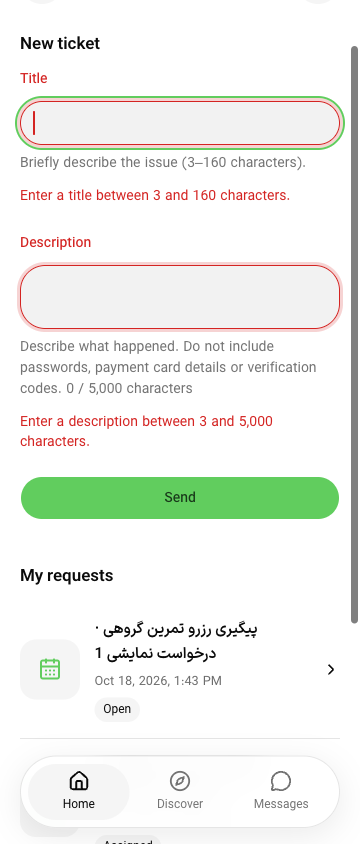

# PH0 — صفحه‌بندی تقویم و دسترس‌پذیری فرم

این برش **پذیرش کامل PH0 نیست**. طبق انتخاب کاربر فقط وب بررسی شد؛ دستگاه، دیتابیس، Docker و سرویس خارجی اجرا نشدند. داده‌ها مصنوعی و fixture فقط‌خواندنی بود؛ هیچ نشست یا follow واقعی ساخته نشد.

## اصلاح

دو فهرست تقویم و خدمات آن، `LumaLoadMore` مشترک را مصرف می‌کنند. خطای گذرای صفحهٔ بعد، دادهٔ خوانده‌شده را نگه می‌دارد؛ Retry همان cursor را ادامه می‌دهد. پاسخ دیررس نمی‌تواند فوکوس را به مسیر خروجی ببرد. صفحهٔ آخر خالی، فوکوس کیبورد را به شمارنده می‌دهد. پاسخ401/403 از این نگهداری مستثناست و دادهٔ قبلی را نمایش نمی‌دهد. شمارندهٔ خدمات نیز به دو زبان اضافه شد.

متن بلند در `.luma-page` می‌شکند، عنوان هدر حداقل عرض صفر دارد و action هدر کوچک نمی‌شود. segmented می‌تواند چندخطی شود. کنترل‌های کلاسیک `.luma-field` فونت۱۶px و حداقل عرض صفر دارند. این اصلاحات محدود به Luma هستند؛ محافظ۵۹ فایل کارت/جزئیات/وابستگی مشترک پاس ماند.

## نگاشت صفحه، API، حالت و شاهد

| صفحه                     | API                                                                             | حالت و شاهد مرورگر                                                                                                                                                                                                                                                                                                                                            | باقی‌مانده                                                                                                           |
| ------------------------ | ------------------------------------------------------------------------------- | ------------------------------------------------------------------------------------------------------------------------------------------------------------------------------------------------------------------------------------------------------------------------------------------------------------------------------------------------------------- | -------------------------------------------------------------------------------------------------------------------- |
| `/calendars`             | `sports/calendars/page`؛ برای view=following، `sports/community/calendars/page` | [پیش از اصلاح](ph0-calendar-before-2026-10-18.json):۲۰→۰ در503. [پس از اصلاح](ph0-calendar-after-error-2026-10-18.json):۲۰ ردیف و فوکوس Retry؛ [بازیابی](ph0-calendar-recovered-2026-10-18.json):۲۳ ردیف، فوکوس ردیف۲۱. [آخر خالی](ph0-calendar-last-empty-2026-10-18.json):۲۰ ردیف، فوکوس شمارنده                                                            | نخستین خطای بارگذاری/کندی و همهٔ تغییرات هم‌زمان، مرورگرها و دستگاه‌های دیگر                                         |
| همان صفحه، view و search | همان دو API با search/cursor                                                    | [هویت مسیر](ph0-calendar-filter-identity-2026-10-18.json):مرز `/calendars` پیش/پس از view=following و جست‌وجو همان DOM node37 ماند؛ جست‌وجوی Ph0Calendar یک نتیجه داد                                                                                                                                                                                         | تمام shellها و queryهای دیگر؛ این یک خانوادهٔ مسیر است                                                               |
| همان صفحه، رد دسترسی     | همان API دنبال‌شده                                                              | [صفحهٔ بعد403](ph0-calendar-denied-2026-10-18.json):دادهٔ قبلی کنار رفت، header و alert باقی ماندند                                                                                                                                                                                                                                                           | رفتار نشست واقعی/تغییر نقش و recovery واقعی، که fixture صادر نمی‌کند                                                 |
| `/calendars/detail?id=…` | `sports/calendars/:id`؛ `:id/services`؛ خواندن account برای follow              | [متن/تاریخ/تومان](ph0-calendar-detail-layout-2026-10-18.json):عنوان۱۶۰ نویسه‌ای و خدمت بلند در عرض۳۶۰ جا شدند. نمونهٔ واقعی DOM:۲۷ مهر۱۴۰۵،۹:۰۰ و۱۸۰٬۰۰۰ تومان. [خطای خدمات](ph0-calendar-services-error-2026-10-18.json):۲۰ ردیف و شمارنده حفظ شد. [خروج حین درخواست](ph0-calendar-late-focus-2026-10-18.json):پس از رفتن به خانه، فوکوس همان لینک خانه ماند | صفحه‌بندی مثبت خدمات در مرورگر، تغییر ID حین درخواست و follow واقعی؛ مثبت۲۳ خدمت فقط در آزمون HTTP fixture پوشش دارد |
| `/support`               | `sports/community/support` فقط DTO خواندنی؛ submitهای آزمایش نامعتبر و محلی     | [ماتریس چهار حالت](ph0-support-form-matrix-2026-10-18.json):فارسی/انگلیسی × روشن/تیره در عرض۳۶۰، label و hint/error متصل، aria-invalid، دو alert، فوکوس عنوان، فونت۱۶px؛ در [عنوانِ تنها](ph0-support-form-fa-2026-10-18.json)، خطای عنوان پاک و فوکوس توضیحات شد                                                                                             | فرمان موفق/شکست واقعی، reply و سایر فرم‌ها، صفحه‌خوان و zoom واقعی                                                   |

حدود reflow: [فضای CSS۱۸۰×۴۲۲ با DPR۲](ph0-support-reflow-180-observed-2026-10-18.json) فقط شبیه‌سازی عرض است. کنترل‌های فرم داخل viewport بودند؛ عرض برخی لینک‌های nav حدود۳۲CSSpx بود. این شاهد را آزمون واقعی browser zoom۲۰۰٪ یا پذیرش کامل اهداف لمس نمی‌نامیم. [رنگ فوکوس](ph0-support-focus-palette-2026-10-18.json) نیز ثبت شد؛ ارزیابی کامل کنتراست indicator، border و shadow هنوز لازم است.

## صحت raster

سه PNG اولیهٔ این برش، پس از۷۲۰ ردیف دقیقاً تصویر ابتدای خود را تکرار می‌کردند:۱۷۸٬۵۶۰ مقدار کانال در۱۲۴ ردیف پایانی هر فایل یکسان بود. DOM فرم فقط دو ورودی و دو خطا داشت؛ raster تکراری، شاهد دو فرم تعاملی نیست. فایل‌های خام با پسوند `-unverified-viewport.png` حفظ شدند؛ `-visible-crop.png` فقط۷۲۰ ردیف نخست آن‌هاست و تصویر کامل صفحه محسوب نمی‌شود.

در آن ثبت‌ها فقط CDP metrics تغییر کرده بود؛ native browser viewport هنوز۷۲۰px بود. ثبت نهایی با **هر دو** browser viewport۳۶۰×۸۴۴ و CDP metrics همان اندازه با DPR۱ انجام شد. [حالت ثبت نهایی](ph0-support-proof-2026-10-18.json) و PNG آن بازبینی شدند؛ تکرار۷۲۰px در آن وجود ندارد. این تشخیصِ مشکل capture است، نه اصلاح کد محصول.

[ممیزی۱۶۸ raster مرجع قبلی کارت](ph0-painted-raster-audit-2026-10-18.json) هیچ تکرار کامل با فاصلهٔ۷۲۰px پیدا نکرد؛ آن روش هر دو اندازه را تنظیم می‌کرد. این فقط کنترل یک failure mode است. نتیجهٔ قبلی۷۸/۸۴ جفت دقیق و۶ جفت اختلاف محدود همچنان accepted=false است؛ از این ممیزی پذیرش کامل raster یا P0-01 نتیجه نمی‌گیریم.

## بررسی و هزینهٔ اجرا

۱۰۳ آزمون ترتیبی پاس‌اند؛ چهار آزمون جدید قرارداد DTO، مرز cursor/جست‌وجو، خطای صفحهٔ بعد، آخر خالی، رد دسترسی، اتصال خدمات به شعبه و ممنوعیت نوشتن را بررسی می‌کنند. این‌ها آزمون fixture هستند، نه جایگزین backend/PostgreSQL یا مرورگر. lint فایل‌های تغییرکرده، TypeScript داخل build، `git diff --check` و محافظ۵۹ فایل پاس‌اند. inventory با۹۶ مسیر و۱۴۲ مصرف‌کننده از نو تولید شد.

build نهایی application برابر `CuMYYCscHxNIXoZkhyu_4` است. لاگ‌ها در `.artifacts/ph0-calendar-2026-10-18/` هستند. buildهای۳۸۴ و۴۴۸MiB در TypeScript به heap limit خوردند؛ ساده‌کردن ورودی QueryState به سه فیلد نیز به‌تنهایی کافی نبود. بررسی مستقیم با extendedDiagnostics،۵۳۸٬۶۵۴KiB حافظه و یک خطای implicit-any در آزمون جدید نشان داد. خطای نوع با DTOهای صریح اصلاح شد؛ build ترتیبی با heap۶۴۰MiB و یک worker موفق بود. این سقف هر فرایند V8 است، نه سقف کل RAM. buildهای business/admin این برش تکرار نشدند؛ منطق UI مشترک آن‌ها تغییر نکرد و دو کلید ترجمهٔ تازه فقط در application مصرف می‌شوند.

preview و fixture هنگام build خاموش بودند. پس از QA، زبان/تم به فارسی/تیره برگشت، metrics و viewport پاک و همهٔ تب‌های خودمان بسته شدند؛ هر دو فرایند loopback با SIGINT متوقف شدند. هیچ cache شخصی، دیتابیس یا backup حذف نشد. [ماتریس کامل PH0](ph0-acceptance.md) همچنان باز است.
