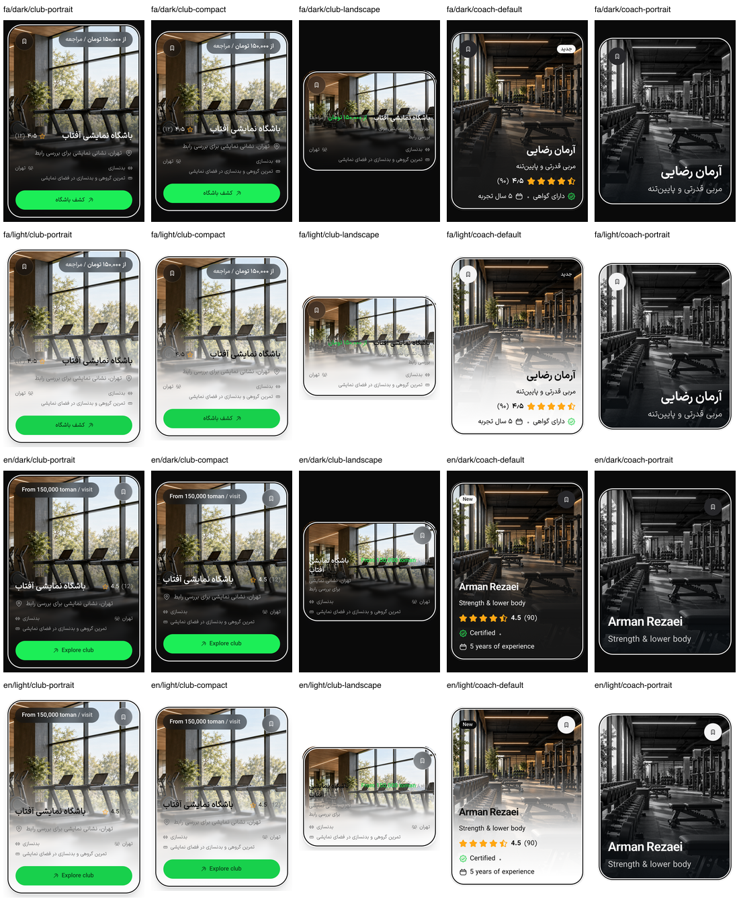

# PH0 — صحت ثبت تصویر و کارت‌های فوکوس‌شده

این برش ابزار QA و شاهد وب را اصلاح می‌کند؛ کد محصول و۵۹ فایل محافظت‌شده تغییر نکردند. پذیرش کامل PH0 باز است.

## دو نقص روش ثبت

در همان وضعیت DOM با عرض۳۶۰ و ارتفاع۸۴۴، `Page.getLayoutMetrics` اندازهٔ CSS را۳۶۰×۸۴۴ و backing را۷۲۰×۱۶۸۸ گزارش کرد. ثبت با DPR۱ فقط۳۶۰×۸۴۴ پیکسل برگرداند و بخش چپ/بالای رندر۲برابری را نشان داد. با DPR۲، PNG۷۲۰×۱۶۸۸ و کل کارت با هندسهٔ DOM تطبیق داشت. نداشتن تکرار۷۲۰px، به‌تنهایی این نوع crop را رد نمی‌کند. نمونه‌های تشخیصی در `baselines/ph0-capture-diagnostic-2026-10-18/` حفظ شدند؛ `surface-true.png` ناقص است و `surface-dpr2.png` کل viewport را دارد.

مشکل دوم مستقل بود: در [مجموعهٔ اولیهٔ۶۰ تصویر](ph0-backed-focus-initial-2026-10-18.json)، نمونهٔ `en-dark-360-coach-portrait.png` با وجود receipt درست DOM، هنوز محتوای کارت default قبلی را داشت. این مجموعه **رد شده** و فایل‌هایش در پوشهٔ `ph0-backed-focus-initial-2026-10-18` باقی‌اند. ثبات DOM به معنی ثبات frame compositor نیست.

## کنترل ثبت تازه

`scripts/ph0-capture.cua.mjs` فقط از APIهای tab انتخاب‌شده در cua_repl استفاده می‌کند. قبل از ذخیره:

- visual viewport، inner viewport، DPR و backing باید دقیقاً مطابق باشند؛ scale برابر۱ باشد.
- فونت و تصاویر هدف آماده، و تمام هدف با حداقل۸CSSpx حاشیه داخل viewport باشد.
- دو PNG پیاپی باید checksum دقیقاً یکسان داشته باشند؛ حداکثر۲۰ capture، بدون tolerance. پنج capture برای یک نمونه کافی نبود؛ در مجموعهٔ نهایی هر نمونه۲تا۶ capture لازم داشت.
- ابعاد واقعی PNG باید برابر backing باشد و receipt DOM قبل/بعد capture تغییر نکند.

ارتفاع integer در cssLayoutViewport برای یک scroll نیم‌پیکسلی۸۴۳ بود، درحالی‌که visual viewport و innerHeight هر دو۸۴۴ بودند؛ کنترل ابعاد به visual viewport متکی است و این داده‌های خام در receipt آمده‌اند. این ابزار screen zoom واقعی۲۰۰٪ را شبیه‌سازی یا تأیید نمی‌کند؛ DPR۲ فقط نسبت پیکسل raster به CSS است.

## نتیجهٔ قابل اتکا و حدود آن

[مجموعهٔ نهایی](ph0-backed-focus-2026-10-18.json) شامل۵ نوع کارت ×۲ زبان ×۲ تم ×۳ عرض۳۶۰/۳۹۰/۴۳۰، در ارتفاع۸۴۴CSSpx و DPR۲ است. هر۶۰ هدف فوکوس داشت، کاملاً داخل viewport بود، فایل با checksum کنترل شد و دو frame آخر دقیقاً برابر بودند.۳۲ مورد بیش از دو capture نیاز داشتند. تصویرها از application build `ofgoMlI3Fw5e-K6menQHA` و fixture فقط‌خواندنی `protected-catalog` هستند.

سه contact sheet بازبینی شدند؛ در هر۶۰ target crop، محتوای variant درست، کل کارت و حلقهٔ داخلی دیده شد. نمونهٔ مستقل `en-light-360-coach-portrait.png` نیز با اندازهٔ اصلی بازبینی شد. probe کوتاه لبهٔ چپِ وسط کارت در هر۶۰ مورد پیکسل روشن≥۲۴۹ و تیره≤۱۱ داشت؛ این یک مقطع است و جای محاسبهٔ تمام لبه‌ها/تصاویر یا ممیزی کنتراست کامل را نمی‌گیرد. contact sheetها برای بازبینی کوچک شده‌اند؛ PNGهای اصلی مرجع هندسه‌اند.

این۶۰ تصویر **وضعیت فعلیِ فوکوس‌شده** را نشان می‌دهند و مقایسهٔ before/after حفظ ظاهر نیستند. نتیجهٔ قبلی۷۸/۸۴ دقیق، accepted=false باقی است؛ ثبت‌های قدیمی backing/ثبات frame را ثبت نکرده‌اند و کامل‌بودن paint آن‌ها از checksum یا عدم تکرار۷۲۰px اثبات نمی‌شود. همهٔ عکس‌ها، variantها، نقشه، جزئیات و حالات تعامل در این مجموعه پوشش ندارند. P0-01 و P0-10 همچنان بازند.

## بررسی و هزینه

`node scripts/ph0-focus-sheets.mjs` ابعاد، checksum و ثبات frame هر۶۰ فایل را کنترل و سه contact sheet را تولید کرد. syntax دو ابزار، diff check و محافظ۵۹ فایل بررسی شدند. چون کد محصول تغییر نکرد، build و۱۰۳ آزمون منطقی دوباره اجرا نشدند؛ نتایج سه build برش فوکوس معتبر در محدودهٔ قبلی خود باقی‌اند. فقط یک preview با heap۱۹۲ و یک fixture با heap۹۶MiB فعال بود؛ هر دو متوقف شدند. تب خودمان بسته، metrics/viewport پاک و زبان/تم فارسی/تیره بازگردانده شد. دستگاه، دیتابیس، Docker، سرویس خارجی و ارسال واقعی اجرا نشدند.
