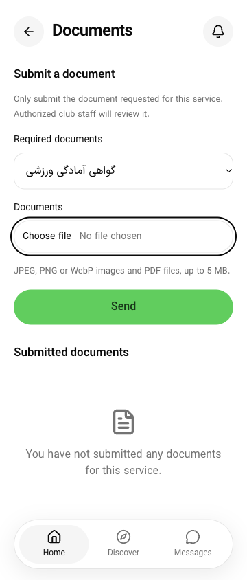

# PH0 — نشانگر فوکوس مشترک وب

این برش فقط وب است و پذیرش کامل PH0 یا WCAG محسوب نمی‌شود. هیچ حساب، درخواست کد ورود، فایل، پیام یا دادهٔ واقعی ارسال نشد. fixture فقط‌خواندنی روی loopback اجرا شد؛ دستگاه، Docker و دیتابیس اجرا نشدند.

## اصلاح و علت

در [مشاهدهٔ قبلی](ph0-support-focus-palette-2026-10-18.json)، رنگ outline سبز روی سفید نسبت اسمی۲٫۰۶۵ داشت. طبق [توضیح رسمی کنتراست غیرمتنی W3C](https://www.w3.org/WAI/WCAG21/Understanding/non-text-contrast.html)، نشانگر فوکوس سفارشی باید با رنگ مجاور کنتراست کافی داشته باشد. رنگِ outline به‌تنهایی ممیزی کل indicator نیست؛ border، shadow و پس‌زمینه هم باید بررسی شوند.

`packages/ui/src/focus.css` در root هر سه اپ وارد شد. کنترلِ دارای focus-visible یک outline۲px از foreground و نوار مات۳px از background می‌گیرد. توکن سبز، فونت و ظاهر بدون فوکوس تغییر نکردند. لینک تمام‌سطحی کارت باشگاه/مربی outline داخلی با offset منفی و نوار inset دارد تا overflow-hidden آن را حذف نکند. انتخاب فایلِ شفاف، نشانگر را روی wrapper قابل‌دیدن می‌گیرد. حالت forced-colors از Highlight سیستم و بدون shadow استفاده می‌کند؛ مرورگر فاقد focus-visible fallback فوکوس دارد، اما آن مرورگر قدیمی اجرا نشده است.

در آزمون اولیه، `transition-all` دکمه حلقه را حدود۱۵۰ms از رنگ نیمه‌شفاف قبلی به نشانگر تازه می‌برد. [سه رسید پیش از اصلاح](ph0-focus-before-transition-fix-2026-10-18.json) حفظ شدند. outline و shadow از transition-property کنترل فوکوس‌شده خارج شدند؛ رسید بلافاصله پس از ورودی کیبورد در build نهایی، نشانگر مات۲px را نشان داد. این رسید نمونهٔ style است، نه ضبط تمام frameهای رندر.

## مشاهدهٔ مرورگر

[۲۵ رسید نهایی](ph0-focus-observations-2026-10-18.json) شامل این نمونه‌هاست:

- application: عنوان نامعتبر، دکمهٔ فرم و Home؛ عنوان/دکمه در تم روشن و تیره؛ دکمه با reduced-motion؛ دکمهٔ Sheet در portal؛ پنج overlay کارت در هر دو تم؛ wrapper انتخاب فایل در هر دو تم؛ ورودی و کارت با forced-colors.
- business و admin: ورودی تلفن و دکمهٔ صفحهٔ ورود در فارسی/تیره. فقط ArrowRight برای گرفتن فوکوس استفاده شد؛ شماره‌ای وارد و فرم ارسال نشد.

نمونه‌ها در viewport۳۶۰×۸۴۴، DPR۱ ثبت شدند. هدف واقعی، focus-visible، نبود ancestor غیرفعال، opacity، رنگ، ضخامت و offset ذخیره شدند. در کنترل فایل، خود input فوکوس دارد و هندسه/style از wrapper قابل‌دیدن خوانده شد. پنج overlay در هر تم style داخلی درست داشتند؛ این به‌تنهایی شاهد پذیرش پیکسلی روی همهٔ عکس‌ها نیست.

[محاسبهٔ رنگ](ph0-focus-contrast-2026-10-18.json) برای۲۳ نمونهٔ مات، نسبت دو رنگ۱۸٫۹۵۷۵ در تیره و۱۹٫۷۹۳۱ در روشن داد. حداقلِ بیشینهٔ کنتراست این دو رنگ با یک پس‌زمینهٔ **یکنواخت** به‌ترتیب۴٫۳۵۴ و۴٫۴۴۹ است؛ مقایسه پیش از گردکردن انجام شد. دو نمونهٔ forced-colors فقط وجود outline سیستم و حذف shadow را بررسی می‌کنند و نتیجهٔ عددی AA ندارند. عکس پیچیده، پوشیده‌شدن، ضخامت پیکسلی واقعی و همهٔ کنترل‌ها از این محاسبه نتیجه نمی‌شوند. اسکریپت رنگ نامعتبر/شفاف را شکست ثبت می‌کند و خطا را به نتیجهٔ سبز تبدیل نمی‌کند.

## صحت تصویر

هر سه PNG تکرار دقیق۷۲۰px نداشتند، اما بازبینی انسانی دو تصویر کارت و دکمه را به‌علت ناسازگاری مقیاس/crop با هندسهٔ DOM رد کرد. آن‌ها با پسوند `-unverified-scale.png` حفظ شده‌اند و شاهد پذیرش کامل کارت/فرم نیستند. [ممیزی raster](ph0-focus-raster-audit-2026-10-18.json) این محدودیت را ثبت می‌کند. تصویر فایل با viewport واقعی۳۶۰×۸۴۴ و CDP metrics همان اندازه ثبت و بازبینی شد:

## بررسی و باقی‌مانده

build ترتیبی سه اپ با یک worker و heap۶۴۰MiB پاس شد: application=`ofgoMlI3Fw5e-K6menQHA`، business=`eO5Q1cACjO5tO5cYkZS7G`، admin=`LeTU4fORtTy0MKIZeOG3r`. لاگ‌ها و manifest در `.artifacts/ph0-focus-2026-10-18/` هستند. application پیش از قالب‌بندی صرفاً whitespace فایل CSS ساخته و آزموده شد؛ دو پنل پس از آن ساخته شدند. lint منابع تغییرکرده و محافظ۵۹ فایل پاس‌اند.۱۰۳ آزمون برش قبلی برای منطق navigation/fixture بدون تغییر مانده‌اند و این برش CSS آن‌ها را دوباره اجرا نکرد؛ TypeScript داخل هر سه build بررسی شد.

پس از آزمون، زبان/تم به فارسی/تیره برگشت؛ media، metrics و viewport پاک شدند، تب‌های خودمان بسته و preview/fixture متوقف شدند. باقی‌مانده: QA تصویری معتبر کارت‌های فوکوس‌شده، کنترل‌های دیگر و پس‌زمینه‌های تصویری، zoom واقعی۲۰۰٪، صفحه‌خوان واقعی و آزمون دستگاه. [همهٔ دروازه‌های پذیرش PH0](ph0-acceptance.md) همچنان بازند؛ قبولی styleهای نمونه به پایان فاز تعمیم داده نمی‌شود.

پیگیری همان روز: [صحت capture و۶۰ تصویر کامل تازه](ph0-capture-2026-10-18.md) مشکل backing scale و frame قدیمی را جدا کرد. تصاویر تازه دامنهٔ فوکوس پنج نوع کارت را پوشش می‌دهند؛ پذیرش جامع یا مقایسهٔ قبل/بعد نیستند.
