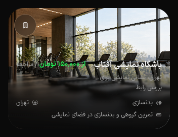

# PH0 — Back، اسکرول و مرجع PNG

ادامهٔ فقط وب طبق انتخاب کاربر انجام شد. **PH0 هنوز بسته نیست.** این برش دو نقص قابل‌تکرار را اصلاح می‌کند؛ شواهد آن به تمام مسیرها یا دستگاه واقعی تعمیم داده نمی‌شوند.

## تغییر و آزمون

- قفل Back فقط commit همان مقصد و URL فعلی را می‌پذیرد. commit قدیمی مبدأ و pop زودتر از render مقصد، قفل را باز نمی‌کنند. نیت جدیدِ رفتن به مسیر دیگر، Back معلق را کنار می‌زند. سه آزمون اضافه شد؛ مجموع **۹۹ تست، صفر شکست** با concurrency=1 پاس‌اند. لاگ: `.artifacts/ph0-navigation-2026-10-18/tests.txt`.
- recorder اختیاری QA اکنون رسید شروع، timestamp شروع/پایان و رخدادهای push/replace/commit/Back/click را دارد. مسیرهای رخداد ناوبری بدون query ثبت می‌شوند؛ observer معیوب رفتار ناوبری را عوض نمی‌کند. دکمه فقط پس از شروع واقعی recorder به «Recording 8s» می‌رود؛ خروجی قدیمی دیگر شاهد سناریوی جدید محسوب نمی‌شود.
- scroll anchoring مرورگر با بازیابی SSGOI تداخل داشت: خانه پس از ترک و بازگشت از۷۱۰ به۵۸۲ می‌رفت. حلقهٔ مرورگری قرمز بود؛ غیرفعال‌کردن anchoring آن را سبز کرد، برگرداندن auto دوباره قرمز، و محدودکردن none فقط به سطح گذار دوباره سبز شد. اکنون `PageTransitions` همان `overflow-anchor:none` را دارد؛ بدون restorer موازی یا تغییر کارت‌ها.
- seam رگرسیون واقعی در `scripts/ph0-scroll-loop.cua.mjs` است؛ tab موجود CUA و fixture لازم دارد و سروری اجرا نمی‌کند. [حالت عادیِ تب آماده](ph0-scroll-full-settled-2026-10-18.json) و [کاهش حرکتِ تب آماده](ph0-scroll-reduced-settled-2026-10-18.json) در CSS viewport۱۲۸۰×۷۲۰ و DPR۱،۷۱۰ را حفظ کردند. مقایسهٔ مختصات اسکرول کمتر از۱ CSS pixel فقط برای گردکردن API عددی است؛ مقایسهٔ PNG همچنان بدون tolerance است.

ورودی اسکرول بلافاصله پس از تغییر تب جداست: حلقهٔ اولیهٔ reduce،۷۱۰→۰ را مشاهده کرد؛ در تلاش بعدی خودِ wheel هم به اسکرول غیرصفر نرسید. با media ثابت نیز این رفتار مشاهده شد. آزمون آماده‌بودن تب از آزمون ورودی در چرخهٔ گذار جدا شد؛ **پذیرش اسکرول خیلی زود، تغییر media حین گذار و همهٔ رفتارهای کاهش حرکت اعلام نمی‌شود**. احتمال درگیری پنجرهٔ ثبت/قفل اسکرول SSGOI نیازمند شاهد مستقل است؛ بر اساس آن اصلاح حدسی یا delay محصول اضافه نشد. یک آزمایش با viewport متغیر نیز از پذیرش کنار گذاشته شد.

## شواهد Back

رسیدهای Back از build `jaBPQRrRqVp5USuPe0DNX` هستند؛ آخرین build پس از اصلاح محدوده‌دار anchoring ثبت شد. منطق Back پس از ثبت این رسیدها تغییر نکرد.

[رسید کاهش حرکت](ph0-reduced-back-receipt-2026-10-18.json)۴۰۰ نمونه دارد. Back گالری در۴۸۸٫۴ms اجرا شد؛ commit مقصد در۵۰۸٫۲ms، Back دوم در۵۶۸٫۵ms قفل شد؛ Back بعدی در۴۰۸۸٫۸ms به ورودی واقعی `/qa/ph0` برگشت. در این trace بیش از یک مرز تعاملی مشاهده نشد. این شاهد دو Back با فاصلهٔ۸۰٫۱ms است، نه پذیرش تمام لمس‌ها/فریم‌ها.

[رسید نخست](ph0-back-receipt-first-2026-10-18.json) ورود تا gallery را ثبت می‌کند ولی اصلاً رخداد click/Back برای تلاش خیلی زود ندارد؛ پس آن تلاش خرابی اثبات‌شدهٔ adapter تاریخچه نیست. [رسید دوم](ph0-back-receipt-second-2026-10-18.json) Back واقعی gallery→detail و commit مقصد را ثبت کرده است؛ Back بعدی بیرون بازه بود. [ورود مستقیم](ph0-cold-back-2026-10-18.json) در تب تازه، gallery→detail با همان branch و سپس detail→discovery را تأیید کرد.

## مرجع تصویری

مجموعهٔ اولیهٔ PNG، با وجود فرمت lossless، raster قابل‌اعتماد نداشت:۴۰ جفت حداقل یک crop کاملاً تک‌رنگ داشتند؛ فقط۲۱ جفت غیرتک‌رنگ دقیق بودند. [نتیجهٔ ردشده](ph0-lossless-comparison-2026-10-18.json) نگه داشته شد؛ برابرشدن دو تصویر خالی پاس نیست.

مجموعهٔ جداگانهٔ [پیش](ph0-painted-before-2026-10-18.json) و [پس](ph0-painted-after-2026-10-18.json)،۷ کارت × فارسی/انگلیسی × روشن/تیره × عرض۳۶۰/۳۹۰/۴۳۰ دارد. کارت و۱۶px اطراف آن داخل viewport رندرشده قرار گرفتند؛ پس از توقف اسکرول، PNG کل viewport ثبت و با مختصات ثبت‌شده crop شد. viewport این آزمون۱۶۰۰px ارتفاع دارد؛ **پذیرش چیدمان در ارتفاع موبایل نیست**. نسخهٔ پیش از اصلاح اسکرول `jaBPQRrRqVp5USuPe0DNX` و نسخهٔ نهایی `y7zptyQc77gOz38TFYz4w` است؛ این جفت‌ها بازآزمایی بصری آخرین اصلاح اسکرول‌اند، نه baseline قبل از تمام کارهای PH0.

`node scripts/ph0-compare-lossless.mjs painted`، checksum، PNG ورودی، containment، اندازه و RGBA را بدون tolerance مقایسه می‌کند. [نتیجه](ph0-painted-comparison-2026-10-18.json): **۷۸/۸۴ جفت دقیق؛۶ جفت با مجموع۱۶ پیکسل متفاوت و حداکثر delta=1**. هندسهٔ تمام۸۴ جفت دقیق و هیچ crop تک‌رنگ نیست. exit code=1 و accepted=false حفظ شد؛ اختلاف‌ها نادیده گرفته یا به‌عنوان رگرسیون قطعی محصول دسته‌بندی نشدند. علت کامل۱۶ پیکسل، تمام حالت‌های کارت، نقشه و ترکیب کامل جزئیات هنوز بازند.

نمونهٔ نهایی: 

## بررسی نهایی و منابع

lint فایل‌های تغییرکرده، TypeScript پکیج UI، syntax اسکریپت‌ها و محافظ۵۹ فایل پاس‌اند. build هر سه وب با heap۳۸۴MiB و یک worker به‌ترتیب انجام شد؛ لاگ‌ها `.artifacts/ph0-navigation-2026-10-18/{application,business,admin}-build-scroll.txt` هستند. build و سرور پیش‌نمایش هم‌زمان اجرا نشدند. native، Docker، دیتابیس و سرویس ابری اجرا نشدند؛ fixture فقط‌خواندنی روی loopback بود. پس از QA، media و device metrics تب‌های خودمان پاک، تب‌ها بسته، viewport reset و هر دو فرایند preview/fixture با SIGINT متوقف شدند.

باقی‌مانده‌ها در [ماتریس پذیرش](ph0-acceptance.md) بازند: ورودی خیلی زود/کندی/آفلاین، پوشش همهٔ مسیرها و فرم‌ها، حرکت سه اپ، کنتراست/zoom/صفحه‌خوان، مرجع کامل بصری و آزمون دستگاه. انتخاب ادامهٔ وب معیار دستگاه را حذف نمی‌کند.
