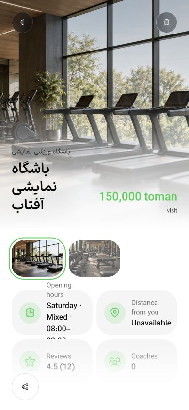

# جمع‌بندی اصلاحات PH0/PH1 — ۲۰ اکتبر ۲۰۲۶

اصلاحات این برش پیاده و در سه build تولیدی بررسی شدند. **پذیرش کامل PH0 و PH1 هنوز بسته نیست**؛ ماتریس جامع وب/دسترس‌پذیری و دروازه‌های دستگاه، عملیات و انتشار پایین صریحاً بازند.

## رفتار اصلاح‌شده

- حرکت مسیر از همگرایی طولانی به پیشروی با زمان محدود تغییر کرد. SSGOI 7.4.1 دو فریم پایان اضافه می‌کند و controller سرعت factory را بازنویسی می‌کند؛ `RouteAnimation` این رفتار را در سطح composite جبران می‌کند. قرارداد fade۱۲۰، push۲۲۰ و Sheet۲۰۰ms در آزمون موتور نصب‌شده بررسی شد.
- زوم باشگاه از **کارت کلیک‌شده** شروع می‌شود؛ وجود چند کارت با کلید یکسان تصویر اشتباه را انتخاب نمی‌کند. برگشت از همان نوع کارت استفاده می‌کند؛ ورودی فاقد anchor به push برمی‌گردد. بارگذاری سرد حداکثر۵۰۰ms برای anchor مقصد فرصت دارد؛ خطا/کندی طولانی به fallback می‌روند. فایل‌های کارت و جزئیات محافظت‌شده تغییر نکردند.
- تغییر reduced-motion حین اجرا composite فعال را تمام و listener را آزاد می‌کند. CSS شیت‌های Luma و میزبان از۳۲۰ به۲۰۰ms هماهنگ شد.
- شکست Secure Storage هنگام ورود، logout جبرانیِ مستقل از signal ورود با سقف۲ثانیه دارد؛ حتی fetch بی‌اعتنا به abort، خطای اصلی ذخیره‌سازی را معطل نمی‌کند.
- resolver لینک، Android intent filter و Apple association از قرارداد مشترک خانواده‌های مسیر استفاده می‌کنند. پذیرش واقعی OS همچنان دستگاه و دامنهٔ تنظیم‌شده می‌خواهد.
- توقف worker، capture و Restic را لغو می‌کند؛ گروه فرایند با TERM/KILL جمع می‌شود و رسید دیررس منتشر نمی‌شود. pg_dump با برچسب اختصاصی در همان DB/role خاتمه می‌یابد. پایان client Docker به‌تنهایی اثبات پایان exec داخل daemon نیست؛ transaction snapshot نیز بسته می‌شود تا import دیررس نتواند capture معتبر بسازد.
- تعریف هشت سرویس launchd و runner با readiness محدود/قابل‌لغو ساخته شد. runner از build آماده استفاده می‌کند، API را به staging loopback محدود می‌کند و اعتبار migration را به runtime نمی‌دهد. تولید plist سرویس را نصب یا فعال نمی‌کند.
- دو suite عملیات به workflow PH1 افزوده شدند.

## بررسی نهایی

رسیدها در [پوشهٔ این برش](baselines/ph0-ph1-closeout-2026-10-20/) و هش آن‌ها در `receipts.json` نگهداری می‌شوند.

| بررسی | نتیجه |
| --- | --- |
| تست‌های برنامه، ترتیبی |۱۷۶ پاس، صفر شکست/skip |
| lifecycle/services/worker/media-backup/association |۲۴ پاس؛ شامل child/grandchild واقعی و adapterهای DB/Docker |
| build تولیدی application، business، admin |هر سه پاس؛ webpack، یک worker و heap۵۱۲MiB، به‌ترتیب |
| lint حرکت UI |پاس |
| محافظ طراحی |۵۹ فایل بدون تغییر |
| هشت plist ساخته‌شده |هر هشت `plutil -lint` پاس؛ نصب/اجرا نشده‌اند |
| منبع |۸۹۹ ورودی قبل از QA نهایی ثبت؛ تطبیق پایانی در `final-audit.json` |

آزمون مستقیم typecheck با heap۳۸۴MiB به محدودیت حافظه رسید؛ جای پاس شمرده نشده است. typecheck داخل buildهای نهایی موفق بود. سه `next-env.d.ts` به بایت‌های اولیه بازگردانده شدند. snapshot ورودی‌ها پس از شروع build نهایی و پیش از QA گرفته شد؛ این شاهد، نظارت پیوسته بر تمام لحظات build نیست.

## مرورگر تولیدی

API این نوبت فقط fixture عمومی مصنوعی، خواندنی و روی loopback بود؛ هیچ حساب، DB، SMS یا خرید واقعی ساخته نشد. trace هشت‌ثانیه‌ای از خود برنامه، مسیرهای تعاملی و زمان WAAPI را ثبت کرد. فیلد anchor روی clone تصویر خالی است؛ خالی‌بودن آن به معنی نبود زوم نیست؛ transform مقیاس و trackهای تصویر نیز بررسی شدند.

- فارسی در۳۹۰×۸۴۴: compact سرد، landscape و portrait زوم داشتند؛ compact در برگشت نیز زوم داشت. زمان مؤثر WAAPI۲۲۰ms و حداکثر یک route تعاملی بود.
- انگلیسی/روشن: ورودی Featured بدون anchor، push۲۲۰ms و بدون scale داشت؛ عرض صفحه۳۹۰ و بدون سرریز افقی بود.
- تغییر تب کشف به خانه: زمان مؤثر fade۱۲۰ms و حداکثر یک route تعاملی در۴۸۱ نمونه ثبت شد.
- تغییر media هنگام زوم portrait: یک نمونهٔ متحرک پیش از تغییر و یک نمونه در نخستین frame با reduce=true ثبت شد؛ نخستین نمونهٔ بدون transform/filter،۷۹٫۱ms بعد بود. این نتیجه «صفر frame از لحظهٔ تغییر» نیست.
- شیت تو‌در‌تو: Back ابتدا داخلی را بست و فوکوس به Sheet 2 برگشت؛ Escape بیرونی را بست و فوکوس به Sheet 1 برگشت. trace صفر/یک/دو دیالوگ و زمان۰٫۲s را ثبت کرد. همین توالی در فارسی/تیره با reduce هم از UI اجرا شد؛ capture آن stale بود و به‌عنوان شاهد فریمِ reduce پذیرفته نشد.
- مرورگر معمولی، صفحه‌خوان یا دستگاه واقعی نیست. این نمونه‌ها پذیرش تمام مسیرها، تم‌ها و حالت‌های آفلاین/خطا را ثابت نمی‌کنند.

## کار باز واقعی

| بخش | شرط باقی‌مانده |
| --- | --- |
| PH0 وب |ماتریس کامل حفظ ظاهر، کنتراست/semantics/صفحه‌خوان و حالت‌های rapid/slow/offline/theme در سه اپ؛ گراف قبلی۹۴ مسیر بدون رسید پیوندشده دارد، نه۹۴ مسیر الزاماً تست‌نشده |
| PH0/PH1 موبایل |Android متصل نیست؛ Xcode کامل موجود نیست. پذیرش Secure Storage، لینک، باشگاه تازه، خروجی فایل، keyboard/safe-area/Back روی Android/iOS باز است |
| export جدید موبایل |preflight واقعی با۰٫۶GiB فضای آزاد متوقف شد؛ حداقل۵GiB لازم است. guard دور زده نشد و export قدیمی حفظ شد |
| T026 عملیات |نصب/آزمون supervisor و recovery پس از reboot، HTTPS عملیاتی دامنه و تحویل هشدار بیرونی |
| T027 انتشار |اجرای CI سبز راه‌دور؛ اتصال GitHub قبلاً403 داد و کاربر ادامهٔ محلی را خواسته است |
| T029 بازیابی |مقصد مستقل، custody، retention و تمرین restore خارج از این مک؛ کاربر مقصد آماده ندارد |
| T028 پذیرش نهایی |ترکیب کامل وب/native و عملیات روی دو مجموعه/دو شعبه؛ تست‌های قبلی دسترسی/عدم نشت، جای این پذیرش جامع نیستند |

سرورهای موقت متوقف و تب ساخته‌شده بسته شد؛ پورت‌های۷۳۹۱/۷۳۹۹ شنونده ندارند.۸۹۹ ورودی نسبت به snapshot پیش از QA ثابت و سه فایل خودکار دقیقاً بازیابی شدند. تب کاربر، سرویس‌های موجود، داده‌ها و تاریخچهٔ Git دست‌نخورده ماندند. پایان این اصلاحات به معنی پایان کل Goal نیست.
