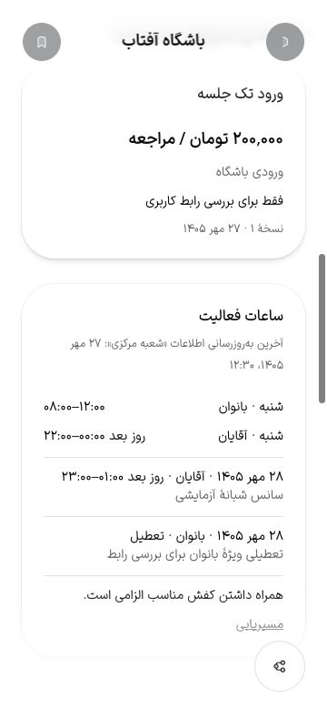

# تاریخ شعبه و سانس‌های اعلام‌شده — ۱۹ اکتبر ۲۰۲۶

T017-b پذیرفته شد: تاریخ ویرایش شعبه، مخاطب سانس و بازهٔ شبانه درست ذخیره/نمایش داده می‌شوند. والد T017، چرخهٔ کامل کاتالوگ و PH0/PH1 بازند. این گزارش پذیرش کامل جزئیات یا دستگاه نیست.

## اصلاح و دامنه

PATCH صرفاً نام، timezone یا مجموعه‌های فرزند مثل ساعت/رشته، `branchProfiles.updatedAt` را جلو نمی‌برد. اکنون همان تراکنش، تاریخ رکورد شعبه را هم تغییر می‌دهد؛ شکست اعتبارسنجی تاریخ را تغییر نمی‌دهد. برچسب عمومی، تاریخ ویرایش اطلاعات شعبه است؛ تأیید ادمین، تاریخ قیمت یا زمان تغییر کل مجموعه را ادعا نمی‌کند. پاسخ API/DTO موجود استفاده می‌شود و migration لازم نیست.

کارت ساعات، نام شعبه و تاریخ/ساعت را از `updatedAt` با منطقهٔ زمانی همان شعبه در عنصر `time` نشان می‌دهد. ساعت خلاصهٔ جزئیات نیز ارقام محلی و مخاطب هر بازه را حفظ می‌کند. پایان دقیقاً در نیمه‌شب هم «روز بعد» دارد؛ پایان بعد از نیمه‌شب، ساعت روز بعد را نمایش می‌دهد.

استثنای تعطیلی اکنون مخاطب را نشان می‌دهد؛ تعطیلی ویژهٔ بانوان با تعطیلی همهٔ مخاطبان اشتباه نمی‌شود. بازه‌های استثنا در `bdi dir=ltr` قرار دارند تا در جملهٔ فارسی معکوس دیده نشوند. تاریخ استثنا یک روز تقویمی است، نه لحظه؛ نمایش آن به timezone منتقل نمی‌شود. تاریخ ویرایش که یک لحظه است، همچنان در منطقهٔ شعبه قالب‌بندی می‌شود. تعداد روز/جلسهٔ تعرفه هم ارقام محلی دارد.

فایل محافظت‌شدهٔ ClubPage یا ClubDetail و کارت‌ها تغییر نکردند؛ دادهٔ ورودی خلاصهٔ ساعت اصلاح شد و کارت موجود ساعات تکمیل شد. زمان‌های۱۲۰/۲۲۰/۲۰۰ms تغییر نکردند.

## آزمون و شاهد واقعی

- ۱۸۹ آزمون Node ورزشکار/کلاینت پاس‌اند؛ سه آزمون جدید، padding/ارقام، پایان۱۴۴۰/۱۵۰۰، مخاطب خلاصه و روز تقویمی فارسی/انگلیسی را بررسی می‌کنند.
- ۴۳ آزمون NestJS/PostgreSQL/S3 پاس‌اند؛ آزمون تازه تاریخ را به۲۰۲۰ برمی‌گرداند و PATCH مستقل نام، timezone، ساعت و رشته را اجرا می‌کند. تاریخ پاسخ با مقدار ذخیره‌شده برابر و از مقدار قدیمی جدیدتر است؛ ورودی نامعتبر تاریخ قبلی را حفظ می‌کند. suite همچنین آمادگی، رد انتشار بدون تأیید، submit→بررسی ادمین→publish، پنهان‌بودن شعبهٔ ناقص و جداسازی tenant را بررسی می‌کند. این suite جای چرخهٔ کامل UI بیزینس/ادمین را نمی‌گیرد.
- دو آزمون i18n، check-copy، lint مربوط API/ورزشکار، types API و build/types ورزشکار پاس‌اند. مجموع آزمون‌های نهایی۲۳۴ است؛ سه آزمون ساعت جزئی از۱۸۹ هستند.
- مرورگر به NestJS/PostgreSQL واقعی متصل بود؛ پاسخ API mock نشد. داده‌ها دو مجموعهٔ مصنوعی با دو شعبه و تصویر placeholder مشخص‌اند. fixture اختیاری `UI_FIXTURE_CATALOG_HOURS=true` فقط ساعت‌ها و استثناهای شعبهٔ متعلق به همان fixture را می‌سازد؛ cleanup والد آن‌ها را حذف می‌کند.
- ۸ حالت fa/en × روشن/تیره ×۳۶۰×۷۸۰/۱۲۸۰×۹۰۰ روی build نهایی ثبت شدند: تاریخ ثابت fixture برابر `2026-10-19T09:00:00Z` به۱۲:۳۰ تهران رسید؛ فارسی۲۷ مهر۱۴۰۵ و انگلیسیOct19 را نشان داد. استثنای۲۰ اکتبر به۲۸ مهر تبدیل شد. بانوان۰۸–۱۲، آقایان۲۲–۰۰ روز بعد، استثنای آقایان۲۳–۰۱ روز بعد و تعطیلی مخصوص بانوان واضح‌اند. جهت بازهٔ استثنا ابتدا در تصویر معکوس بود؛ پس از اصلاح و rebuild همهٔ حالت‌ها دوباره ثبت شدند. scrollWidth در هر۸ حالت با عرض برابر بود.
- تغییر به شعبهٔ شمال، URL/گزینهٔ فعال، تاریخ همان شعبه، ساعت‌های عمومی۰۸–۲۲، تعرفهٔ ماهانه۱٬۵۰۰٬۰۰۰ و نظر همان شعبه را نشان داد؛ تعطیلی بانوان شعبهٔ مرکزی دیگر دیده نشد. فوکوس روی radio انتخاب‌شده ماند.
- کنتراست محاسبه‌شدهٔ متن تازهٔ تاریخ روی رنگ واقعی Card، روشن۴٫۷۳۲ و تیره۶٫۹۰۸ است؛ رنگ‌های خوانده‌شده بی‌فام‌اند و luminance آن‌ها از `L³` در OKLCH محاسبه شد. این شاهد فقط همین متن/پس‌زمینه است؛ ممیزی کامل کنتراست، zoom و صفحه‌خوان نیست.

## نگاشت اجراشدهٔ صفحه، API و شاهد

| صفحه/بخش وب | endpoint اجراشده | حالت و شاهد |
| --- | --- | --- |
| `/discovery/clubs/:id`، ClubPage/useCatalogClub | `GET /api/v1/catalog/clubs/:id` | هویت/دو شعبه و تعرفه؛ پاسخ۲۰۰ در `http-final.json` و تصویر جزئیات |
| کارت ساعات، خلاصه و تعویض شعبه | `GET /api/v1/catalog/clubs/:id/branches/:branchId` | دو شناسهٔ شعبه، تاریخ، weekly/exceptions؛ پاسخ۲۰۰، `browser-final.json` و `branch-switch.json` |
| نظر شعبهٔ انتخاب‌شده | `GET /api/v1/catalog/clubs/:id/branches/:branchId/reviews?page=1` | پاسخ۲۰۰ و نمایش نظر/امتیاز مخصوص همان شعبه |
| ذخیره ویرایش شعبه | `PATCH /api/v1/business/clubs/:id/branches/:branchId` | آزمون واقعی ذخیرهٔ تاریخ برای چهار نوع تغییر و حفظ آن در۴۰۰؛ `clubs.log` |

۲۸ پاسخ کاتالوگ در `http-final.json` ثبت شدند؛ buffer حذف رویداد یا صفحهٔ ادامه ندارد. این جدول فقط مسیرهای اجراشدهٔ همین برش است و جای نگاشت کامل۹۶ مسیر PH0 نیست. native در مرورگر وب شبیه‌سازی نشده است.

## ساخت و پاک‌سازی

ساخت اول `KYuFJmLLWIi85ykyknlHc` موفق بود؛ پیش از اصلاح جهت بازه، preview متوقف شد. ساخت نهایی `NLaU5wzKi4QZSpEj6I67j` exit0 داشت و مرورگر با reload آن را دریافت کرد.۷۵۸ ورودی وب و۱۳۶ ورودی API در رسیدهای منبع ثابت ماندند؛ بیزینس/ادمین در این برش rebuild نشدند. فقط دو build ورزشکار اجرا شدند، هرکدام با heap۶۴۰MiB، یک worker و اولویت پایین؛ preview هنگام rebuild بسته بود.

lint اولیهٔ API با heap۳۸۴MiB کمبود حافظه داشت؛ پس از پایان قطعی آن، با۶۴۰MiB اجرا و پس از حذف دو assertion غیرضروری پاس شد. یک کلید ترجمه ابتدا در namespace اشتباه انگلیسی بود؛ آزمون i18n آن را گرفت و هر دو آزمون نهایی پاس‌اند. نصب پکیج یا تغییر محدودیت امضا لازم نشد.

آثار خصوصی در `.artifacts/ph1-catalog-detail-2026-10-19/` و تصویر/DOM/HTTP عمومی در `docs/qa/baselines/ph1-catalog-detail-2026-10-19/` هستند. preview نهایی exit130 و API پس از cleanup exit0 دادند؛ شمارش دو مجموعه، weekly و exceptions متعلق به fixture صفر شد. DB اختصاصی `gym4me_ph1catalogdetail_1a14e17_test` حذف شد. زبان و تم به حالت ابتدایی برگشتند؛ cookie زبان موقت حذف، viewport بازگردانده و تب موقت بسته شد. containerها و bucket قبلی دست‌نخورده ماندند.

پذیرش کامل اطلاعات/امکانات و چرخهٔ UI بیزینس→ادمین→وب در T017، دیگر معیارهای جزئیات T022، نگاشت/حفظ ظاهر/حرکت/دسترس‌پذیری کامل PH0، دستگاه، HTTPS دامنه، remote CI و بکاپ خارج از مک بازند. شاهد این برش به تاریخ و سانس‌های اعلام‌شده محدود است.

