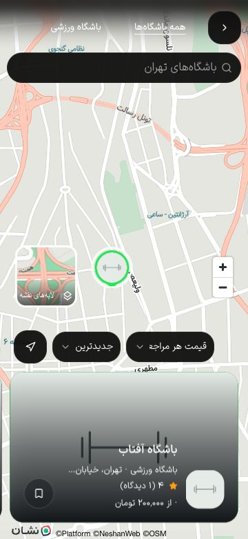

# جست‌وجو و فیلتر کاتالوگ — ۱۹ اکتبر ۲۰۲۶

T021 پذیرفته شد: فهرست/نقشه، مکان دستی، نرمال‌سازی فارسی و فیلتر خدمت/قیمت از API کاتالوگ خوانده شدند. این پذیرش، PH0/PH1، دستگاه یا انتشار production را نمی‌بندد.

## اصلاح

انتخاب کشور یا استان تا پیش از انتخاب شهر، فهرست را محدود نمی‌کرد: UI فقط cityId/districtId می‌فرستاد و قرارداد API نیز کشور/استان نداشت. اکنون چهار سطح انتخاب‌شده در DTO، کلاینت، اعتبارسنجی UUID و شرط همان شعبهٔ عمومی اعمال می‌شوند؛ اتصال کشور یک شعبه به قیمت/شهر شعبهٔ دیگر مجاز نیست. انتخاب parent همچنان فرزندان را پاک می‌کند. هیچ migration یا تغییر در فایل‌های محافظت‌شده لازم نشد.

شمارندهٔ شهر و پایین فهرست با زبان محلی قالب‌بندی شد. fixture کاتالوگ، origin معتبر preview را برای تصاویر استفاده می‌کند؛ کشور/استان خالیِ اختصاصی هم برای آشکارکردن فیلتر حذف‌شده اضافه شد. این داده‌ها فقط در workflow موقت و با `UI_FIXTURE_GEOGRAPHY=true` ساخته می‌شوند.

## شواهد

- ۱۸۶ آزمون Node ورزشکار/کلاینت پاس‌اند؛ دو آزمون تازه، انتقال هر چهار سطح به کلاینت و حذف سطح خالی را می‌سنجند. ۴۲ آزمون واقعی NestJS/PostgreSQL/S3 پاس‌اند: کشور/استان قبل از شهر، UUID نامعتبر، محدودهٔ ناشناخته، تقاطع محدوده/شهر و انتخاب شعبهٔ فرعی نیز پوشش دارند. دو آزمون i18n، check-copy، lint مرتبط، types API/کلاینت و محافظ۵۹ فایل پاس‌اند.
- مرورگر از NestJS و DB اختصاصی با دو مجموعهٔ مصنوعی و دو شعبه برای هرکدام خواند؛ پاسخ کاتالوگ mock نشد. کشور خالی و استان خالی هرکدام صفر کارت و پیام خالی دادند؛ بازگشت به کشور/استان دارای شعبه، دو کارت را برگرداند. `سپيدار` با ی عربی فقط «باشگاه سپیدار» را یافت.
- ورودی/مراجعه با سقف۲۲۵٬۰۰۰ تومان فقط آفتاب۲۰۰٬۰۰۰ را نشان داد. ترتیب نزولی، سپیدار۲۵۰٬۰۰۰ را اول آورد. عضویت/ماه با بازهٔ۱٬۴۰۰٬۰۰۰ تا۱٬۶۰۰٬۰۰۰ هر دو شعبهٔ شمال را با قیمت۱٬۵۰۰٬۰۰۰، آدرس نیاوران و شناسهٔ شعبهٔ متناظر برگزید. بازهٔ معکوس خطای محلی داشت و کارت‌ها کنار رفتند.
- ۸ حالت نهایی fa/en × روشن/تیره ×۳۶۰×۷۸۰/۱۲۸۰×۹۰۰ ثبت شدند: دو کارت، قیمت/واحد/شعبهٔ درست، RTL/LTR و شمارندهٔ محلی؛ scrollWidth با عرض برابر بود. این بررسی، ادعای کنتراست کامل یا صفحه‌خوان نیست.
- SDK واقعی نشان، CSS، سبک/کاشی و فونت‌ها پاسخ۲۰۰ دادند؛ نقشه و نشانگرهای مختصات fixture در مرورگر رسم شدند. انتخاب نشانگر کارت همان مجموعه را باز کرد؛ لینک، شعبهٔ واقعی و تعرفهٔ مراجعه را در جزئیات نشان داد. جست‌وجوی فارسی، قیمت هر مراجعه و مرتب‌سازی به درخواست واقعی `unit=visit&maxPrice=350000&sort=priceLow` رسیدند. جست‌وجوی بدون نتیجه نشانگر و کارت را حذف کرد و شمارنده صفر شد. نمونه‌های نهایی فارسی موبایل و انگلیسی موبایل/دسکتاپ ذخیره شدند. کلید نشان یا query ارائه‌دهنده در شاهد ذخیره نشده است.

HTTP اولیه پیش از rebuild کامل ثبت شد؛ buffer ثبت نهایی مرورگر بخشی از رویدادهای قدیمی را حذف کرد، اما درخواست‌های نهایی نقشه/قیمت در آن موجودند. نبود یک رویداد در آن فایل، شاهد نبود درخواست نیست. فایل‌های `http-statuses*.json` فقط URL داخلی و origin/path خارجی و status دارند.

## build و پاک‌سازی

ساخت اول `_Jh4FUuVp5JjmJPuUG1cU` موفق بود؛ پس از اصلاح شمارنده‌ها preview بسته و build نهایی `IcecGd2mEkbqUD0PwSuGA` ساخته شد. ۷۵۶ ورودی منبع قبل/بعد build نهایی ثابت بودند. مرورگر با reload نسخهٔ نهایی را دریافت کرد؛ فقط ورزشکار rebuild شد. آخرین تغییر شمارنده، با lint و build/types نهایی بررسی شد؛ suiteهای۱۸۶/۴۲ مربوط به منطق مکان‌اند و پیش از این تغییر نمایشی پاس شده بودند.

ابزار pnpm در sandbox برای lint دوباره نتوانست امضای نسخه را از registry بررسی کند؛ lint با executable نصب‌شدهٔ محلی مستقیم اجرا شد و exit0 داد. نصب یا کاهش کنترل امضا انجام نشد. buildها با heap۶۴۰MiB، یک worker، webpack بدون cache و اولویت پایین اجرا شدند. آثار در `.artifacts/ph1-discovery-2026-10-19/` و تصاویر/DOM در `docs/qa/baselines/ph1-discovery-2026-10-19/` هستند.

preview نهایی exit130 و API fixture پس از cleanup exit0 دادند. شمارش دو مجموعه و جغرافیای اختصاصی پس از cleanup برابر صفر بود؛ DB `gym4me_ph1discovery_1a14e17_test` حذف شد. cookie زبان موقت حذف، viewport بازگردانده و تب موقت بسته شد. containerهای قبلی و bucket مشترک باقی ماندند؛ فقط اشیای متعلق به fixture از مسیر cleanup حذف شدند.

T017، T022، نشست/لینک/حریم خصوصی native، HTTPS دامنه، CI بیرونی، بکاپ خارج از مک و معیارهای کامل PH0 هنوز طبق backlog بازند. نقشهٔ وب روی localhost پذیرفته شد؛ اعتبار دامنهٔ production و نقشه روی Android/iOS در این شاهد نیستند. زمان‌های مصوب۱۲۰/۲۲۰/۲۰۰ms تغییر نکردند؛ حرکت، zoom و صفحه‌خوان این برش پذیرش نشده‌اند.

