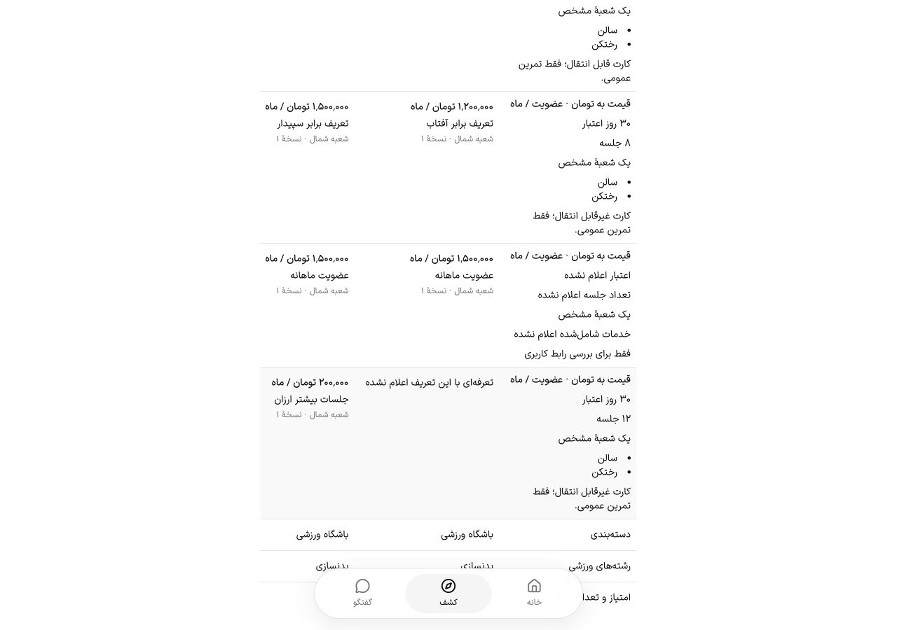

# مقایسهٔ تعریف اعلام‌شدهٔ تعرفه — ۱۹ اکتبر ۲۰۲۶

T022-a، مقایسهٔ تعرفه با تعریف اعلام‌شدهٔ یکسان، پذیرفته شد. T022 والد تا پذیرش جزئیات/باشگاه تازه در native و معیارهای دیگر باز است؛ PH0/PH1 نیز بسته نشده‌اند.

## اصلاح

قبلاً ردیف قیمت، ارزان‌ترین طرح با خدمت/واحد مشابه را انتخاب می‌کرد؛ شرایط ردیف دیگر همهٔ طرح‌ها را نشان می‌داد. طرح۱۰روزه می‌توانست کنار۳۰روزه یا۸جلسه‌ای کنار۱۲جلسه‌ای قرار گیرد.

اکنون هر ردیف، تعریف اعلام‌شدهٔ مشترک دارد: خدمت، واحد، ارز، روز اعتبار، تعداد جلسه، خدمات شامل‌شده، متن شرایط و دامنهٔ همهٔ شعب/یک شعبه. همهٔ پیشنهادهای آن تعریف با نام، قیمت، شعبه و نسخه در سلول باشگاه دیده می‌شوند. نام یا قیمت متفاوت مانع مقایسه نیست؛ اختلاف اعتبار/جلسه/خدمات/شرایط/دامنه، ردیف جدا می‌سازد. نبود پیشنهاد به‌صراحت نمایش داده می‌شود؛ صفر قیمت معتبر است و نبود مقدار به معنی نامحدود نیست.

متن فقط از نظر شکل حروف فارسی/عربی، ارقام، NFC و فاصله عادی می‌شود؛ خدمات شامل‌شده به‌صورت مجموعهٔ نام‌ها مقایسه می‌شوند. هم‌معنی‌بودن متن‌های متفاوت حدس زده نمی‌شود. این مقایسهٔ دادهٔ اعلام‌شده است و کامل‌بودن شرایط اعلام‌نشده را تضمین نمی‌کند. سرستون/عنوان ردیف‌ها `scope=col/row` دارند و عددهای ساختاری محلی‌اند.

در آزمون واقعی، Retry بعد از404 موفق شد ولی فوکوس به BODY افتاد. hook مشترک Retry یک fallback اختیاری گرفت؛ مقایسه پس از حذف دکمه به کنترل واحد برمی‌گردد. بازآزمایی نهایی ثابت کرد: Retry ناموفق فوکوس دکمهٔ Try again را نگه داشت؛ موفقیت، SELECT با شناسهٔ compare-unit و ارتفاع۴۴px را در محدودهٔ دید فوکوس کرد. با تأخیر شبکه۱۲۰۰ms و انتخاب جست‌وجو در حین پاسخ، INPUT با شناسهٔ compare-search فوکوس را حفظ کرد. مصرف‌کنندگان قبلی بدون fallback همان مسیر قبلی را دارند.

## شاهد نهایی

- ۱۸۴ آزمون وب/کلاینت/adapter native پاس‌اند؛۵ مورد تازه، جداسازی تعریف، یکسان‌سازی نوشتاری، صفر، همهٔ پیشنهادها، عدم تغییر داده و فیلتر خدمت/واحد/وضعیت را بررسی می‌کنند. دو آزمون i18n و check-copy، lint مرتبط و types fixture API پاس‌اند.
- کاتالوگ موقت از NestJS/PostgreSQL واقعی خوانده شد؛۷ طرح اضافه عمداً فرق اعتبار، تعداد جلسه، متن انتقال، خدمات و دامنهٔ شعبه داشتند. پیشنهادهای هم‌تعریف۱٬۲۰۰٬۰۰۰/۱٬۵۰۰٬۰۰۰ کنار هم و۱۰۰٬۰۰۰/۲۰۰٬۰۰۰ متفاوت در ردیف جدا بودند.
- ۸ حالت fa/en × روشن/تیره ×۱۲۸۰×۹۰۰/۳۶۰×۷۸۰ پیش از اصلاح و دوباره روی build نهایی بررسی شدند:۱۰ عنوان ردیف،۳ سرستون، RTL/LTR درست و صفر سرریز بیرونی. جدول عریض اسکرول داخلی دارد؛ ArrowRight آن را۴۰px جابه‌جا کرد و Tab ستون بعد را داخل viewport آورد. حالت کلاس/دورهٔ بدون پیشنهاد نیز بررسی شد.
- باشگاه مصنوعی با تغییر کنترل‌شدهٔ وضعیت در DB اختصاصی پنهان شد: API404 داد و جدول قیمت کنار رفت. پس از بازگرداندن وضعیت، Retry اطلاعات را بازیابی کرد؛ همان آزمایش، نقص فوکوس را آشکار کرد.

این‌ها پذیرش صفحه‌خوان واقعی، zoom، native، همهٔ حالت‌های کاتالوگ یا معیار کامل PH0 نیستند. fixtureهای مقایسه فقط با `UI_FIXTURE_COMPARISON=true` فعال‌اند و زیر cleanup همان مجموعهٔ اختصاصی قرار دارند.

## build، پاک‌سازی و ادامه

آثار در `.artifacts/ph1-comparison-2026-10-19/` و تصاویر در `docs/qa/baselines/ph1-comparison-2026-10-19/` هستند. build نهایی ورزشکار `67TdtAi1oDgQpKybpGase` exit0 داشت و۷۵۵ ورودی منبع پیش/پس ثابت ماندند؛ browser-final.json همان شناسه را دارد. فقط ورزشکار rebuild شد؛ آخرین buildهای بیزینس/ادمین تاریخی‌اند و این برش برای آن‌ها شاهد تازه نیست. buildها مرحله‌ای و با heap۶۴۰MiB، یک worker و اولویت پایین اجرا شدند؛ اصلاح ارقام، scope عنوان‌ها و سپس فوکوس پیش از بازآزمایی نهایی انجام شدند و preview پیش از هر rebuild بسته شد.

preview با exit130 و API fixture با exit0 بسته شدند؛ cleanup مالکیت‌دار تمام داده/فایل‌های خود را پاک کرد و DB اختصاصی `gym4me_ph1comparison_1a14e17_test` نیز DROP شد. cookie موقت زبان حذف و viewport، media و تأخیر شبکه بازگردانده شدند؛ تب موقت بسته شد. دادهٔ اصلی، containerهای قبلی، پیامک زنده و انتشار بیرونی تغییر نکردند.

T021، نمایش جزئیات/باشگاه تازه روی native در T022 و دروازه‌های PH0/PH1 همچنان طبق [backlog](../product/backlog.md) بازند. پیکربندی نقشه کلید دارد؛ اعتبار/رفتار واقعی provider در این برش آزموده نشد.

