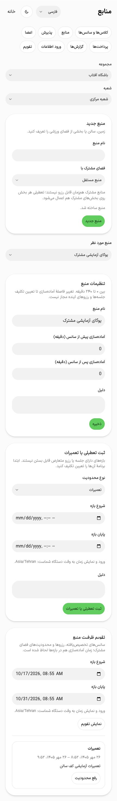
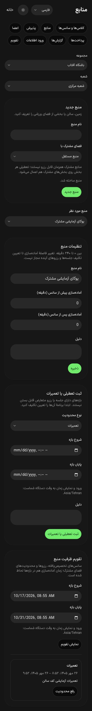
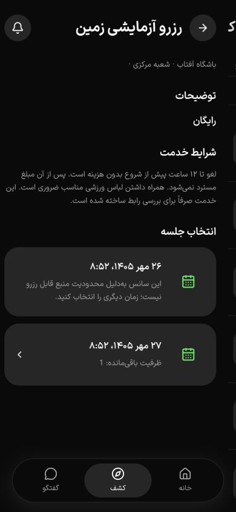

# منابع، آماده‌سازی و تعطیلی — ۱۷ اکتبر ۲۰۲۶

وضعیت: معیار محلی مدل، API و پنل T041 بررسی شد؛ این برش به‌تنهایی پذیرش PH0 تا PH2 را نمی‌بندد.

## تغییر دامنه

منابع قبلی فقط نام، شعبه و واحد مشترک داشتند. migration افزایشی `0025_sports_resource_availability` فاصلهٔ آماده‌سازی پیش/پس از سانس (۰ تا ۲۴۰ دقیقه)، revision منبع و بازه‌های دلیل‌دار تعمیرات/تعطیلی را اضافه می‌کند. کارت‌ها و جزئیات باشگاه تغییر نکرده‌اند.

قفل‌ها به ترتیب منبع و سپس واحد مشترک گرفته می‌شوند. آماده‌سازی در همان `tstzrange` قفل ظرفیت لحاظ می‌شود؛ تعطیلی نیز منبع سوم همان جدول occupancy است و همان قید GiST از هم‌پوشانی آن با کلاس، دوره یا رزرو زمین جلوگیری می‌کند. مرز بازه‌ها `[)` است؛ تماس دقیق انتهای یک تخصیص با ابتدای تخصیص بعد مجاز می‌ماند.

تغییر buffer منبعی با تخصیص آینده رد می‌شود تا زمان وعده‌داده‌شدهٔ رزروهای قبلی عوض نشود. ایجاد یا رفع محدودیت revision/idempotency، مجوز مالک/مدیر شعبه و audit دلیل‌دار دارد. رفع محدودیت داده را حذف نمی‌کند؛ سابقه و دلیل آن حفظ می‌شود. تعطیلیِ متعارض با کلاس برنامه‌ریزی‌شده حتی بدون شرکت‌کننده رد می‌شود؛ ابتدا باید خود جلسه از مسیر مجاز تعیین تکلیف شود.

## قرارداد و صفحات

- `POST /api/v1/business/sports-resources/:id/settings`
- `POST /api/v1/business/sports-resources/:id/blocks`
- `POST /api/v1/business/sports-resources/:id/blocks/:blockId/cancel`
- `GET /api/v1/business/sports-resources/:id/calendar?from=…&to=…`؛ بازهٔ معتبر تا ۹۳ روز و نمایش تخصیص‌های واحدهای مشترک بدون اطلاعات خصوصی ورزشکار.
- ساخت منبع موجود اکنون audit، قفل حسابِ قابل نوشتن و idempotency اجباری در HTTP دارد؛ درخواست هم‌زمان با یک کلید با advisory lock سری می‌شود و همان نتیجه را برمی‌گرداند. فهرست منبع شناسهٔ واحدهای مشترک را نیز برای ساخت بخش مشترک برمی‌گرداند. DTOهای منبع، تنظیمات، محدودیت و تقویم در `@repo/api/sports` و پارامترهای جدید در Swagger ثبت شده‌اند؛ schema ساخت منبع مرجع مشترک parser و Swagger است.
- `/resources` بیزینس: ساخت مستقل/مشترک، انتخاب منبع، تنظیم آماده‌سازی، ثبت محدودیت، فیلتر بازهٔ تقویم و رفع محدودیت با دلیل.
- جزئیات خدمت و جابه‌جایی ورزشکار، سانس فاقد منبع را از انتخاب خرید کنار می‌گذارند؛ ورود مستقیم به checkout نیز پیام و دکمهٔ غیرفعال دارد. quote و تراکنش خرید جداگانه کنترل می‌کنند؛ UI مرجع قفل ظرفیت نیست. تاریخ پیشنهادی کاتالوگ نیز سانس بسته را کنار می‌گذارد.

## شواهد تاکنون

دیتابیس `gym4me_resource_test` و پورت‌های QA 7098/7091/7093 مستقل از preview کاربرند. bucket آزمون‌های تجارت تصادفی و خصوصی است. برای فلو مرورگر، `UI_FIXTURE_RESOURCES=true` یک زمین، بخش مشترک، دو سانس و تعمیرات مصنوعی می‌سازد؛ پیش‌فرض fixture تغییر نکرده است.

- اجرای اولیهٔ ۴۳ آزمون تجارت پاس شد: buffer و مرز دقیق، محدودیت واحد مشترک، تکرار درخواست/رفع محدودیت، quote و checkout، رقابت تعطیلی با خرید، rollback سری و حفظ رزرو قبلی در جابه‌جایی ناموفق.
- نتیجهٔ نهایی: **۴۵ از ۴۵ آزمون تجارت** روی `gym4me_resource_final_test` با `NODE_OPTIONS=--throw-deprecation` پاس شدند (۴٫۳۵۵ ثانیه). قیود دیتابیس، لغو مجوز شعبه و منع replay پس از لغو، تاریخ کاتالوگ و ساخت منبع هم‌زمان/تکراری نیز بررسی شدند. **۳۶ از ۳۶ آزمون کاتالوگ** با همان تنظیم سخت‌گیرانه پاس شدند (۴٫۵۳۵ ثانیه).
- دو اجرای پیشین timeout داشتند؛ پس از timeout، کار ناتمام آزمون با cleanup برخورد کرد و TRUNCATE به deadlock رسید. سناریوی تعمیرات به‌تنهایی پاس شد. در آزمون خواندن تاریخچه، ۱۰۰ ردیف اضافی با fixture دسته‌ایِ دارای قیود واقعی و snapshot همان checkout اصلی جایگزین ۱۰۰ checkout ترتیبی شدند؛ تمام assertهای ۱۰۲ رزرو حفظ شدند و timeout ۳۰ ثانیه تغییر نکرد. این fixture آزمون خواندن است؛ فلوهای مالی و هم‌زمانی همچنان از سرویس واقعی استفاده می‌کنند. اجرای پاک نهایی بدون deadlock تمام شد.
- در مرورگر، سانس تحت تعمیرات بدون لینک خرید و سانس آزاد با لینک خرید دیده شد. ذخیرهٔ آماده‌سازی ۱۲/۲۰ دقیقه، ماندگاری در فرم و بازگشت فوکوس به عنوان تنظیمات بررسی شدند.
- رفع تعمیرات از پنل، ناحیهٔ وضعیت و فوکوس عنوان تقویم را به‌روز کرد؛ پس از بارگذاری کامل صفحهٔ ورزشکار، هر دو سانس لینک خرید داشتند. ثبت تعطیلی تازه با دلیل نیز در تقویم نمایش داده شد.
- پنج select با ارتفاع ۳۶ پیکسل، لینک‌های ناوبری ۳۶ پیکسلی و دکمهٔ ظاهر ۴۰ پیکسلی پیدا و با کلاس‌های محدود به صفحه اصلاح شدند. در [اندازه‌گیری نهایی ۱۲ ترکیب](resource-availability-widths-2026-10-17.json)، دو زبان/دو تم/عرض‌های ۳۶۰، ۳۹۰ و ۴۳۰ سرریز نداشتند و هیچ input/select/textarea/button/link قابل مشاهده‌ای در main کمتر از ۴۴×۴۴ نبود. کنترل‌های داخلی date picker سیستم در این شمارش DOM نیستند.
- تغییر نام منبع به آخر ترتیب الفبایی انتخاب را حفظ کرد. ساخت فضای مشترک با Enter، منبع تازه را در index=2 از سه گزینه انتخاب کرد و محدودیت فضای اصلی در تقویم آن دیده شد. این فلو با قرارداد نهاییِ دارای idempotency نیز دوباره از UI بررسی شد.
- زبان اپ در localStorage همان مبدأ نگه‌داری می‌شد و کنترل زبان در پنل وجود نداشت. پوستهٔ صفحات ورزشی پنل کنترل زبان و ظاهر گرفت؛ business اکنون ClientLocaleProvider و providerهای API/جهت/اعلانِ وابسته به زبان دارد. تغییر انگلیسی/LTR، ماندگاری پس از reload و پیام تعارض انگلیسی از API بررسی شدند. پیام موفقیت منبع نیز به‌جای متن ثابت، کلید ترجمه نگه می‌دارد.
- کنتراست نمونهٔ متن توضیح روی card تیره، با رنگ‌های خنثی OKLCH اندازه‌گیری‌شده، ۶٫۹۱:۱ بود؛ این شاهد کل ممیزی کنتراست یا WCAG نیست.
- پس از QA، سه سرویس آزمایشی متوقف شدند. شمار منابع، محدودیت‌ها، occupancy، خدمات، کاربر و سازمان fixture هر شش مورد صفر بود. چهار دیتابیس موقت این برش پس از تأیید نبود اتصال حذف شدند. زبان‌های هر دو مبدأ QA فارسی و ظاهر پنل تیره شد؛ viewport بازنشانی و تب‌های خود عامل بسته شدند. شبیه‌سازی موقت media به همان تب محدود بود و با بسته‌شدن آن پایان یافت.

| بررسی فنی نهایی | نتیجه |
| --- | --- |
| API، shared API، UI و business | TypeScript و lint مرتبط پاس |
| زبان‌ها | ۲ آزمون و کنترل متن پاس |
| build API/application/business | موفق؛ وب‌ها در `.next-qa` ایزوله ساخته شدند |
| export native | ۴۹ مسیر static موفق؛ API URL تنظیم نبود و شاهد اجرای دستگاه نیست |
| اجزای محافظت‌شده | ۵۹ فایل کارت، جزئیات و وابستگی‌ها بدون تغییر |

## محدودیت ابزار طراحی

مهارت 12ui اجرا شد. درخواست اول پیش از تولید طرح با ناسازگاری پاسخ corpus (`balanced` در برابر `hedge`) متوقف شد؛ تلاش صریح با `balanced` به HTTP 403 با `unsupported_country_region_territory` رسید. هیچ تصویر یا طرحی تولید یا تأیید نشد. پنل با ترکیب‌های موجود shadcn تکمیل شد و نباید «هم‌تراز با طرح تولیدشدهٔ 12ui» گزارش شود. شواهد اجرای ابزار در دو پوشهٔ موقت `12ui-gym4me-sports-business-resource-XKAana` و `12ui-gym4me-business-resource-managem-CfQxj1` باقی‌اند.

مستندات رسمی [Field](https://ui.shadcn.com/docs/components/radix/field)، [Button](https://ui.shadcn.com/docs/components/radix/button)، [Card](https://ui.shadcn.com/docs/components/radix/card) و [Native Select](https://ui.shadcn.com/docs/components/radix/native-select) با CLI خوانده شدند؛ اجزای نصب‌شده دوباره نصب یا بازنویسی نشدند.

## حدود پذیرش

صفحه‌خوان واقعی، بزرگ‌نمایی، دستگاه Android/iOS، drag/drop، تعطیلی تکرارشونده، تخصیص مجدد دورهٔ فروخته‌شده، QA کامل حرکت و staging با این شاهد بسته نمی‌شوند. حفظ template سانس زمین در زمان تعمیرات به معنی بازبودن خرید نیست؛ دسترسی دوباره در quote و تراکنش خرید کنترل می‌شود. انتخاب واحد مشترک باید واقعیت سالن را بازتاب دهد. این برش معیار محلی T041 را پوشش می‌دهد؛ پذیرش عملیاتی و فاز PH2 مستقل و بازند.
