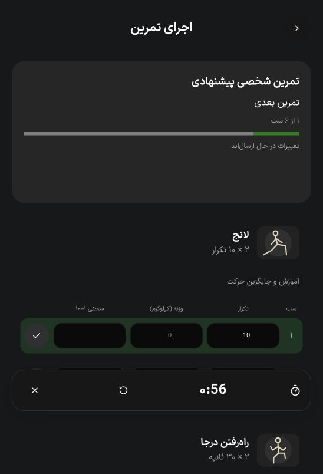
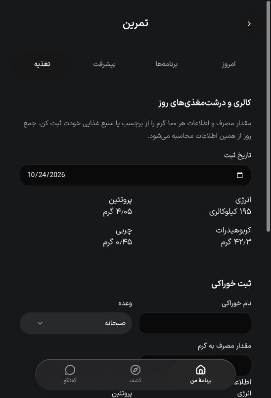

# آزمون قابلیت‌های منتخب — ۲۴ اکتبر ۲۰۲۶

این گزارش مربوط به برش E01 تا E06 در [سند دامنه و پیاده‌سازی](../product/selected-capabilities-implementation.md) است. تغییرات محلی‌اند و پذیرش کل فهرست قابلیت‌های محصول یا آمادگی انتشار را اعلام نمی‌کنند.

## محیط

- PostgreSQL 18 روی loopback و پورت موقت 55434، در کلاستر جداگانهٔ `/tmp/gym4me-selected.eziBWH`.
- دیتابیس‌های مستقل برای آزمون سرویس، رگرسیون تمرین و رابط؛ همه با کاربران و دادهٔ ساختگی.
- migrationهای 0041، 0042 و 0043 روی همین دیتابیس‌های موقت اجرا شدند.
- رابط Next در حالت توسعهٔ QA روی `localhost:7091` و API fixture روی `127.0.0.1:7098` بررسی شد. OTP و رضایت از fixture ساختگی بودند.
- بانک، پیامک واقعی، دیتابیس عملیاتی و انتشار استفاده نشدند.
- پس از ثبت شواهد، تب و سرورهای موقت QA و کلاستر آزمایشی متوقف و خروجی موقت آن‌ها پاک شد؛ تصاویر و آزمون‌های بازتولیدپذیر در پروژه باقی‌اند.

## نتایج خودکار

| بررسی | نتیجه | پوشش |
| --- | --- | --- |
| قواعد پیشنهاد و قرارداد تغذیه | ۸ آزمون موفق | تجهیزات، استثناها، کمبود سابقه، تمرین اخیر، کاهش فشار، شرط افزایش بار، زمان، دادهٔ آینده/قدیمی، محاسبه و اعتبارسنجی غذا |
| سرویس‌های جدید روی PostgreSQL | ۶ آزمون موفق | تکرار عملیات، هم‌زمانی تأیید، مالکیت، انقضا، حرکت آرشیوشده، حساب در حال حذف، جداسازی سابقه، اتصال به ثبت ست، جمع روز غذا، نسخهٔ برنامهٔ غذایی و مجوز ویدیو |
| رگرسیون موجود تمرین | ۲۲ آزمون موفق | برنامه و نسخه، واگذاری، اجرای تمرین و مسیرهای همکاری/حریم خصوصی موجود |
| i18n | ۲ آزمون موفق و check-copy موفق | هم‌ترازی پیام‌ها و کلیدها |
| TypeScript | موفق | API سرور، کلاینت API و UI مشترک |
| ESLint فایل‌های درگیر | موفق | سرویس/قرارداد/کنترلر/آزمون جدید و اجزای UI تغییرکرده |
| check-ui-fixture و diff --check | موفق | مرز fixture و قالب patch |

جمع آزمون‌های دامنه و رگرسیون: **۳۶**؛ دو آزمون ترجمه جداگانه‌اند. اولین اجرای رگرسیون به‌دلیل کمبود فضای cache متوقف شد؛ پس از پاک‌کردن خروجی موقت همین QA، اجرای بدون cache هر ۲۲ آزمون را گذراند.

نمونهٔ فرمان‌های بازتولید از ریشهٔ پروژه؛ PostgreSQL محلی و دیتابیس اختصاصی باید از قبل آماده باشند:

```sh
pnpm --filter api exec jest --runInBand --no-cache --runTestsByPath src/modules/training/adaptive.policy.spec.ts src/modules/training/nutrition.contracts.spec.ts
SELECTED_TEST_DATABASE_URL=postgresql://gym4me@127.0.0.1:55434/gym4me_selected_test pnpm --filter api exec ts-node test/adaptive.integration.test.ts
TRAINING_TEST_DATABASE_URL=postgresql://gym4me@127.0.0.1:55434/gym4me_selected_training_test pnpm --filter api test:training --no-cache
pnpm --filter api exec tsc --noEmit --incremental false
pnpm --filter @repo/api exec tsc --noEmit --incremental false
pnpm --filter @repo/ui exec tsc --noEmit --incremental false
pnpm --filter @repo/i18n test
pnpm --filter @repo/i18n check-copy
node scripts/check-ui-fixture.mjs
git diff --check
```

آزمون سرویس جدید، مقصد غیرمحلی یا نام دیتابیس بدون پسوند `_selected_test` را رد می‌کند. آزمون رگرسیون موجود فقط در دیتابیس اختصاصی fixture اجرا شود.

## بررسی مرورگر

1. پیشنهاد با وزن بدن ساخته و پیش‌نمایش داده شد؛ تأیید، برنامهٔ شخصی جدید ساخت. شروع همان برنامه به اجرای موجود رسید؛ یک ست ثبت شد، پیشرفت ۱ از ۶ و تایمر استراحت دیده شد.
2. در تب تغذیه، ۱۵۰ گرم خوراک آزمایشی با برچسب هر ۱۰۰ گرم شامل ۱۳۰ کالری، ۲٫۷ پروتئین، ۲۸٫۲ کربوهیدرات و ۰٫۳ چربی ثبت شد. فرم پاک شد، ثبت در فهرست آمد و جمع روز **۱۹۵ کالری، ۴٫۰۵ پروتئین، ۴۲٫۳ کربوهیدرات و ۰٫۴۵ چربی** نمایش داده شد.
3. دکمهٔ چاپ در برنامهٔ تأییدشده، حالت چاپ و دکمهٔ بستن آن را فعال کرد. فرمان چاپ در مرورگر داخلی به timeout ابزار رسید؛ تولید و ذخیرهٔ فایل PDF نهایی تأیید نشده و باید در مرورگر پشتیبانی‌شده بررسی شود.





## مرز پذیرش

- برنامهٔ غذایی، متن نسخه‌دارِ همراه برنامهٔ تمرین است. رژیم خودکار، بانک غذای آماده یا فرایند متخصص تغذیه تحویل نشده است.
- پیشنهاد تمرین قواعد داخلی قابل توضیح دارد؛ اندازه‌گیری یا پیش‌بینی فیزیولوژیک ریکاوری ندارد.
- metadata ویدیو با URL آزمایشی در دیتابیس موقت آزمون شد؛ فایل رسانه فراخوانی نشد و metadata پس از آزمون پاک شد. پخش رسانهٔ واقعی، مجوز محتوا، زیرنویس و سازگاری native آزمون نشده‌اند.
- دکمهٔ لینک عمومی مربی از نظر نوع و lint بررسی شد؛ clipboard بومی دستگاه و دامنهٔ production در این نوبت آزمون نشدند.
- build کامل production، بستهٔ native و اتصال تجهیزات گیت/کمد در این برش اجرا نشدند.
- اعتبار چند مجموعه، ظرفیت خالی، CRM، بازی باز و پرداخت سهمی مطابق سند دامنه همچنان کار مستقل باقی دارند.

پیش از انتشار، migrationهای جدید باید از مسیر معمول پروژه اعمال شوند؛ سپس چاپ PDF، رسانهٔ دارای مجوز و clipboard در مرورگر و دستگاه هدف آزمون شوند.
