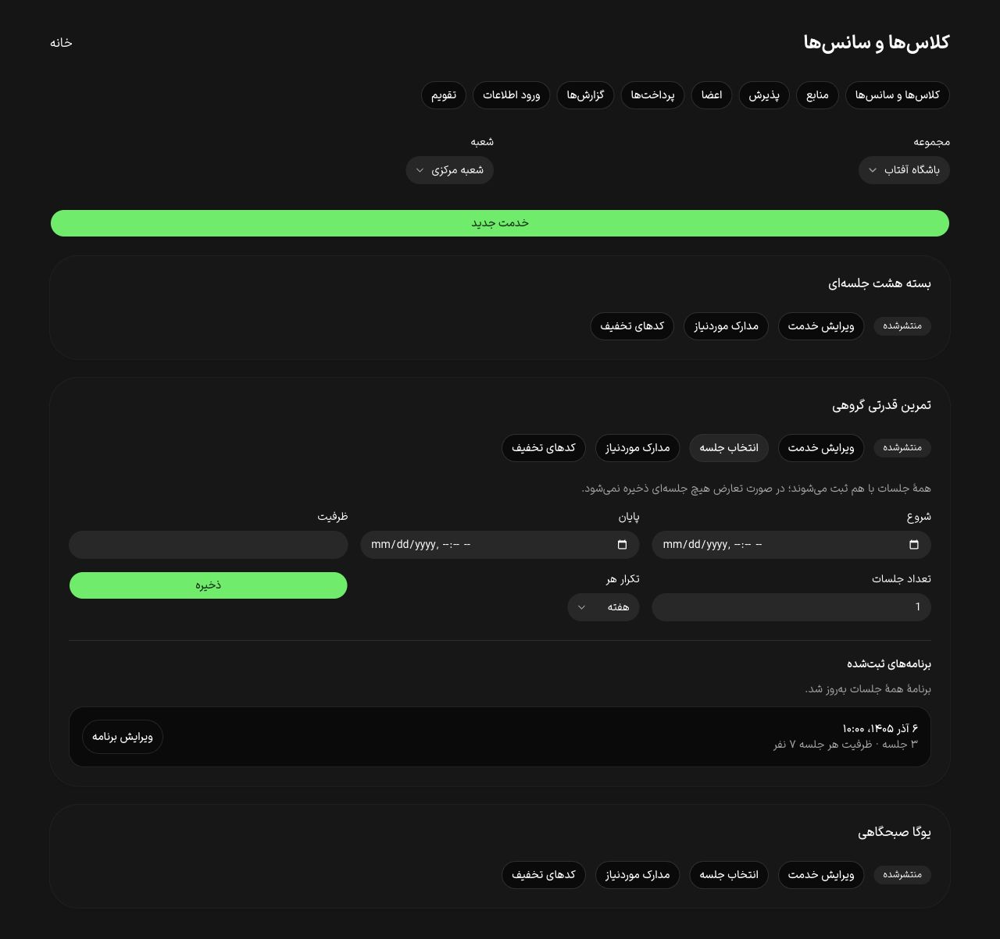

# ویرایش برنامهٔ جلسات — ۱۷ اکتبر ۲۰۲۶

این برش بخشی از T042 است؛ پذیرش کامل PH0، PH1 یا PH2 محسوب نمی‌شود.

## رفتار و قرارداد

- migration افزایشی `0022_sports_occurrence_series_edit`، revision سری و قید یکتای deferred برای تاریخ جلسات را اضافه می‌کند. تغییر موقتِ تاریخ یک جلسه به تاریخ قبلی جلسهٔ دیگر، در صورت معتبر بودن برنامهٔ نهایی، ممکن است.
- `GET /api/v1/business/sports/services/:id/occurrence-series` خلاصه و امکان ویرایش هر سری را با مجوز شعبه برمی‌گرداند.
- `POST /api/v1/business/sports/services/:id/occurrence-series/:seriesId/edit` زمان شروع/پایان اولین جلسه، ظرفیت، فاصله، revision، دلیل و کلید idempotency می‌گیرد. تعداد و شناسهٔ جلسات ثابت می‌مانند.
- قفل خدمت، سری و جلسات، بررسی ثبت‌نام/انتظار/دعوت/گفتگو، قفل دورهٔ فروخته‌شده، بازسازی ادعاهای منبع/مربی و audit در یک تراکنش‌اند. تعارض در هر جلسه همهٔ تغییرات را برمی‌گرداند. تکرار همان فرمان نتیجهٔ ذخیره‌شده را می‌دهد؛ revision کهنه رد می‌شود.
- پنل بیزینس برنامه‌های ثبت‌شده را نمایش می‌دهد و ویرایش سری‌های قفل‌شده را فعال نمی‌کند. تاریخ خلاصه فارسی شمسی است؛ ورودی زمان همچنان کنترل بومی `datetime-local` مرورگر است و انتخاب‌گر شمسی اختصاصی نیست.

## شواهد

- ۳۳ آزمون تجارت با همهٔ migrationها روی PostgreSQL ایزوله پاس شد. دو آزمون تازه، حفظ شناسه، تغییر فاصله/ظرفیت، تکرار فرمان، revision کهنه، سازمان دیگر، قفل پس از ثبت‌نام و rollback تعارض جلسهٔ دوم را پوشش می‌دهند. جابه‌جایی به تاریخ قبلی جلسهٔ بعدی نیز آزموده شد.
- در مرورگر QA و دیتابیس اختصاصی `gym4me_series_ui_test`، ورود با پیامک ساختگی، ساخت سه جلسه، خطای پایانِ قبل از شروع، تغییر تاریخ/ظرفیت/فاصله، پیام موفقیت و بازگشت focus به دکمهٔ ویرایش بررسی شدند. پس از بستن و بازکردن بخش، مقادیر ذخیره‌شده باقی بودند.
- عرض سند در عرض‌های ۳۶۰، ۳۹۰ و ۴۳۰ با عرض viewport برابر بود. این بررسی به فارسی/تم تیره و همین فرم محدود است.
- برای شعبهٔ بدون خدمت، بارگذاری و راهنمای حالت خالی اضافه شد. فرم ویرایش به ماژول مستقل منتقل شد؛ Field/Separator موجود، نام صریح فرم، ارتباط label و input، ارتباط خطای تاریخ با ورودی‌ها، حداقل ارتفاع ۴۴ پیکسل کنترل‌های جدید و قفل ورودی هنگام ذخیره استفاده می‌شوند.
- کنترل یکسان‌بودن کلیدها/آرگومان‌های دو زبان، دو متن انگلیسی در namespace اشتباه را پیدا کرد؛ اصلاح شدند و هر دو آزمون i18n پاس شدند.
- پس از تکمیل Fieldها، مرورگر دوباره بارگذاری شد: هر شش کنترل فرم در سه عرض دقیقاً ۴۴ پیکسل ارتفاع داشتند، `aria-invalid` در خطای تاریخ فعال شد، ظرفیت جدید ذخیره و پیام موفقیت با ارقام فارسی نمایش داده شد. build API و business، typecheck UI/API/قرارداد، lint مرتبط، کنترل متن و هش ۵۹ فایل محافظت‌شده پاس شدند.
- fixture و preview جدا متوقف شدند. پیش از حذف دیتابیس موقت، شمار سری، خدمت و کاربر ساختگی صفر بود. دو دیتابیس اختصاصی همین برش حذف شدند؛ fixture و دیتابیس‌های قبلی کاربر تغییر نکردند.

یک اجرای میانی مجموعهٔ تجارت شکست‌های زمان‌حساس در پرداخت/انتظار داشت. اجرای متمرکز و اجراهای بعدی مجموعه پاس شدند، ولی علت قطعی آن شکست ثبت نشده است؛ پایداری روی CI مستقل همچنان باید بررسی شود.

## باقی‌مانده

گروه سنی و پیش‌نیازهای دسته‌بندی‌شده در [برش بعدی](service-eligibility-2026-10-17.md) اضافه و بررسی شدند. تصویر خدمت نیز در [برش بعدی](service-cover-2026-10-17.md) اضافه شد. ویرایش دورهٔ فروخته‌شده از مسیر رسیدگی پشتیبانی و معیارهای دیگر T042 بازند. ممیزی کامل دو زبان/دو تم، صفحه‌خوان، انتخاب‌گر شمسی، آزمون دستگاه و پذیرش staging هنوز با این شاهد اثبات نشده‌اند.
