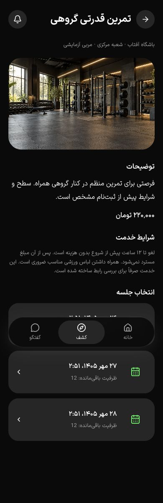

# تصویر نسخه‌دار خدمت — ۱۷ اکتبر ۲۰۲۶

این برش، تصویر خدمت در T042 و بخشی از نگهداری فایل T019 را تکمیل می‌کند؛ پذیرش کامل PH0–PH2 نیست.

## پیاده‌سازی

- Migration افزایشی `0024_sports_service_images` تصویر را به خدمت متصل می‌کند. کلید خارجی مرکبِ خدمت/تصویر مانع اتصال تصویر خدمت دیگری به نسخه می‌شود.
- `POST /api/v1/business/sports/services/:id/cover` فایل، توضیح جایگزین، revision و کلید idempotency می‌گیرد. JPG/PNG/WebP تا ۱۰ مگابایت، با کنترل نوع واقعی، تعداد فریم و سقف پیکسل پذیرفته و پس از اصلاح جهت/حذف metadata به WebP تبدیل می‌شود. تغییر تصویر، نسخهٔ تازه و audit می‌سازد و داده‌های دیگر خدمت را حفظ می‌کند.
- `POST .../:id/cover/remove` نسخهٔ بدون تصویر می‌سازد. انتشار صریح همچنان لازم است. فایل نسخهٔ قدیمی بلافاصله پاک نمی‌شود؛ نسخه‌های تاریخی آن را نگه می‌دارند.
- `GET .../:id/cover/preview` پیش‌نمایش امضاشدهٔ کوتاه‌عمر برای میزبان مجاز می‌دهد. `GET /api/v1/sports/media/:id` فقط تصویر نسخهٔ فعلیِ منتشرشده در مجموعهٔ عمومی و تأییدشده را با `image/webp`، `nosniff` و `no-store` ارائه می‌کند. پیش‌نویس و تصویر کنارگذاشته‌شده عمومی نیستند.
- فرم ساخت خدمت مسیر افزودن تصویر پس از ثبت را توضیح می‌دهد. بخش تصویرِ مدیریت خدمت، انتخاب فایل، alt، پیش‌نمایش، ثبت، حذف از پیش‌نویس، خطا و پیام موفقیت دارد. پس از عملیات focus به انتخاب فایل برمی‌گردد. تصویر در جزئیات عمومی و بررسی خرید از همان base URL قرارداد API خوانده می‌شود؛ آدرس میزبان در UI ثابت نشده است.
- فهرست‌گیری S3 اکنون prefix می‌گیرد. نگهداری فایل، `sports/` را جدا از `clubs/` بررسی می‌کند؛ شاخهٔ قبلی sports زیر فهرست‌گیریِ محدود به clubs عملاً اجرا نمی‌شد. پیام/مدرک/تصویر دارای metadata حفظ می‌شوند و فایل قدیمیِ بدون مرجع قابل پاک‌سازی است.

## شواهد

- ۳۸ آزمون تجارت روی PostgreSQL تازه و S3 واقعی پاس شد. سه آزمون تازه خصوصی‌بودن پیش‌نویس، انتشار/حذف نسخه‌دار، تکرار فرمان، کلید با محتوای متفاوت، حفظ تصویر در ویرایش متن خدمت، سازمان دیگر، مدیر دارای شعبه/فاقد شعبه، قید اتصال بین خدمات، فایل SVG با MIME جعلی، revision کهنه بدون باقی‌ماندن object، حذف orphan و حفظ فایل تاریخی را پوشش می‌دهند.
- ۳۶ آزمون کاتالوگ/رسانهٔ باشگاه نیز پاس شد. هر دو مجموعهٔ آزمون bucket تصادفی و اختصاصی می‌سازند و پس از اجرا حذف می‌کنند؛ تست retention فایل‌های bucket مشترکِ preview را بررسی/حذف نمی‌کند.
- build API، application و business و TypeScript/lint مرتبط پاس شدند. دو آزمون i18n، کنترل متن، هش ۵۹ فایل محافظت‌شده و `git diff --check` پاس‌اند.
- مرورگر QA با حساب و دیتابیس ساختگی: فایل موجود `public/images/clubs/training.png` بدون تغییر فایل اصلی بارگذاری شد. متن جایگزین ثبت شد؛ پیش‌نمایش خصوصی و پیام موفقیت دیده شدند و focus به انتخاب فایل برگشت. پیش از انتشار، تصویر عمومی وجود نداشت؛ پس از انتشار، تصویر از endpoint جدید با `naturalWidth=1672` بارگذاری شد. همان تصویر در صفحهٔ خرید نیز واقعاً بارگذاری شد.
- حذف تصویر از پیش‌نویس و انتشار نسخهٔ بدون تصویر در UI انجام شد؛ پس از reload، تصویر عمومی وجود نداشت. حفظ تصویر عمومی تا پیش از انتشار حذف، در آزمون API بررسی شده است؛ مشاهدهٔ فوریِ UI پس از reload برای این حالت به‌عنوان شاهد استفاده نشده است.
- جزئیات خدمت به فارسی/تیره در عرض‌های ۳۶۰، ۳۹۰ و ۴۳۰ سرریز افقی نداشت؛ عرض تصویر به‌ترتیب ۳۲۰، ۳۵۰ و ۳۹۰ بود. این بررسی، ماتریس کامل زبان/تم و همهٔ صفحات نیست.
- fixture، دو preview و تب‌های QA متوقف/بسته شدند و viewport به حالت اولیه برگشت. پیش از حذف دیتابیس موقت، شمار تصویر، خدمت و کاربر ساختگی صفر بود؛ cleanup، objectهای تصاویر همین fixture را نیز حذف کرد.

## موارد باز

آزمون دستگاه، پوشش کامل روشن/تیره و فارسی/انگلیسی، حالت خطای تصویر در مرورگر، پذیرش staging و رسیدگی به تغییر دورهٔ فروخته‌شده بازند. تصویر در سفارش‌های تاریخی نمایش داده نمی‌شود؛ فایل تاریخی در storage حفظ می‌شود.

مجموعهٔ کاتالوگ در این برش با وجود پاس‌شدن، هشدار `pg` دربارهٔ فراخوانی query روی client مشغول داشت. در [برش بعدی](booking-history-2026-10-17.md)، ریشه در خواندن موازی بخش‌های publication readiness روی یک اتصال تراکنش شناسایی و اصلاح شد؛ هر ۳۶ آزمون با `NODE_OPTIONS=--throw-deprecation` پاس شدند.
