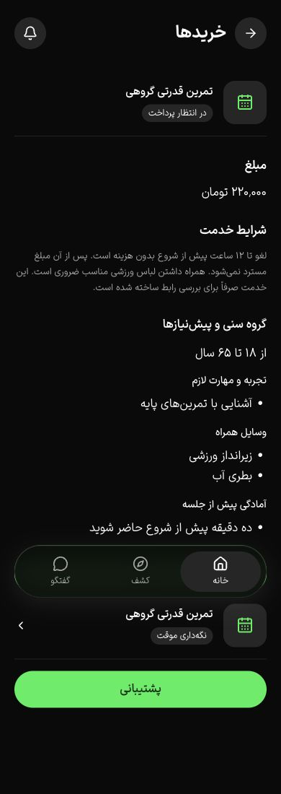

# گروه سنی و پیش‌نیاز خدمت — ۱۷ اکتبر ۲۰۲۶

این برش، ثبت و نمایش نسخه‌دار شرایط مخاطب در T042 را پوشش می‌دهد. تصویر خدمت در [برش بعدی](service-cover-2026-10-17.md) اضافه و بررسی شد. تغییر دورهٔ فروخته‌شده و پذیرش کامل فازها همچنان بازند.

## داده و قرارداد

Migration افزایشی `0023_sports_service_eligibility` به هر نسخهٔ خدمت، `eligibility` با حداقل/حداکثر سنِ اختیاری و فهرست پیش‌نیازهای دسته‌بندی‌شده اضافه می‌کند. دسته‌ها تجربه و مهارت، وسایل همراه و آمادگی پیش از جلسه‌اند. سن عدد صحیح ۰ تا ۱۲۰ است؛ حداکثر نباید کمتر از حداقل باشد. حداکثر ۱۲ پیش‌نیاز و هر مورد حداکثر ۲۰۰ نویسه مجاز است. هم schema ورودی و هم قید PostgreSQL ساختار داده را کنترل می‌کنند. نسخه‌های قبلی به‌صورت پیش‌فرض محدودیت تازه‌ای ندارند.

ساخت و ویرایش خدمت این داده را در نسخهٔ تازه ثبت می‌کنند. کاتالوگ، جزئیات عمومی و پاسخ quote، نسخهٔ منتشرشده را برمی‌گردانند. سفارش، شرایط را داخل snapshot نگه می‌دارد؛ تغییر یا انتشار بعدی، سفارش قبلی را عوض نمی‌کند. DTOهای خدمت، quote، سفارش و رزرو در `@repo/api` به‌روز شده‌اند و snapshotهای قدیمیِ فاقد این فیلد پشتیبانی می‌شوند. Swagger ساخت و ویرایش خدمت از همان schema اعتبارسنجی تولید می‌شود.

این داده، شرط اعلام‌شدهٔ باشگاه است. تاریخ تولد تازه‌ای جمع نمی‌شود و سن یا مهارت فرد خودکار تأیید نمی‌شود. بررسی مدارک الزامی، مسیر جداگانهٔ فعلی خود را حفظ می‌کند.

## رابط و شواهد

- فرم مشترکِ ساخت/ویرایش بیزینس از Fieldهای موجود استفاده می‌کند؛ label و توضیح به ورودی مرتبط‌اند. بازهٔ نادرست، بیش از ۱۲ مورد و خطِ بیش از ۲۰۰ نویسه، پیش از ارسال پیام فارسی دارند. اصلاح حداقل سن، خطای کهنهٔ حداکثر را پاک می‌کند.
- خلاصهٔ مشترک در جزئیات خدمت، بررسی خرید، جزئیات سفارش و رزرو استفاده شده است. اعداد با زبان رابط قالب‌بندی می‌شوند و دسته‌های خالی نمایش داده نمی‌شوند.
- در مرورگر ایزوله، شرایط ۱۸ تا ۶۵ سال با چهار پیش‌نیاز ذخیره و منتشر شد؛ پس از بازکردن مجدد فرم باقی بود. سپس ورزشکار ساختگی قیمت را بررسی و سفارش ایجاد کرد. بعد از انتشار بازهٔ ۱۸ تا ۷۰ در بیزینس، صفحهٔ خدمت ۱۸ تا ۷۰ و سفارش قبلی پس از reload همچنان ۱۸ تا ۶۵ را نشان داد.
- خلاصهٔ جزئیات خدمت در ۱۲ ترکیبِ فارسی/انگلیسی، روشن/تیره و عرض ۳۶۰/۳۹۰/۴۳۰ بررسی شد؛ عرض سند با viewport برابر بود. فرم بیزینس به فارسی/تیره در هر سه عرض بررسی شد؛ حداقل ارتفاع دو ورودی سن ۴۴ پیکسل و سه textarea دست‌کم ۶۴ پیکسل بود. این شاهد، ممیزی کامل صفحات یا صفحه‌خوان نیست.
- ۳۵ آزمون تجارت روی PostgreSQL تازه با همهٔ migrationها پاس شدند. دو آزمون تازه، نسخهٔ زنده در برابر پیش‌نویس، snapshot سفارش، quote کهنه پس از انتشار و رد داده‌های نامعتبر در ورودی و دیتابیس را پوشش می‌دهند.
- build API، application و business؛ TypeScript و lint مرتبط؛ دو آزمون i18n و کنترل متن پاس شدند. کنترل هش ۵۹ فایل محافظت‌شده و `git diff --check` نیز پاس‌اند.
- fixture و دو preview متوقف شدند. شمار خدمت، سفارش و کاربر ساختگی پیش از حذف دیتابیس اختصاصی صفر بود. زبان فارسی، تم تیره و اندازهٔ پیش‌فرض مرورگر بازگردانده شدند؛ تب‌های ایجادشده برای QA بسته شدند.

تصاویر خلاصهٔ خدمت: [فارسی تیره](images/service-eligibility-fa-dark.jpg)، [فارسی روشن](images/service-eligibility-fa-light.jpg)، [انگلیسی تیره](images/service-eligibility-en-dark.jpg)، [انگلیسی روشن](images/service-eligibility-en-light.jpg).

## محدودیت پذیرش

احراز واقعی سن/صلاحیت، ممیزی کامل فرم بیزینس در دو زبان/دو تم، آزمون صفحه‌خوان و دستگاه، staging و دروازهٔ فروش واقعی با این برش اثبات نشده‌اند. T042 و PH2 بسته نمی‌شوند.
