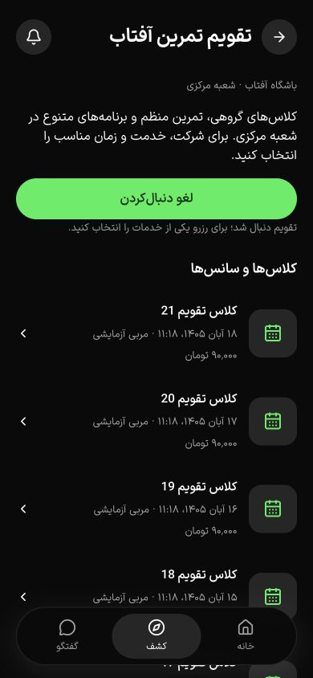
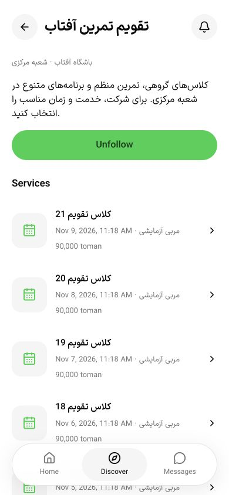
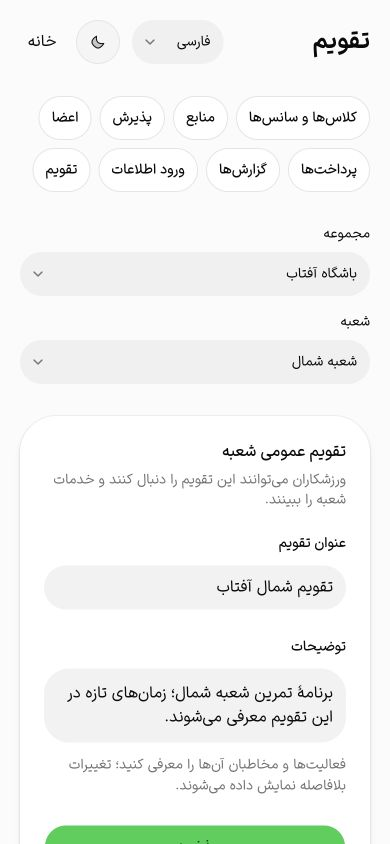

# تقویم ورزشی شعبه و دنبال‌کردن — ۱۷ اکتبر ۲۰۲۶

این برش بخشی از T069 و پذیرش تجربهٔ PH0/PH2 است. پذیرش کامل فازها، دستگاه و میزبانی گفتگو همچنان باز است. داده‌های مرورگر در `gym4me_calendar_ui_test` ساختگی و مستقل از preview کاربر و staging بودند؛ پیامک از adapter محلی و PostgreSQL/S3 واقعی استفاده شد. فلو یا تصویر تازه‌ای از Luma در این برش مشاهده نشده؛ ادامهٔ الگوهای ثبت‌شده و اجزای موجود محصول است.

## قرارداد و قواعد

منطق تقویم از CommunityService به `SportsCalendarService` منتقل شد. migration افزایشی `0028_sports_calendar_metadata`، revision مثبت، زمان ایجاد/ویرایش و indexهای صفحه‌بندی را اضافه می‌کند. schema ورودی و Swagger از منبع مشترک و DTO/hookهای کلاینت در `@repo/api/sports` هستند.

| مسیر API | رفتار |
| --- | --- |
| `GET sports/calendars/page` | جست‌وجوی عنوان، توضیح، مجموعه و شعبه؛ cursor و حداکثر ۲۵ مورد |
| `GET sports/community/calendars/page` | فقط تقویم‌های دنبال‌شدهٔ حساب فعلی با همان قرارداد |
| `GET sports/calendars/:id` و `:id/services` | دریافت مستقیم تقویم، نخستین ۲۰ خدمت و صفحه‌های بعدی |
| `GET/POST sports/community/calendars/:id/follow` | وضعیت و تنظیم تکرارپذیر دنبال‌کردن؛ بدون سفارش یا ظرفیت |
| `GET/POST sports/community/host/calendar` | scope سازمان/شعبه؛ مشاهده برای چهار نقش و ویرایش فقط مالک/مدیر مجاز |

مسیرها زیر `/api/v1/` هستند. دریافت مستقیم دیگر تقویم خارج از نخستین ۱۰۰ رکورد را گم نمی‌کند. cursor در همان فیلتر/حساب/شعبه اعتبارسنجی و tuple زمان/شناسه در SQL مقایسه می‌شود؛ دقت میکروثانیه با تبدیل به Date از بین نمی‌رود. یک رکورد اضافه پایان صفحه را تعیین می‌کند. مسیرهای آرایه‌ای قبلی برای سازگاری باقی‌اند؛ صفحات جدید از آن‌ها استفاده نمی‌کنند.

فهرست عمومی فقط سازمان تأییدشده، باشگاه منتشرشده و شعبهٔ آرشیونشده را نشان می‌دهد. افزودن follow همین شرط و قفل حساب قابل‌نوشتن را دارد؛ حذف follow پس از ناموجودشدن مجموعه نیز مجاز است. ویرایش metadata با قفل شعبه، revision، کلید تکرار دارای hash، receipt و audit اتمیک است؛ مجوز فعلی پیش از replay دوباره بررسی می‌شود. تغییر بدنه با کلید قبلی و نسخهٔ کهنه رد می‌شوند. ایجاد تقویم پیش از اولین خدمت ممکن است؛ ساخت خدمت بعدی عنوان/توضیح نویسنده را جایگزین نمی‌کند.

## رابط و شواهد مرورگر

فهرست، جست‌وجو و تب «همه/تقویم‌های شما»، جزئیات، ورود برای دنبال‌کردن، خدمات صفحه‌بندی‌شده و پیش‌نمایش خانه متصل‌اند. انتخاب تب در query می‌ماند و reload آن را حفظ می‌کند. بارگذاری بیشتر با Enter، شمار قابل‌اعلان و انتقال focus به اولین رکورد تازه دارد. hint روشن می‌کند دنبال‌کردن رزرو نیست؛ برای شرکت باید خدمت انتخاب شود.

پنل `/calendar` بیزینس عنوان و توضیح عمومی را با اجزای موجود Field/Card/Input/Textarea/Button و توکن‌های فعلی ویرایش می‌کند. هدف ورودی عنوان و دلیل جلسه به‌صورت محدوده‌دار حداقل ۴۴ پیکسل شد؛ هیچ Input، preset یا CSS عمومی عوض نشد. خطای عنوان به field متصل و focus به آن برمی‌گردد؛ ذخیرهٔ موفق پیام status و focus روی عنوان بخش دارد. تعارض، پیش‌نویس را نگه می‌دارد و تنها دکمهٔ صریح «بارگذاری اطلاعات فعلی» آن را جایگزین می‌کند. خطای refetch دادهٔ موجود را از فرم حذف نمی‌کند. headingهای بخش و خدمات معنایی هستند.

سناریوهای واقعاً اجراشده:

- دایرکتوری ابتدا ۲۶ و پس از ایجاد تقویم شمال ۲۷ رکورد یکتا داشت؛ صفحهٔ ۲۰تایی با Enter کامل شد. دنبال‌شده‌ها ۲۵ رکورد و خدمات تقویم مرکزی ۲۴ رکورد یکتا بودند؛ focus روی رکورد ۲۱ نشست. [ثبت DOM و ماتریس](calendar-widths-2026-10-17.json).
- جست‌وجوی بی‌نتیجه، پیام خالی/شمار صفر و جست‌وجوی عنوان دقیق با یک نتیجه بررسی شدند. تب دنبال‌شده پس از reload در URL و aria-pressed حفظ شد.
- ورود ناشناس از CTA با returnTo همان شناسه، OTP ساختگی، دنبال‌کردن و لغو دنبال‌کردن و پیش‌نمایش خانه بررسی شدند؛ هیچ سفارش یا رزروی ایجاد نشد.
- مالک، تقویم مرکزی را ویرایش و تقویم شعبهٔ شمالِ بدون خدمت را ایجاد کرد؛ reload و انتخاب دوبارهٔ شعبه ماندگاری را نشان دادند. عنوان whitespace خطای فارسی و focus درست داشت. تعارض با افزایش کنترل‌شدهٔ revision در دیتابیس **آزمایشی** تزریق شد؛ خطای 409، حفظ draft، بارگذاری صریح نسخهٔ تازه و ذخیرهٔ مجدد موفق مشاهده شدند. این تزریق، اقدام کاربر واقعی یا audit API تلقی نمی‌شود.
- ورود جداگانهٔ کاربر ساختگی با نقش پذیرش، تقویم و جلسات را نشان داد؛ تعداد ورودی عنوان/توضیح، دکمهٔ ذخیره، لغو و ساخت گفتگو هر چهار صفر بود. build نهایی headingهای H2/H3 و همین نمایش فقط‌خواندنی را تأیید کرد.
- ماتریس نهایی شامل ۱۲ حالت میزبان و ۲۴ حالت فهرست/جزئیات ورزشکار در دو زبان، دو تم و عرض‌های ۳۶۰/۳۹۰/۴۳۰ با ارتفاع ۸۴۴ است. innerWidth واقعی ثبت شد؛ سرریز افقی و کنترل با ارتفاع کمتر از ۴۴ وجود نداشت. در ورزشکار هر دو بُعد هدف‌ها حداقل ۴۴ بود. تصاویر ۳۹۰ پیکسلی ثبت شدند. این اندازه‌گیری و بازبینی محدود، گواهی کامل WCAG نیست.

هنگام ورود از تقویم، حلقه‌ای در Back پیدا شد: برگشت از مقصد ورود به دایرکتوری، predecessor قدیمی را نگه می‌داشت و Back بعدی دوباره جزئیات را باز می‌کرد. adapter هنگام fallback به parent، فقط metadata خود را با predecessor خالی ثبت می‌کند؛ replace معمول فیلتر همچنان والد معتبر را حفظ می‌کند. آزمون رگرسیون اضافه شد و پس از build، ورود و دو Back جدا در مرورگر به `/calendars` و سپس `/` رسیدند. [تکمیل شاهد Back](navigation-back-2026-10-17.md).

## بررسی فنی و staging

۶۱ آزمون تجارت روی PostgreSQL ایزوله پاس شدند؛ پنج آزمون تازه، تقویم/نسخه/کلید تکرار، مجوز شعبه و سلب مجوز پیش از replay، follow و حساب غیرقابل‌نوشتن، بیش از ۱۰۰ تقویم و ۱۰۱ خدمت قابل‌نمایش، cursor نامرتبط و زمان‌های میکروثانیه را پوشش می‌دهند. دریافت مستقیم قدیمی‌ترین تقویم خارج از نخستین ۱۰۰ نیز صریحاً آزموده شد. ۳۱ آزمون application، دو آزمون i18n، کنترل متن، typecheck/lint فایل‌ها و packageهای مرتبط پاس‌اند. build API، application QA با ۶۴ مسیر و business QA با ۲۳ مسیر موفق‌اند. کنترل SHA برای **۵۹ فایل محافظت‌شده** موفق است؛ baseline پیکسلی همهٔ کارت‌ها هنوز جایگزین نشده است.

پیش از migration، محل دو مخزن restic و loopback بودن PostgreSQL/S3 فقط‌خواندنی و بدون چاپ secrets بررسی شد. snapshot رمزگذاری‌شده موفق، migration 0028 اعمال و DML محدود runtime روی ۸۷ جدول و منع DDL/تاریخچه/elevated تأیید شد. runtime ستون‌های revision/created_at/updated_at را خواند. snapshot پس از migration و بازیابی/راستی‌آزمایی آن در `2026-10-17T08:08:35.600Z` موفق بود: یک dump و صفر حذف. این شاهد، QA فلو staging یا بکاپ خارج از میزبان نیست.

برای build، سه پوشهٔ قدیمی `.ignored` در node_modules اپ‌ها پس از اثبات نبود symlink، reference و فایل باز حذف شدند. چهار پوشهٔ metadata مخزن عمومی npm در cache pnpm نیز پس از بررسی مقصد و تأیید اجرای خارج sandbox پاک شدند؛ dependency فعال، content store، config، credentials، source، بکاپ و volumeها حفظ شدند. SWC cache به مسیر موقت مجاز هدایت شد. فضای آزاد حدود ۱٫۵ GiB است؛ حداقل ۵ GiB runner native تغییر نکرد و export تازه ساخته نشد.

## باقی‌مانده

T069 بسته نشده است: صفحه‌بندی فهرست گفتگو/اعلان، مدیریت و تغییر وضعیت گفتگوی میزبان با revision/audit، polling در پس‌زمینهٔ واقعی، قطع شبکه و سناریوهای دستگاه باید تکمیل شوند. حفظ draft هنگام تغییر زبان فرم‌های میزبان همچنان polish باز است. VoiceOver/NVDA، بزرگ‌نمایی، reduced-motion واقعی و کل ماتریس فازها در این برش پذیرش نشده‌اند. remote CI، مقصد خارج از میزبان، custody/retention و دروازه‌های PH1/PH2، فروش واقعی و پایلوت نیز بازند.

پاک‌سازی نهایی: API و دو وب اختصاصی QA با shutdown عادی متوقف شدند؛ شمار کاربران، سازمان‌ها، خدمات، تقویم‌ها، followها، سفارش‌ها و اعضای سازمان در هر دو دیتابیس آزمایش هر هفت صفر بود. فقط `gym4me_calendar_ui_test` و `gym4me_calendar_test` بدون FORCE و پس از تأیید نبود اتصال حذف شدند. تب‌های ۲۶/۲۷/۲۸ بسته، viewport بازنشانی و فارسی/تم تیرهٔ originهای QA بازگردانده شدند؛ تب کاربر، preview، دیتابیس مشترک و volumeهای staging حفظ شدند. آزمون‌های application پس از این پاک‌سازی نیز ۳۱/۳۱ پاس بودند.

