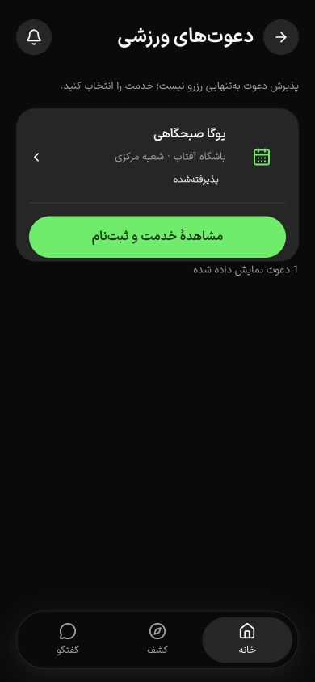
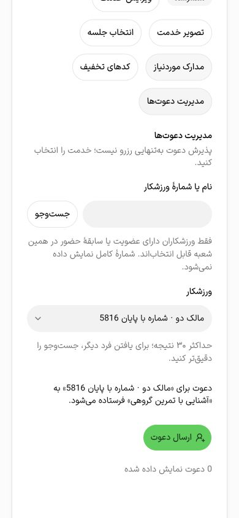

# دعوت ورزشی: چرخه، دسترسی و رابط — ۱۷ اکتبر ۲۰۲۶

این برش، مدیریت دعوت میزبان و پاسخ ورزشکار را به API واقعی متصل می‌کند. پذیرش کامل PH0/PH1/PH2 و حرکت هنوز باز است؛ نقص بازگشتِ زمینه‌ای در برش بعدی همان روز [رفع و در وب بازآزمایی شد](navigation-back-2026-10-17.md).

## قرارداد و رفتار

`0026_sports_invitation_lifecycle` وضعیت `cancelled`، revision و زمان‌های پاسخ/لغو/به‌روزرسانی را به جدول موجود اضافه می‌کند. سرویس مستقل `SportsInvitationService` جای مسیر سادهٔ قبلی در CommunityService را گرفته است؛ endpoint قدیمیِ بدون revision/idempotency باقی نمانده است.

- میزبان مالک/مدیر با مجوز همان سازمان و شعبه، ورزشکار را از دایرکتوری همان شعبه انتخاب می‌کند. دایرکتوری فقط حساب فعالِ فاقد درخواست حذف و دارای عضویت یا رزرو تأییدشده/حضور/غیبت در همان شعبه را می‌پذیرد. نام و چهار رقم آخر شماره نمایش داده می‌شود؛ فهرست عمومی کاربران یا شمارهٔ کامل برنمی‌گردد. جست‌وجوی شمارهٔ کامل فارسی/عربی و قالب محلی از parser موجود شماره استفاده می‌کند.
- خدمت باید منتشر و مجموعه در دسترس باشد. ایجاد دعوت، اعلان درون برنامه مطابق ترجیح گیرنده و audit در یک تراکنش انجام می‌شوند؛ دعوت ظرفیت، سفارش یا پرداخت ایجاد نمی‌کند.
- ایجاد تکراری یک دعوت جدید یا اعلان دوم نمی‌سازد. پاسخ و لغو revision و کلید تکرار دارند؛ رقابت پاسخ/لغو فقط یک تغییر را می‌پذیرد. مجوز میزبان پیش از replay رسید درخواست نیز کنترل می‌شود.
- فقط دعوت بی‌پاسخ قابل لغو یا پاسخ است. پاسخ قبلی و دعوت لغوشده بازنویسی یا خودکار دوباره ارسال نمی‌شوند. پذیرش به مشاهدهٔ خدمت و ثبت‌نام جداگانه هدایت می‌کند؛ رد/لغو دعوت رزرو مستقل ورزشکار را تغییر نمی‌دهد.
- لغو، اعلان دعوتِ هنوز خوانده‌نشده را حذف می‌کند. فهرست خود دعوت و audit تاریخی می‌مانند. پاسخ به دعوت فرد دیگر و cursor خارج از دامنه رد می‌شوند.
- فهرست میزبان و ورزشکار صفحه‌بندی ۲۵تایی با ترتیب `created_at,id` دارند. timestamp در مقایسه داخل PostgreSQL می‌ماند؛ تبدیل cursor به JavaScript Date، دقت میکروثانیه را از بین نمی‌برد چون چنین تبدیل واسطه‌ای حذف شده است.

مسیرهای زیر با prefix `/api/v1` هستند. قرارداد درخواست از schema مشترک parser/Swagger ساخته شده و DTOها و ورودی‌های typed در `@repo/api/sports` وجود دارند. `useSportsCommand` اکنون نوع body اختیاری هم می‌پذیرد؛ مصرف‌کنندگان قدیمی سازگارند.

| مسیر | رفتار |
| --- | --- |
| `GET sports/community/invitations?cursor=…` | دعوت‌های حساب، صفحه‌بندی‌شده |
| `POST sports/community/invitations/:id/answer` | accept، revision، idempotencyKey |
| `GET sports/community/host/services/:id/recipients?search=…` | دایرکتوری محدود به شعبه؛ حداکثر ۳۰ نتیجه با جست‌وجوی دقیق‌تر |
| `GET sports/community/host/services/:id/invitations?cursor=…` | فهرست میزبان با کنترل دسترسی |
| `POST sports/community/host/invitations` | serviceId، userId و idempotencyKey |
| `POST sports/community/host/invitations/:id/cancel` | لغو بی‌پاسخ با revision/idempotencyKey |

## رابط و مرجع

مرجع تازهٔ [Inviting guests در Luma](https://mobbin.com/flows/5769e34d-5a94-44aa-bd7e-4914823710cd) در Mobbin بررسی شد: از هشت صفحه، پیش‌نمایش‌های ۱، ۵ و ۸ واقعاً دیده شدند؛ ورودی Invite، پیش‌نمایش گیرنده/پیام و فهرست اشخاص مبنای تطبیق بودند. زمان حرکت Luma اندازه‌گیری نشده است. کارت‌ها و جزئیات باشگاه تغییر نکرده‌اند.

در `/services` بیزینس، هر خدمت بخش مدیریت دعوت دارد: جست‌وجو، انتخاب ورزشکار، پیش‌نمایش گیرنده و عنوان نسخهٔ منتشرشده، ارسال، فهرست وضعیت‌ها و تأیید لغو. draft بودن خدمت ارسال را غیرفعال می‌کند. فرم از Field/NativeSelect/Button/Badge و Dialog موجود shadcn استفاده می‌کند؛ preset یا CSS مشترک بازنویسی نشده است. [مستندات رسمی Field](https://ui.shadcn.com/docs/components/radix/field) و [Dialog](https://ui.shadcn.com/docs/components/radix/dialog) از مسیر CLI بررسی شدند.

در `/invitations/sports` ورزشکار، نتیجهٔ دعوت، باشگاه/شعبه، پذیرش/رد، وضعیت خدمت ناموجود، ادامهٔ ثبت‌نام و بارگذاری صفحهٔ بعد وجود دارند. پس از پاسخ، focus روی همان دعوت می‌ماند؛ پس از ارسال/بستن دیالوگ میزبان، focus به عنوان بخش بازمی‌گردد. دیالوگ Escape و focus trap اجزای موجود را دارد. راهنمای فرم با `aria-describedby` متصل شده و وضعیت‌ها و خطاها اعلان دسترس‌پذیر دارند.

اندازهٔ چند دکمهٔ قبلی خدمات و select جدید ۳۶ پیکسل بود؛ قواعد اندازهٔ لمس فقط در Frame ورزشی و فرم جدید به ۴۴ پیکسل افزایش یافتند. بخش لغو، CSS محدودی برای حذف animation/blur در reduced-motion دارد؛ تنظیم واقعی سیستم reduced-motion یا صفحه‌خوان در این برش اجرا نشده است. نشست منقضی در پنل اکنون لینک ورود با مقصد بازگشت دارد؛ این حالت در مرورگر واقعاً دیده شد.

تولید/هم‌ترازی تصویری 12ui به‌دلیل خطای منطقه‌ای ثبت‌شدهٔ پیشین در دسترس نبود؛ هیچ طرح تولیدشده یا تأیید تصویری 12ui ادعا نمی‌شود. [شاهد محدودیت ابزار](resource-availability-2026-10-17.md#محدودیت-ابزار-طراحی). این رابط با ترکیب‌های موجود پروژه ادامه یافت.

## شواهد

- **۵۱ از ۵۱ آزمون تجارت** با PostgreSQL/S3 واقعی و `NODE_OPTIONS=--throw-deprecation` موفق؛ اجرای نهایی ۸٫۵۲۷ ثانیه. شش آزمون دعوت شامل اعلان/ترجیح، ایجاد تکراری، پاسخ تکراری، رقابت پاسخ/لغو، حفظ ظرفیت/پول، جلوگیری از دسترسی سازمان/شعبهٔ دیگر و receipt پس از لغو مجوز هستند. صفحه‌بندی ۳۱ رکورد تاریخی با زمان‌های میکروثانیه‌ای و زمان مساوی، بدون حذف/تکرار ردیف بررسی شد. یک اجرای میانی به‌علت نداشتن branch_profile در fixture شعبهٔ دوم شکست خورد؛ fixture کامل و اجرای نهایی موفق شد.
- UI قبل از اختلال محیط: ورود ساختگی میزبان/ورزشکار، ارسال با پیش‌نمایش، پذیرش، رد، لغو، ماندگاری در reload، حالت جست‌وجوی بدون نتیجه، Escape و focus بررسی شدند. هیچ پیامک زنده‌ای ارسال نشد.
- [۱۲ ترکیب میزبان](invitations-widths-2026-10-17.json) با فرم باز و گیرندهٔ انتخاب‌شده، و [۱۲ ترکیب ورزشکار](invitations-athlete-widths-2026-10-17.json) با دعوت بی‌پاسخ، دو زبان/دو تم/عرض ۳۶۰، ۳۹۰، ۴۳۰ را ثبت می‌کنند. هر ۲۴ حالت بدون سرریز و کنترل visible-layout کوچک‌تر از ۴۴×۴۴ بودند. این اندازه‌گیری، کل معیار WCAG یا همهٔ وضعیت‌های همهٔ صفحات نیست.
- تغییر زبان، فرم باز میزبان را همراه بازخوانی scope می‌بندد؛ در ماتریس نهایی فرم پس از تغییر زبان دوباره باز و انتخاب شد و `formReady` برای هر ۱۲ مورد ثبت شد. حفظ پیش‌نویس در تغییر زبان، جای بهبود دارد. پایان theme transition پیش از تغییر مجدد منتظر مانده شد؛ کلیک در animation فعال نادیده گرفته می‌شود.
- پس از بازیابی Docker و ساخت دوبارهٔ fixture، ورود مجدد با حفظ `returnTo`، ماتریس ورزشکار، پاسخ انگلیسی و ورود به جزئیات خدمت دوباره موفق بودند. خواندن مستقل دیتابیس برای خدمت دعوت‌شده `accepted`، صفر سفارش و صفر رزرو را تأیید کرد.
- TypeScript و lint مرتبط API/UI/application/shared API و دو آزمون i18n و کنترل متن موفق؛ build API/application/business موفق. ۵۹ فایل محافظت‌شده بدون تغییر و diff check سالم است.
- فرمان رسمی `build-native.mjs`، ۴۹ مسیر static، شامل دعوت‌ها، صادر کرد؛ API URL تنظیم نبود و شاهد دستگاه نیست. اجرای مستقیم `NEXT_PUBLIC_NATIVE_EXPORT=true next build` مسیرهای وب پویا را اشتباه وارد export کرد و شکست خورد؛ runner رسمی از staging جدا استفاده می‌کند و این خطا را ندارد.

## اختلال محیط و محدودیت build

ساخت native هشدار واقعی ENOSPC در cache موقت Webpack داد و هم‌زمان اتصال‌های PostgreSQL و engine Docker قطع شدند. فقط cacheهای قابل‌بازتولید همین دو QA web پاک شدند؛ خروجی اپ‌ها، فایل کاربر، volume یا مخزن بکاپ حذف نشد. restart معمول Docker به deadline رسید؛ توقف رسمی `--force` و start موفق شد. Engine 29.6.2 و وابستگی‌های test/staging دوباره healthy شدند.

PostgreSQL test صریحاً روی tmpfs است؛ با restart دیتابیس مصنوعی QA از بین رفت و fixture دوباره ساخته شد. این رخداد شاهد ماندگاری داده یا آزمون restore نیست. staging از volume جدا استفاده می‌کند؛ schema و مجوز runtime روی ۸۷ جدول دوباره تأیید شدند. پس از بکاپ رمزگذاری‌شده، migration 0026 روی staging اعمال و ستون‌های دعوت از نقش runtime خوانده شدند؛ snapshot پس از آن نیز گرفته شد. این کار پذیرش UI یا فلو کامل staging نیست.

برای جلوگیری از تکرار کمبود فضا، runner رسمی native پیش از ساخت فایل staging، حداقل ۵ GiB فضای آزاد را کنترل می‌کند. بررسی منفی روی دیسک فعلی موفق بود: فرمان پیش از staging متوقف شد، مجموعهٔ پوشه‌های staging عوض نشد و SHA-256 خروجی موجود دعوت ثابت ماند. export جدید تا آزادشدن فضا اجرا نمی‌شود؛ خروجی قبلی باقی است. این guard پس از export ۴۹صفحه‌ای اضافه شد، نه اینکه build نهایی با دیسک کم را موفق اعلام کند.

## موارد باز

نقص ثبت‌شدهٔ Back جزئیات خدمت به `/services` پس از ورود از دعوت، در برش بعدی همان روز با adapter مشترک وب/native و Sheet-first رفع شد. بازگشت به دعوت، reload، ورود مستقیم، Back/Forward مرورگر و بستن Sheet واقعاً بررسی شدند. حضور صفحهٔ خروجی در درخت دسترس‌پذیری نیز برای فلوهای آزموده‌شده اصلاح شد؛ [شاهد و محدودیت‌ها](navigation-back-2026-10-17.md). پذیرش کامل حرکت PH0، صفحه‌خوان و دستگاه باز می‌ماند.

اعلان بیرونی، دعوت فرد فاقد سابقهٔ شعبه، ارسال ایمیل/SMS، ارسال گروهی، بازدعوت پس از پاسخ، آزمون دستگاه و همهٔ حالت‌های آفلاین/کند و تمام فلوهای تقویم/گفتگو با این برش پذیرش نمی‌شوند. حفظ پیش‌نویس زبان و متن شمارش تک‌موردی انگلیسی نیز در polish بعدی بررسی شوند. هیچ مجوز فروش واقعی یا پایلوت صادر نشده است.

پاک‌سازی نهایی: دو وب و API اختصاصی QA متوقف شدند؛ شمار کاربران، سازمان‌ها، خدمات، دعوت‌ها و سفارش‌های fixture هر پنج مورد صفر بود. دو نام دیتابیس موقت این برش حذف/ناموجود شدند. تب‌های ساخته‌شدهٔ عامل بسته و viewport بازنشانی شد؛ تب preview کاربر و volumeهای staging حفظ شدند.
