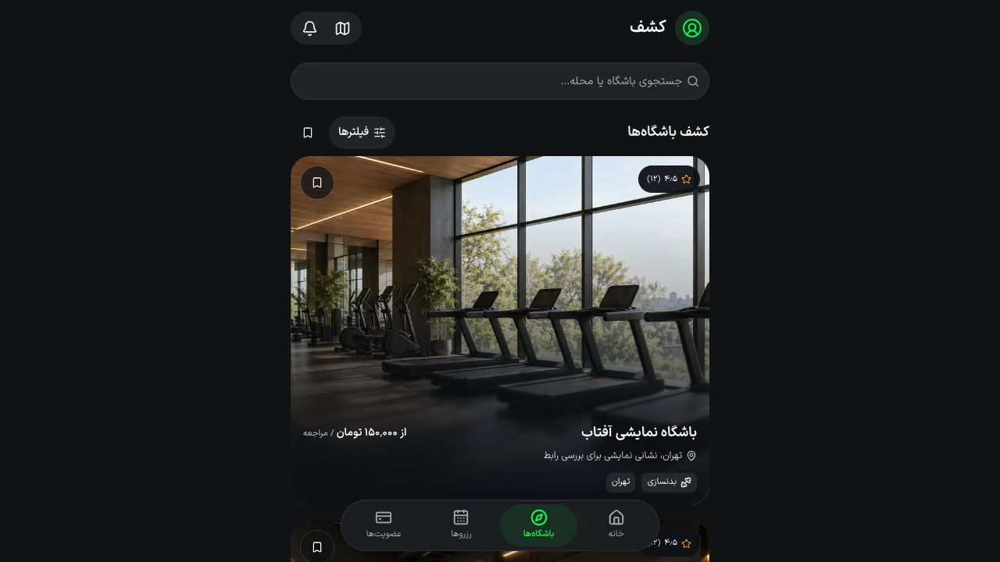
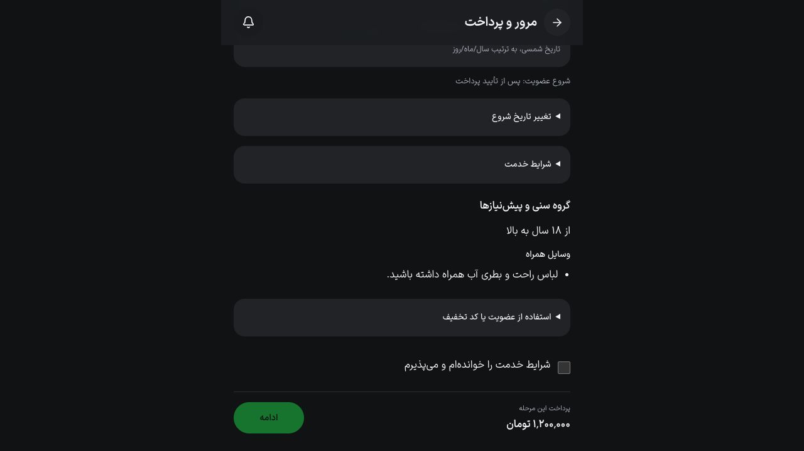

# بررسی ساده‌سازی کشف و خرید — ۲۷ اکتبر ۲۰۲۶

دامنه: حذف فید تکراری و تصادفی از کشف، جمع‌کردن فیلترهای تخصصی و کاهش تصمیم‌های خرید عضویت. توسعه روی `main` انجام شد و منطق مالی/تاریخ شروع در API تغییر نکرد.

## بررسی‌های موفق

- کلاینت اپ و کتابخانهٔ API: ۲۸۹ آزمون موفق؛ شامل سه سناریوی افزوده‌شده برای نبود سابقه، وضعیت‌های معتبر تمدید و جداسازی عضویت سرپرست از افراد وابسته.
- lint اپ و TypeScript اپ موفق‌اند؛ کاتالوگ متن‌ها بررسی و دو آزمون برابری زبان‌ها موفق‌اند.
- ۵۹ فایل محافظت‌شدهٔ طراحی مطابق مبنا هستند. کنترل‌های موجود و ظاهر کارت‌ها استفاده شدند.
- build production اپ با Webpack، یک worker و سقف heap برابر 1024 MiB موفق است.

## بررسی تعاملی مرورگر

رابط واقعی Next با API موقت کاملاً ساختگی روی loopback اجرا شد. حساب، باشگاه، عضویت و قیمت‌ها ساختگی‌اند؛ سرویس آزمون به پایگاه، پیام‌رسان یا درگاه واقعی متصل نبود و ایجاد سفارش را رد می‌کرد. هیچ پذیرش شرایط یا پرداختی انجام نشد.

| سناریو              | مشاهده                                                                                                               |
| ------------------- | -------------------------------------------------------------------------------------------------------------------- |
| ورود به کشف         | جستجو، نقشه، فیلتر و یک فهرست باشگاه؛ بدون فیدهای تکراری و مرور جغرافیایی چندردیفی                                   |
| فیلتر اولیه         | نوع خدمت، واحد و بازهٔ قیمت پنهان‌اند؛ مرتب‌سازی و انتخاب مکان در دسترس‌اند                                          |
| فیلتر بیشتر         | با بازکردن، گزینه‌ها ظاهر شدند؛ حداقل قیمت ۱۰۰۰۰۰ پذیرفته و شمارندهٔ ۱ دیده شد                                       |
| برگشت به کشف        | حداقل قیمت حفظ شد و بخش پیشرفته با مقدار فعال باز بود؛ پاک‌کردن فیلترها مقدار و شمارنده را حذف کرد                   |
| خریدار تازه         | انتخاب تمدید وجود نداشت و تغییر تاریخ شروع بسته بود                                                                  |
| پیش‌فاکتور پیش‌فرض  | درخواست فاقد `startsOn` و `renewMembershipId` بود؛ سرور زمان مجاز را تعیین می‌کند                                    |
| تمدید از لینک معتبر | عضویت قبلی انتخاب شد و توضیح شروع از پایان دورهٔ قبلی دیده شد                                                        |
| تاریخ اختیاری       | تاریخ شمسی ۱۴۰۵/۱۱/۰۱ در نمایش و تاریخ ISO برابر 2027-01-21 در درخواست پیش‌فاکتور ثبت شد                             |
| فرد وابسته          | فقط عضویت همان کودک نمایش داده شد؛ تغییر استفاده‌کننده به سرپرست، انتخاب تمدید کودک را پاک و خرید جدید را انتخاب کرد |
| ویرایش تاریخ و قیمت | پس از واردکردن و پاک‌کردن مقدار، بخش باز ماند و ورودی فوکوس خود را حفظ کرد                                           |
| لینک تمدید نامعتبر  | پیام خطا ظاهر شد؛ با تکمیل نام و تاریخ تولد هم دکمهٔ بررسی قیمت مسدود بود؛ انتخاب صریح «عضویت جدید» مسیر را باز کرد  |

سرورهای موقت و برگهٔ مرورگر آزمون در پایان بسته شدند. اجرای تازهٔ native، پرداخت واقعی و آزمون backend با پایگاه داده جزو شواهد این مرحله نیست؛ API در این تغییر دست‌کاری نشده است.

## تست با کاربران تازه — آمادهٔ اجرا

این بخش هنوز با شرکت‌کنندهٔ واقعی اجرا نشده و نتیجهٔ بخش مرورگر به‌جای پژوهش کاربری ارائه نمی‌شود. سناریو برای پنج فردی که قبلاً اپ را ندیده‌اند:

۱. یک باشگاه در شهر مشخص پیدا کنند و جزئیات آن را باز کنند.
۲. خدمت مناسب را انتخاب و مبلغ و شرایط را پیدا کنند.
۳. تا پیش‌فاکتور عضویت جدید پیش بروند؛ پیش از پذیرش شرایط و پرداخت توقف کنند.

برای هر نفر، زمان انجام، مرحلهٔ توقف، کمک موردنیاز و واژه‌های نامفهوم ثبت شود. حذف قابلیت بعدی باید به مشکل مشاهده‌شده در این جلسه متصل باشد.
